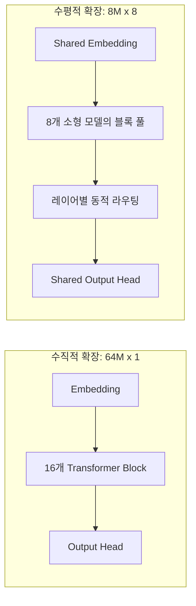
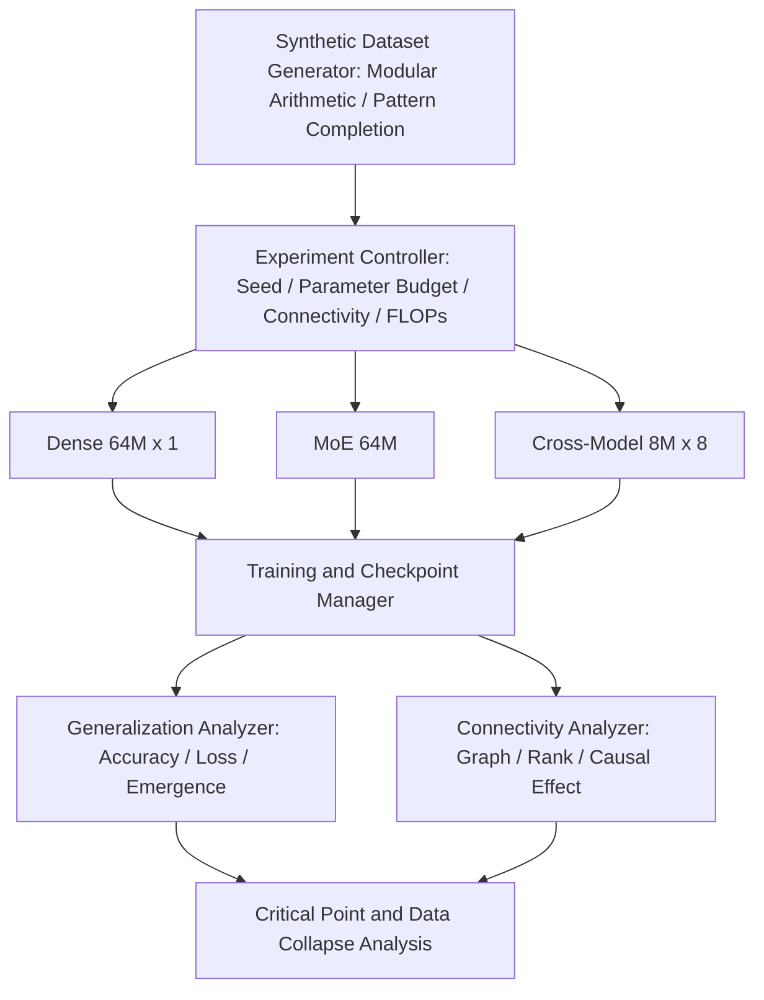
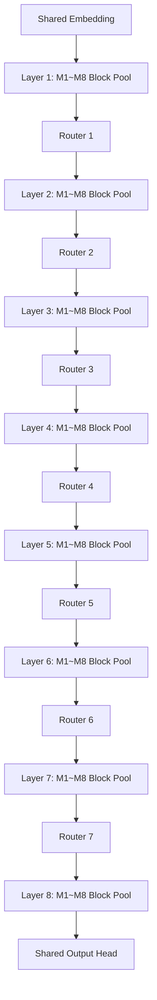
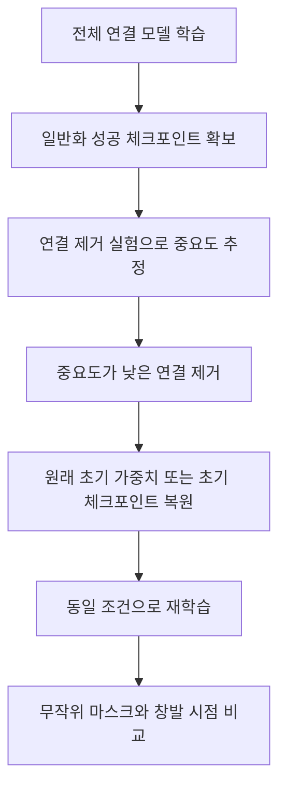
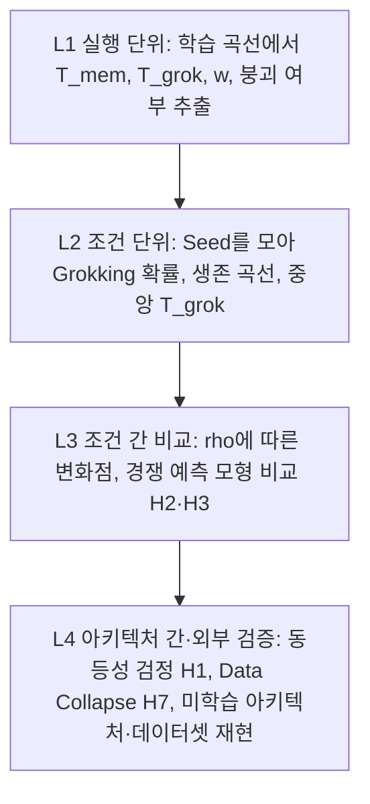
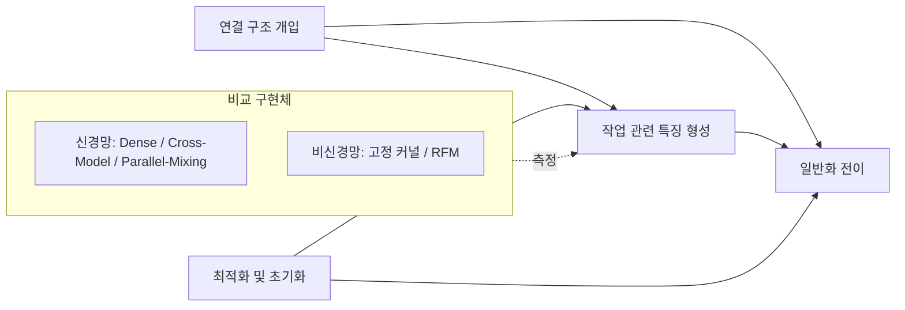

# 연구 실험 기획서 v0.6

## Is There an Architecture-Invariant Critical Connectivity? Testing Connectivity and Representation as Drivers of Emergent Generalization in Neural Networks and Model Swarms

**신경망과 소형 모델 군집의 창발적 일반화에 아키텍처 불변 임계 연결성이 존재하는가: 연결성과 표현 구조의 검정**

*v0.4 검토 반영: 제목을 검정 대상(질문)으로 바꿨다. "아키텍처 불변 임계 연결성"은 전제가 아니라 검정할 가설이며, 대안 설명(표현 구조 X2, 최적화 X4)이 이길 수도 있다.*

> **v0.2 변경 요약 (2026-11-24)** — 참고문헌 12편을 arXiv API와 원문 초록으로 대조 검증했다(상세: `reference_verification_v0.2.md`). 12편 모두 실재하며 서지 정보에 치명적 오류는 없다. [9]는 정식 제목으로 고치고 게재처(TMLR)를 추가했다. 선행연구 공백(Percolation 기반 창발 모델, Routed Scaling Law, 고정·해시 라우팅, 수치 정밀도와 Grokking)을 메우기 위해 13편을 추가했다([13]~[25]). 이에 맞춰 §4 신규성 검토, §5.4 학습 방식 명시, §9 EXP-01 하이퍼파라미터, §14 정밀도, §18 위험요소를 보완했다.
>
> **v0.3 변경 요약 (2026-11-24)** — 2025~2026년 arXiv 문헌을 18개 키워드 질의로 체계적으로 검색했다(상세: `novelty_search_2025_2026.md`). 결과는 다음과 같다.
> 1. **아키텍처가 거의 같은 선행연구가 있다.** 공유 블록 라이브러리를 런타임에 재배열하는 Library of Layers [26], 레이어 간 공유 전문가 풀 MoUE [27]가 있으므로, 본 연구의 신규성은 구조가 아니라 **질문(연결 밀도 → Grokking 전이)**에만 둔다(§4.2).
> 2. **소형 Transformer 모듈러 연산에서 "고정 무작위 라우팅 ≈ 학습 라우팅"이라는 결과가 이미 있다** [28]. H6을 탐색적 가설로 내리고 귀무 결과를 사전 등록한다.
> 3. **Grokking 시점의 경쟁 예측식이 이미 나와 있다.** 하이퍼파라미터 멱법칙 [31], 파라미터 노름 First-passage 법칙 [32]이 그것이며, $C_{\mathrm{eff}}$는 이들을 **넘어서는 추가 설명력**을 보여야 한다(§12B).
> 4. **측정 타당성 문제가 확인됐다.** Effective Rank 압축은 전이보다 늦게 오고 [35][36], Grokking 이후 붕괴(anti-grokking)가 일어날 수 있다 [37][38]. 이에 맞춰 측정 시점과 지속성 기준을 다시 정했다.
> 5. 시뮬레이션 결과 8개 모델 전체가 연결되는 구조적 임계점은 **ρ≈2~4%**에 있다. 기존 1차 격자(0/25/50/75/100%)는 이 구간을 건너뛰므로 EXP-02 격자를 고쳤다.
> 6. 사용자 요청에 따라 **기준체계(§12A)와 평가체계(§12B)를 새로 세우고**, 프로젝트 전 과정의 누락 항목 점검표(§22)를 추가했다.

> **v0.4 변경 요약 (2026-11-24)** — 생물학적 모방을 연구의 전제로 삼지 않고, 일반화가 발생하는 계산·정보 구조의 공통 조건을 탐색하는 방향으로 확장한다. 64M vs 8M×8과 H2·H3는 유지한다. 비신경망 RFM에서의 Grokking을 보고한 ICML 2025 논문 [47]을 경쟁 이론으로 추가하고, GNN의 정보 병목 [48]을 연결 수 해석에 반영한다. §23~§27에서 특징 구조 가설, 대조 실험, 공통 지표, 반증 기준과 확장 예산을 정의한다. 기존 문헌 [1]~[46]의 검증 이력은 원본에서 승계했으며 이번 개정에서 독립 재검증하지 않았다. 신규 실험 결과는 아직 없다.
>
> **v0.4 검토 반영 (2026-11-25)** — [47](arXiv 2407.20199, PMLR 페이지)과 [48](arXiv 2006.05205)이 실재함을 확인했다. 검토에서 나온 9건을 반영했다.
> 1. 학습 예산 표기를 $S_{\max}$(최소 100K, Gate 2.5 동결)로 통일했다(§9 EXP-01, §15.1, §22, §27.2).
> 2. EXP-08의 Fourier 주입을 부분 주입 강도 격자로 바꿔 천장 효과를 피했다(§25.2).
> 3. X-D가 바닥 수준일 가능성을 명시하고, EXP-07을 AGOP 반복 수 용량-반응으로 바꿨다(§24, §25.2).
> 4. §26.2의 예산 10% 시점은 민감도 분석으로만 쓰고 주 분석은 t0로 고정했다.
> 5. X1~X5는 확증 검정·Holm 가족 밖이라고 명시했다(§3.2.1).
> 6. M9·M10의 정의와 비교 규칙을 §12A-3에 추가했다.
> 7. 제목을 검정할 질문 형태로 바꿨다.
> 8. §22.1에 RFM 비용, 확장 사전등록, Extension Gate를 추가했다.
> 9. §17에 일정 재산정 규칙을 추가했다.
>
> 그 밖에 H1·H7의 비교 대상을 Parallel-Mixing으로 맞추고(§3.2.1), §23.3 그림에서 RFM을 원인이 아닌 비교 구현체로 고쳤다. 확장 파일럿은 54회에서 78회로 늘었다.
>
> **v0.4 데이터셋 조사 반영 (2026-11-25)** — 상세: `dataset_search_modular.md`. 문헌 [49]~[61]을 추가했다.
> 1. 모듈러 연산은 표준 데이터셋 없이 생성하는 것이 관례다. 생성 규칙을 고정해 공개하기로 했다(§7.1.1).
> 2. 입력 형식을 `a b =` 3토큰으로 정해 §22.1 미결 1번을 닫았다.
> 3. 분할을 교환법칙 그룹 분할에서 **무작위 순서쌍 분할 기본**으로 바꾸고, 그룹 분할은 민감도 분석으로 돌렸다. 선행연구와 비교할 수 있게 하고, RFM 실패 위험 [57]을 줄이기 위해서다.
> 4. D02의 목적을 "비선형 연산"에서 "같은 군 구조의 다른 표현"으로 고쳤다. 소수 p에서 곱셈은 덧셈과 동형이다.
> 5. D06을 합성 다중 단계 추론(추론/원자 비율 φ)으로 정의했다(§7.2).
> 6. 과제 구조 축 T1~T5를 추가했다(§7.3, 선택). 무작위 라틴 방진 T5는 구조 음성 대조다.
> 7. Gate 1에 분할 무결성·숫자 빈도 점검을 추가했다(§12B-7). RFM 코드의 GPL-3.0 라이선스 주의를 추가했다(§27.3).
>
> **v0.4 추가 (2026-11-25)** — [57] 본문을 확인했다. 교환 (a,b)→(b,a)는 [57]이 말한 반사 대칭 $sr^0$이고, 반사 쌍을 쌍으로만 옮기는 분할에서 RFM이 일반화하지 않았다(§7.1.1 근거 2). §15.1에 아키텍처별 실행 시간 추정(1회 수 분~40분, Core 전체 약 3~5일)과 VRAM 16GB 동시 실행 기준(64M급 2~3개, Cross-Model 4~5개, 8M급 6~8개)을 추가했다. 두 추정 모두 실측 전 값이다. [52] D06 생성기는 MIT로 공개되어 있음을 확인했다(§7.2). [47] RFM 코드는 무작위 순서쌍 분할(기본 p=61, 학습 50%)을 쓰고 Seed가 고정되어 있지 않음을 확인했다. 이에 따라 재현 앵커 R-RFM을 정하고, EXP-07 반복 격자를 {0, 1, 3, 수렴}에서 {0, 5, 10, 30}으로 바꿨다. 기존 격자는 [47]의 전이 시점(약 8회)보다 모두 앞이라 효과를 볼 수 없었기 때문이다(§24, §25.2).

> **v0.5 변경 요약 (2026-11-26)** — Gate 1 코드 착수 전에 비어 있던 구현 명세를 정했다. 이 문서의 원본은 이제 저장소 `jinsan02/critical-connectivity` 의 `docs/plan/` 이다(v0.4 까지의 OneDrive 사본은 더 고치지 않는다).
> 1. Transformer 블록 세부 구조를 고정했다(§5.8). R1 앵커는 [8]과 같고, 8M·64M 계열은 pre-LN · GELU · 학습 위치 임베딩 · 입출력 분리 · bias 있음 · dropout 0 이다.
> 2. Gate 1 파라미터 계수의 설계값을 **블록 파라미터 $12d^2L$** 로 정했다. 임베딩 · 출력층 · Adapter · Router 는 따로 기록한다(§5.8, §12B-7).
> 3. 실행 환경을 Windows 11 네이티브로 고쳤다(§14). WSL2 는 쓰지 않는다. PyTorch 2.15.0+cu132 로 고정했다.

> **v0.6 변경 요약 (2026-11-26)** — 보조 실험 **EXP-11 학습 나이테**(§28)를 추가했다. 주 가설(64M 내부 연결 대 8M×8 외부 연결, H1~H3)과 주 실험(EXP-01~06)은 바꾸지 않았다. 정확도가 튀는 구간에 내부 기능도 급변하는지, 이미 서서히 자라고 있었는지를 연속 체크포인트의 파라미터 변화(층 × 모듈 RMS · 이동량)와 기능 · 행동 변화(반복 패턴 탐지 점수 · 로짓 차이 · 손실 · 정확도)로 추적한다. 새 학습 전에 Pythia-160M 공개 체크포인트 8개로 MVP 를 한다(§28.6). 탐색 실험이며 확증 검정에 쓰지 않는다. 문헌 [62] Pythia, [63] Yin & Steinhardt 를 추가했다(원문 확인). 같은 날 Cross-Model 첫 층 규칙도 정했다(§22.1-1).

이번 기획에서는 지금까지 논의한 Lottery Ticket Hypothesis, MoE, Grokking, 잠재공간 통신, 임계 연결성 이론을 통합하되, 핵심 실험 대상을 **64M 단일 Transformer와 8M Transformer 8개의 레이어 교차 연결 네트워크**로 확정한다.

단순한 멀티에이전트 시스템 개발이나 모델 성능 경쟁이 아니라, **서로 다른 신경망 구조에서도 일반화 능력을 설명할 수 있는 공통 임계 변수가 존재하는지**를 검증하는 기초 연구로 방향을 잡는다.

## 1. 연구 개요

| 구분 | 내용 |
|---|---|
| 연구 유형 | AI 기초 연구, 실험적 가설 검증 |
| 연구 분야 | Neural Scaling Law, Mechanistic Interpretability, Emergent Intelligence |
| 핵심 연구 대상 | 단일 모델과 레이어 단위 소형 모델 군집 |
| 기준 모델 | 64M Dense Transformer |
| 비교 모델 | 8M Transformer × 8 |
| 핵심 독립변수 | 연결 수, 연결 밀도, 정보 전달 차원, 라우팅 구조 |
| 핵심 종속변수 | 일반화 정확도, 창발 시점, 최대 성능 상승률 |
| 주요 실험 환경 | RTX 5070 Ti 16GB, RAM 32GB |
| 연구 기간 | 6~8주 계획 |
| 최종 산출물 | 실험 코드, 체크포인트, 데이터셋, 분석 그래프, 연구 보고서 |

---

## 2. 연구 배경 및 문제 정의

### 2.1 기존 Scaling Law의 한계

기존 신경망의 성능 확장은 주로 다음 세 가지 요소를 중심으로 설명된다.

$$A=f(P,D,F)$$

| 변수 | 의미 |
|---|---|
| $P$ | 모델 파라미터 수 |
| $D$ | 학습 데이터 규모 |
| $F$ | 학습 연산량 |
| $A$ | 모델 성능 |

그러나 파라미터 수가 증가한다고 모든 능력이 동일한 비율로 향상되는 것은 아니다. 특정 능력은 학습 과정에서 급격하게 나타나며, 동일한 아키텍처에서도 초기화와 최적화 경로에 따라 출현 시점이 달라질 수 있다.

2026년 *Emergent Capabilities Arise Randomly from Learning Sparse Attention Patterns*에서는 작업 관련 어텐션 패턴의 학습과 특정 능력의 급격한 출현 사이의 관계를 분석했다. [12] 이 연구는 창발이 학습 중 **확률적으로** 발생하고 큰 모델일수록 평균적으로 더 일찍 나타나며, 어텐션 패턴 학습의 난이도가 문맥 길이와 패턴 희소성에 의존한다고 보고했다. 합성 Linear Map 데이터셋을 사용했다는 점에서 본 연구의 D04(Sparse Linear Map) 설계와 직접 연결된다.

Lubana et al.(2024)은 형식 언어로 학습한 Transformer의 창발을 이분 그래프 위의 Percolation 상전이로 모델링하고, 데이터 구조에 따라 창발 시점이 이동하는 것을 예측했다. [13] Michaud et al.(2023)은 능력을 이산적 단위(quanta)로 보는 Quantization Model로 Scaling Law와 급격한 창발을 함께 설명했다. [14] 즉 **"창발을 임계 현상으로 설명한다"는 발상 자체는 선행연구가 있으며**, 본 연구의 차별점은 임계 변수를 데이터 구조가 아닌 **모델 간·블록 간 연결 구조**에서 찾는 데 있다.

본 연구에서는 이러한 현상을 모델 내부의 어텐션 패턴뿐 아니라 모델 간 연결 구조로 확장한다.

### 2.2 연구 문제

동일한 파라미터 예산을 가진 두 시스템이 있다고 가정한다.



*단일 Transformer는 하나의 연속적인 내부 연산 구조를 사용하고, 레이어 연결형 모델 군집은 여러 모델 내부의 블록을 동적으로 연결한다.*

두 시스템에서 전체 파라미터 수와 학습 데이터를 통제한 후, 연결 구조와 정보 전달 능력을 조절한다.

만약 일반화 성능이 급격하게 상승하는 임계점이 공통된 연결 지표로 설명된다면, 기존 Scaling Law에 네트워크 연결 구조를 추가적인 설명 변수로 도입할 수 있다.

$$A=f(P,D,F,C_{\mathrm{eff}},G)$$

여기서 $C_{\mathrm{eff}}$는 유효 연결량, $G$는 네트워크 토폴로지를 의미한다.

Clark et al.(2022)은 라우팅 네트워크에서 **파라미터 수와 연산량이 서로 독립적인 두 축**이라는 점을 보이고, 모든 라우팅 모델이 같은 비율로 스케일링되는 *Effective Parameter Count*를 도출했다. [15] 본 연구의 $C_{\mathrm{eff}}$는 이와 유사한 "공통 정규화 변수" 접근이므로, H2·H7 검증 시 Clark et al.의 Effective Parameter Count를 **경쟁 설명 변수(baseline)**로 함께 비교해야 한다.

본 연구는 파라미터 수가 중요하지 않다는 것을 전제하지 않는다. **연결 구조가 파라미터 수 이상의 추가적인 설명력을 가지는지**를 검증한다.

---

### 2.3 연구 관점 확장 (v0.4)

인간의 뇌나 생태계는 지능의 구현 사례일 뿐 본 연구가 모방해야 하는 설계 기준은 아니다. 본 연구는 지능 전체가 아니라 **통제된 과제에서 미학습 조합으로 일반화하는 능력**을 연구 대상으로 한정한다. 생물학적 비유보다 계산 그래프, 특징 학습, 정보 병목을 관측 가능한 변수로 정의한다.

기존 연결성 가설과 경쟁하는 설명은 작업에 필요한 특징 공간의 형성이다. 연결 구조가 직접적인 결정 변수인지, 특징 형성을 촉진하는 수단인지, 또는 최적화 조건에 따라 두 요인이 상호작용하는지 분리한다. 비신경망에서의 Grokking [47]은 신경망의 연결 구조가 해당 현상의 보편적 필요조건이라는 강한 주장에 대한 반례다. 다만 모든 계산 시스템에서 정보 전달이 불필요하다는 뜻은 아니다.

## 3. 연구 목표 및 가설

### 3.1 최종 연구 목표

서로 다른 신경망 아키텍처에서 일반화 능력의 창발을 설명할 수 있는 공통 임계 연결 조건의 존재 여부를 규명한다.

### 3.2 세부 연구 가설

| ID | 연구 가설 | 검증 방법 |
|---|---|---|
| H1 | 단일 모델과 모델 군집은 유사한 유효 연결량에서 일반화 전이를 보인다. | 임계점 비교 |
| H2 | 단순 연결 수보다 유효 연결량이 일반화 성능을 더 잘 설명한다. | 예측 모델 비교 |
| H3 | 특정 연결 밀도 이상에서 일반화 정확도가 비선형적으로 상승한다. | Change-point 분석 |
| H4 | 잠재공간 벡터 연결은 텍스트 연결보다 정보 전달에 유리하다. | 동일 예산 통신 비교 |
| H5 | 기능적으로 중요한 부분 경로를 보존하면 더 적은 연결로 동일 성능을 달성할 수 있다. | Lottery Ticket 기반 Pruning |
| H6 | Router의 학습과 기능적 회로의 형성이 창발 시점과 관련된다. | 체크포인트 및 인과 분석 |
| H7 | 서로 다른 아키텍처의 일반화 곡선을 공통 연결 변수로 정규화할 수 있다. | Data Collapse 검증 |

### 3.2.1 가설 위계와 반증 기준 (v0.3 추가)

가설 7개를 같은 비중으로 검정하면 다중비교 문제가 생기고 결론이 흐려진다. 따라서 주 가설과 부 가설을 나누고, 각 가설이 **어떤 결과가 나오면 기각되는지**를 사전에 정한다.

| 위계 | 가설 | 사전 등록 예측 | 기각 조건 |
|---|---|---|---|
| **주 가설 (Confirmatory)** | H3 | Joint Cross-Model에서 교차 연결 밀도 ρ에 따른 Grokking 확률·시점 곡선이 하나의 변화점(change-point)을 가진다 | 구간 회귀의 변화점 모형이 선형·로그선형 모형보다 ΔAIC < 4이거나, 변화점 위치의 95% CI가 탐색 범위 전체를 덮음 |
| **주 가설 (Confirmatory)** | H2 | Grokking 시점 예측에서 $C_{\mathrm{eff}}$를 추가하면 경쟁 예측 변수(§12A-3)만 쓴 모형보다 Held-out 오차가 줄어든다 | Leave-one-condition-out 교차검증에서 오차 감소분의 95% CI가 0을 포함 |
| 부 가설 (Confirmatory) | H1, H7 | Parallel-Mixing(§5.7)과 Cross-Model의 임계점이 같은 좌표계에서 동등성 허용 범위 안에 든다 | TOST 동등성 검정 실패 (허용 범위 §12B-5) |
| 탐색적 (Exploratory) | H5 | 중요 경로 마스크(L03)가 같은 밀도의 무작위 마스크(L05)보다 빨리 Grokking한다 | — (효과 크기와 CI만 보고) |
| 탐색적 | H6 | 학습 Router가 고정·해시 Router보다 일찍 일반화한다 | — ([28]의 반대 결과가 있으므로 귀무 결과도 주요 결과로 보고) |
| 탐색적·보류 | H4 | 잠재공간 통신이 텍스트 통신보다 유리하다 | — (2025~2026년 LLM 멀티에이전트 분야에서 이미 활발히 연구됨 [42][43]. 8M 모델 모듈러 연산에서는 "텍스트 통신"의 정의가 약해 Phase 0~1에서 제외) |

주 가설 2개에는 Holm 보정을 적용하고(α=0.05), 탐색적 가설은 p값 대신 효과 크기와 신뢰구간만 보고한다.

**확장 가설 X1~X5 (§23.2, v0.4)의 위치.** X 계열은 위 확증 검정 체계와 Holm 보정 가족(family)에 포함하지 않는다. 별도 사전등록(`docs/extension_preregistration.md`)으로 주 가설 하나를 동결하기 전까지는 p값을 보고하지 않고 효과 크기와 신뢰구간만 보고한다. 확장 사전등록 이후 확증 검정을 하더라도 H2·H3와는 별개의 가족으로 보정한다. 확장 결과가 H2·H3의 판정을 바꾸지 않는다.

### 3.3 귀무가설

전체 파라미터, 학습량 및 연산량을 통제했을 때 연결 구조의 변화는 일반화 능력의 창발을 유의미하게 설명하지 못한다.

귀무가설을 포함해야 특정 실험 결과를 창발로 자의적으로 해석하는 문제를 방지할 수 있다.

---

## 4. 선행연구 및 이론적 기반

| 선행연구 | 핵심 개념 | 본 연구 적용 | 근거 |
|---|---|---|---|
| Lottery Ticket Hypothesis | 학습 가능한 희소 부분망 | 유효 연결 경로 발견 | [1] |
| Grokking | 암기에서 일반화로의 급격한 전환 | 창발 시점 정의 | [4], [8] |
| Grokking 이론 (LU 메커니즘, 회로 효율, Lazy→Rich) | Weight Norm·데이터 크기·회로 효율로 지연 일반화 설명 | 64M 과대모수 조건의 Grokking 설계, 교란변수 통제 | [16], [17], [18] |
| Grokked Ticket | 일반화 단계 부분망의 그래프 구조 변화 | 연결 구조와 창발의 직접적 선행 근거 | [9] |
| Sparse Attention Emergence | 작업 관련 어텐션 패턴 형성 | 내부 회로 분석, D04 설계 | [12] |
| Percolation Model of Emergence | 창발을 그래프 Percolation 상전이로 모델링 | 연결 밀도 임계점 이론의 직접 선행연구 | [13] |
| Quantization Model | 능력의 이산 단위(quanta)와 Scaling | 창발의 대안 설명 | [14] |
| Mixture of Experts | 동적 전문가 선택 | Router 비교군 | [10], [19] |
| Routed Scaling Law | 파라미터·연산량 독립 축, Effective Parameter Count | $C_{\mathrm{eff}}$의 경쟁 설명 변수 | [15] |
| Hash Routing | 학습하지 않는 고정·해시 라우팅의 경쟁력 | E06·E07 대조군의 근거 | [20] |
| Model Stitching | 독립 신경망의 내부 표현 연결 | 소형 모델 레이어 연결 | [3] |
| Layer 재배치 연구 | 중간 레이어의 교환·생략·병렬 실행 내성 | 블록 교차 연결의 타당성 | [21] |
| Mixture of Depths | 동적 연산량 및 깊이 선택 | 활성 연산량 통제 | [11] |
| Percolation Theory | 네트워크 연결 임계 현상 | 연결 밀도 분석 | [13] (신경망 적용 사례) |
| Information Bottleneck | 정보 전달 과정의 압축 | 잠재공간 통신 분석 | [22] |
| 표현 유사도 (CKA) | 신경망 표현 비교 | 블록 간 표현 정렬 측정 | [23] |
| 숨은 진척도 (Hidden Progress) | 지표상 불연속이어도 내부는 연속 진행 | 창발 착시 통제 | [7], [24] |
| 수치 안정성과 Grokking | Softmax Collapse가 Grokking을 막음 | BF16 정밀도 위험 관리 | [25] |
| Universality | 서로 다른 시스템의 공통 임계 현상 | 공통 스케일링 변수 탐색 | 물리학적 의미로 사용 (아래 주의) |

특히 Model Stitching 연구에서는 학습 후 동결된 두 모델 A, B에 대해 **A의 하위 레이어와 B의 상위 레이어를 단순한 학습 가능 계층 하나로 접합**하고, 내부 표현의 호환성을 분석했다. 이 연구는 같은 아키텍처의 좋은 모델들이 성능 하락 없이 서로 접합되는 "stitching connectivity"도 보고했다. [3] 본 연구의 레이어 교차 연결 방식에 방법론적 근거가 된다. 다만 [3]은 **단일 접합 지점·동일 아키텍처·동결 모델**을 다룬다는 점에서, 매 레이어마다 라우팅하는 본 연구 구조와 차이가 있다.

> **용어 주의 — Universality.** 메커니즘 해석 분야에서 "Universality"는 서로 다른 모델이 같은 회로를 학습하는 현상을 가리킨다(Chughtai et al., 2023, 군 연산 학습). 본 기획서의 H7은 통계물리의 **임계 보편성(critical universality)과 Data Collapse**를 뜻하므로, 본문과 논문에서 "critical universality"로 명시해 혼동을 피한다.

### 4.1 신규성 검토 (v0.2 추가)

검증된 선행연구와 겹치는 지점을 정리하면 다음과 같다.

| 본 연구의 주장 | 가장 가까운 선행연구 | 남는 차별점 |
|---|---|---|
| 창발 = 연결 임계 현상 | [13] Percolation Model (데이터 구조 그래프) | 임계 변수를 **아키텍처 연결 그래프**에서 정의 |
| 부분망 구조가 Grokking을 좌우 | [9] Grokked Ticket (평균 경로 길이·군집 계수 변화) | 모델 간 블록 연결 단위로 확장, 연결 밀도를 독립변수로 조작 |
| 아키텍처 간 공통 정규화 변수 | [15] Effective Parameter Count | 일반화 **전이 시점**을 정규화 (Clark은 Loss Scaling) |
| 고정 대 학습 Router 비교 | [20] Hash Layers | 일반화 창발 시점에 대한 인과 효과 측정 |

따라서 신규성은 "연결 임계 현상의 발견"이 아니라 **"동일 파라미터 예산에서 블록 연결 밀도를 조작했을 때 Grokking 전이가 이동하는지, 그리고 그 이동이 [15]의 Effective Parameter Count보다 $C_{\mathrm{eff}}$로 더 잘 설명되는지"**로 좁혀 서술하는 것이 안전하다. 특히 [9]는 그래프 지표(평균 경로 길이, 군집 계수)를 이미 사용했으므로 §11의 연결 지표에 포함해 직접 비교한다.

### 4.2 2025~2026 문헌 체계 검색 결과 (v0.3 추가)

arXiv에서 2025-01-01~2026-11-24에 제출된 문헌을 18개 질의(Grokking×연결/토폴로지/라우팅/Lottery/스케일링, 창발×Percolation/상전이, Model Stitching, 레이어 라우팅, 잠재공간 통신 등)로 검색했다. 약 400건 가운데 관련 30편의 초록을 읽고 다음과 같이 분류했다. **모두 arXiv 프리프린트이며 동료심사 여부는 확인하지 않았다.** 인용 전에 게재 여부를 확인한다.

**(a) 신규성을 직접 위협하는 문헌**

| 문헌 | 겹치는 부분 | 본 연구의 대응 |
|---|---|---|
| [26] Library of Layers (2026) | 공유 Transformer 블록 라이브러리를 입력에 따라 동적으로 재배열. Dense·Recurrent·MoE를 하나의 계열로 일반화 | 구조 자체는 신규성이 아님을 명시. [26]은 성능·효율을 보고, 본 연구는 **연결 밀도에 따른 Grokking 전이**를 본다. [26]을 비교 아키텍처(외부 검증용)로 사용 가능 |
| [27] MoUE (2026) | 레이어에 무관한 전문가 풀을 여러 레이어가 재사용. 경로 폭발과 깊이 인식 Load Balancing 문제 지적 | 경로 폭발 문제는 본 연구의 시뮬레이션(ρ=25%에서 경로 약 9천 개)과 같은 현상. Load Balancing 설계 시 참고 |
| [28] Sparsity Moves Computation (2026) | 1층 Transformer 모듈러 연산에서 **고정 무작위 라우팅이 학습 라우팅과 거의 같음**. 계산 재분배는 Router 학습이 아니라 구조적 희소성 때문 | H6을 탐색적 가설로 강등. E07(Random Router)을 주 비교군으로 승격 |
| [29] Geometric Inductive Bias of Grokking (2026) | 아키텍처 토폴로지를 사전에 바꿔 Grokking 시점을 조작(구면 정규화로 20배 이상 단축, 데이터 의존 어텐션 라우팅 제거) | "아키텍처 구조 개입 → Grokking 시점" 방법론의 선례. 본 연구는 개입 변수를 **블록 간 연결 밀도**로 특정 |
| [30] Systematic Empirical Study of Grokking (2026) | mod 97에서 조율을 맞추면 **아키텍처 차이는 대부분 사라지고 최적화·정규화 상호작용이 지배적** | 아키텍처별 하이퍼파라미터 탐색 예산을 동일하게 맞추는 규칙 추가(§12B-6). H1 해석 시 최대 교란 요인 |

**(b) 경쟁 설명 변수 (H2의 기준선이 되어야 함)**

| 문헌 | 예측식 | 활용 |
|---|---|---|
| [31] Quantifying the Memorization-to-Generalization Transition (2026) | $T_{\mathrm{grok}} \propto H^{-0.27} D^{-2.04} \eta^{-0.50} \lambda^{-0.64}$ (MLP, 384개 설정) | 기준 예측 모형 M1 |
| [32] First-Passage Prediction of Grokking Delay (2026) | $T_{\mathrm{grok}}-T_{\mathrm{mem}} \propto (\eta\lambda)^{-1}\log(V_{\mathrm{mem}}/V^*)$, $V$=파라미터 노름² | 기준 예측 모형 M2 |
| [33] How Large Must a Model Be to Grok? (2026) | $T_{\mathrm{gen}}$과 $T_{\mathrm{mem}}$의 교차점으로 Grokking 가능 크기 예측 | 64M·8M 설계 점검, Random-label 대조 데이터 추가 |
| [15] Effective Parameter Count (2022) | 라우팅 모델의 유효 파라미터 수 | 기준 예측 모형 M3 |

**(c) 평가 설계를 바꿔야 하는 문헌**

| 문헌 | 핵심 결과 | 평가체계 반영 |
|---|---|---|
| [34] Grokking Is Conditional and Fragile (2026) | Grokking은 단일 결과가 아니라 **다중 Seed 비율**로 측정해야 함. 학습 데이터 포함률에 따라 결정됨 | 주 지표를 Grokking 확률과 생존 곡선으로 설정 |
| [35] At-Grok Is Not Converged (2026) | 전이 시점에 잰 Effective Rank는 수렴값을 1.3~5배 과대평가. 압축은 전이보다 1만 스텝 이상 늦음 | 표현 지표는 사전에 정한 고정 시점에서 측정 |
| [36] Subspace Crystallization (2026) | Rank 압축은 전이 **이후**에 일어남(원인이 아니라 결과일 가능성) | $C_{\mathrm{eff}}$의 $b_e$는 전이 이전 시점에서 측정해야 예측 변수로 인정 |
| [37] Anti-grokking (2026), [38] Beyond Embedding Transfer (2026) | 일반화 이후 장기 학습에서 Test 정확도가 다시 무너짐 | 지속성 기준 강화, 학습 종료 규칙 명시 |
| [39] GrokTransfer (2025) | 임베딩 초기화가 Grokking 지연을 크게 좌우 | Shared Embedding 폭(576 대 288)을 교란 변수로 통제 |

**(d) 이론적 근거를 보강하는 문헌**

| 문헌 | 내용 | 활용 |
|---|---|---|
| [41] Functional Percolation (2025) | Erdős–Rényi 네트워크에서 거대 연결 성분이 생기는 지점과 정보 처리 능력의 급변 지점이 일치 | H3의 이론적 근거. 구조적 연결 임계점과 기능적 임계점의 일치 여부를 직접 검정 |
| [40] Dimensional Criticality Across MLPs and Transformers (2026) | 기울기 Avalanche 차원 $D(t)$가 MLP·Transformer 모두에서 전이 시점에 $D=1$을 교차 | 아키텍처 불변 임계 신호의 다른 후보. 단독 저자 프리프린트이므로 보조 지표로만 사용 |
| [44] Invariant Algorithmic Cores (2026) | 독립 학습된 모델들이 같은 알고리즘 핵심 부분공간으로 수렴. Grokking 시 형성 후 정규화로 팽창 | 블록 간 표현 정렬 분석의 방법론 |
| [46] Modular Addition: Fourier Features, Lottery Ticket, Grokking (2026) | 2층 신경망의 모듈러 덧셈 메커니즘과 Lottery Ticket의 관계 | H5 해석 근거 |
| [45] Revisiting Model Stitching in the Foundation Model Era (2026) | Stitch 계층 학습 방식이 접합 성능을 크게 좌우 | Stitched 보조 실험의 프로토콜 |
| [42] Causal Audit of Latent Channels (2026), [43] LatentMAS (2025) | 잠재 채널이 실제로 정보를 전달하는지 메시지 치환으로 인과 검증 | H4를 다시 열 경우의 평가 방법 |

**검색 결론.** "연결 밀도를 독립변수로 조작해 Grokking 전이 시점·확률의 임계점을 찾고, 기존 예측식(M1~M3) 대비 추가 설명력을 검정한다"는 조합을 직접 다룬 문헌은 이번 검색에서 찾지 못했다. 다만 이 결론은 arXiv 초록 검색에 근거하므로, 학회 발표본(NeurIPS 2025, ICLR 2026)과 인용 추적(forward citation of [9], [13])으로 한 번 더 확인한다.

---

### 4.3 비신경망 및 정보 구조의 경쟁 이론 (v0.4)

| 문헌 | 확인된 내용 | 본 연구 적용 |
|---|---|---|
| [47] Mallinar et al., ICML 2025 | Recursive Feature Machine(RFM)과 Average Gradient Outer Product(AGOP)를 사용한 커널 모델에서도 모듈러 연산의 지연 일반화와 급격한 전이가 관측됨. 작업 관련 block-circulant 특징과 Fourier 알고리즘의 연결을 분석함 | 신경망 고유의 창발이라는 해석을 배제하고, 특징 기반 공통 변수의 경쟁력을 검증 |
| [48] Alon & Yahav, ICLR 2021 | GNN에서 장거리 정보가 고정 크기 벡터에 과도하게 압축되는 over-squashing 문제 | 동일 간선 수가 동일 정보 전달 능력을 보장하지 않는다는 근거 및 D04 확장 설계 |

[47]이 이미 비신경망과 신경망의 공통 특징 형성을 분석했으므로, 이를 발견하는 것 자체를 신규성으로 주장하지 않는다. 추가 연구의 차별점은 **블록 연결성의 통제된 개입과 특징 구조의 개입을 교차시키고, 경쟁 예측력을 독립 조건에서 비교하는 것**이다. 이 확장 질문의 신규성은 추가 인용 추적 후 확정한다.

## 5. 시스템 아키텍처 설계

### 5.1 전체 실험 시스템



Training & Checkpoint Manager에서는 학습 지표, Router 상태, Hidden State를 수집한다. 마지막 분석 단계에서는 임계점을 추정하고 아키텍처 간 비교를 수행한다.

### 5.2 기준 모델: Dense-64M

| 구성 요소 | 초기 후보 |
|---|---:|
| Transformer Block | 16개 |
| Hidden Dimension | 576 |
| Attention Heads | 8개 |
| FFN Dimension | 2,304 |
| Vocabulary | 합성 데이터 전용 |
| 학습 방식 | End-to-End |
| 파라미터 목표 | 약 64M |

표준 Attention과 2개의 선형 변환을 사용하는 FFN을 가정하면 Transformer Block의 파라미터 수는 대략 다음과 같다.

$$P_{\mathrm{block}}\approx12d^2$$

$$P_{\mathrm{dense}}\approx16\times12\times576^2$$

약 63.7M의 블록 파라미터가 계산된다.

Embedding, Normalization, Output Head 등을 포함하여 실제 구현 시 정확한 파라미터 수를 확정한다.

### 5.3 소형 모델: SLM-8M

| 구성 요소 | 초기 후보 |
|---|---:|
| Transformer Block | 8개 |
| Hidden Dimension | 288 |
| Attention Heads | 4개 |
| FFN Dimension | 1,152 |
| 개별 블록 파라미터 합계 | 약 7.96M |
| 모델 개수 | 8개 |
| 전체 블록 파라미터 | 약 63.7M |

두 모델군의 블록 파라미터 예산을 거의 동일하게 유지할 수 있다.

다만 16개 레이어를 가진 Dense 모델과 8개 활성 레이어를 가진 군집은 계산 깊이가 다르므로, 깊이와 활성 연산량을 통제하는 별도 대조군도 포함한다.

### 5.4 제안 모델: Cross-Model Layer Network



소형 모델 8개, 64개 내부 블록, 7개 중간 라우팅 단계. 예시 활성 경로 A: M1→M3→M3→M5→M6→M2→M4→M7. 예시 활성 경로 B: M5→M5→M6→M7→M3→M3→M8→M8.

주요 설계는 다음과 같다.

| 모듈 | 기능 |
|---|---|
| Shared Embedding | 공통 입력 표현 생성 |
| Block Pool | 8개 소형 모델의 내부 Transformer Block |
| Router | 다음 단계에서 사용할 블록 선택 |
| Connection Mask | 허용되는 교차 연결 제한 |
| Latent Adapter | 모델 간 은닉 표현 정렬 |
| Fusion Module | Top-K 블록 결과 통합 |
| Shared Output Head | 최종 예측 생성 |
| Graph Logger | 입력별 실제 활성 경로 기록 |

각 단계의 연산은 다음과 같이 정의한다.

$$h^{(l+1)}=\sum_{j\in S_l}g_j^{(l)}F_j^{(l)}(A_j^{(l)}h^{(l)})$$

- $S_l$: Router가 선택한 블록 집합
- $g_j^{(l)}$: 선택된 블록의 결합 가중치
- $F_j^{(l)}$: 소형 모델의 Transformer Block
- $A_j^{(l)}$: 잠재공간 정렬 Adapter

Top-1에서는 하나의 블록을 선택하고, Top-2 이상에서는 여러 블록의 결과를 가중 결합한다.

초기 실험에서는 토큰별 라우팅보다 시퀀스 단위 라우팅을 사용한다. 구현 복잡도를 줄이고 통신 경로의 인과관계를 명확하게 분석하기 위함이다.

### 5.5 학습 방식 명시 (v0.2 추가)

v0.1에서는 8개 소형 모델을 **각자 사전학습한 뒤 접합하는지**, **처음부터 함께 학습하는지**가 정해지지 않았다. 두 방식은 검증하는 질문이 다르므로 분리한다.

| 방식 | 설명 | Adapter의 역할 | 근거 |
|---|---|---|---|
| Joint (주 실험) | 64개 블록·Router를 처음부터 End-to-End 학습 | 모든 블록의 Hidden Dimension이 288로 같으므로 필수 아님. 정보 병목(EXP-03)에만 사용 | — |
| Stitched (보조 실험) | 8개 모델을 독립 학습 후 동결, Adapter·Router만 학습 | 잠재공간 정렬에 필수 | [3], [21] |

Joint 방식에서는 "잠재공간 불일치"가 구조적으로 크지 않으므로, §13의 결과 B 해석과 §18의 위험요소는 Stitched 방식에 한정해 적용한다. 또한 Joint 방식은 Top-1 시퀀스 라우팅 시 **활성 파라미터가 약 8M**이므로, Dense-64M(활성 64M)과의 비교는 [15]에 따라 "동일 총 파라미터" 비교와 "동일 활성 연산량" 비교로 나누어 보고한다.

### 5.6 Router 학습 방식과 구현 명세 (v0.3 추가)

v0.1~v0.2에는 Top-1 선택이 미분 불가능하다는 점에 대한 처리 방식이 없었다. 다음과 같이 고정한다.

| 항목 | 결정 | 근거·비고 |
|---|---|---|
| Router 입력 | 직전 블록 출력의 시퀀스 평균 풀링 벡터(288차원) | 시퀀스 단위 라우팅 |
| Router 구조 | 선형 288→8 + 연결 마스크(허용되지 않은 블록은 −∞) | 마스크가 곧 ρ를 구현 |
| Top-1 학습 | Switch 방식: 선택된 블록 출력에 게이트 확률 $g_j$를 곱해 기울기 전달 | [19] |
| 보조 손실 | Load Balancing Loss(계수 0.01) + Router z-loss(계수 1e-3) | Router Collapse 방지 |
| 고정 Router | 입력 해시 $(a\cdot 31+b) \bmod 8$로 블록 선택(마스크 안에서) | [20], 학습 파라미터 0 |
| 무작위 Router | 초기화 후 동결한 선형 Router | [28]의 "frozen random routing" 재현 |
| 기록 | 입력별 경로, 블록별 사용 빈도, Router 엔트로피(100 스텝마다) | Graph Logger |

### 5.7 Dense 계열의 연결 밀도 정의: Parallel-Mixing 모델 (v0.3 추가)

v0.2의 EXP-06은 Dense 모델에서 Attention Head를 마스킹하겠다고 했지만, 그 마스킹 비율이 Cross-Model의 ρ와 **같은 의미인지**가 정의되지 않았다. Dense-64M(폭 576)을 직접 마스킹하면 블록 폭이 Cross-Model(288)과 달라 같은 그래프가 되지 않는다. 그래서 두 아키텍처가 **같은 블록과 같은 그래프를 공유하는** 대조 모델을 따로 둔다.

- SLM-8M의 8층 블록 체인 8개를 나란히 둔다(블록 파라미터 64M, Cross-Model과 동일).
- 교차 간선 $(l, i\to j)$가 허용되면 체인 $i$의 레이어 $l$ 출력을 저랭크 Adapter(288→16→288, 간선당 약 9.2K 파라미터)를 거쳐 체인 $j$의 레이어 $l+1$ 잔차 스트림에 더한다.
- Cross-Model도 교차 간선마다 **같은 Adapter**를 쓴다. 두 모델의 파라미터는 완전히 같다(ρ=100%일 때 Adapter 합계 약 3.6M).
- 출력은 8개 체인 최종 은닉 상태의 평균을 Shared Output Head에 넣어 만든다.
- ρ=0이면 연결 없는 8×8M 앙상블(B-4)과 같고, ρ가 커질수록 체인 간 혼합이 늘어난다. 후보 간선 392개와 **중첩 마스크 순서**를 Cross-Model과 공유한다.

이렇게 하면 두 모델의 차이는 단 하나다. Parallel-Mixing은 허용된 모든 경로가 **동시에** 활성화되고(활성 64M), Cross-Model은 Top-1로 경로 **하나만** 활성화된다(활성 8M). 이 차이가 곧 H1이 검정하려는 아키텍처 차이다. Dense-64M(B-2)은 이 비교 밖의 외부 기준점으로 남긴다.

### 5.8 블록 세부 구조와 파라미터 계수 기준 (v0.5 추가)

§5.2~§5.3 은 층 수 · 폭 · 헤드 · FFN 크기만 정했다. 정규화 위치, 활성 함수, 위치 임베딩은 파라미터 수와 Grokking 시점을 바꾸므로 구현 전에 고정한다.

| 항목 | R1 재현 앵커 | 8M · 64M 계열 (B-1~B-7, Cross-Model, Parallel-Mixing) |
|---|---|---|
| 근거 | [8] 의 설정을 그대로 | 표준 GPT 형 블록 |
| 층 · 폭 · 헤드 · FFN | 1층 · d=128 · 4헤드 · 512 | §5.2 · §5.3 · §12A-2 표 |
| 정규화 | 없음 | pre-LN (블록 안 Attention · FFN 앞), 마지막 블록 뒤 최종 LayerNorm |
| 활성 함수 | ReLU | GELU |
| 위치 임베딩 | 학습 (3 위치) | 학습 (3 위치) |
| 입력 임베딩과 출력층 | 분리 (가중치 공유 없음) | 분리 |
| bias | 있음 | 있음 |
| Dropout | 0 | 0 |
| 어휘 · 출력 | p+1 (숫자 + `=`) 입력, p 클래스 출력 (`=` 위치) | 같음 |

**파라미터 계수 기준 (Gate 1).** 설계값은 기획서가 쓴 블록 파라미터 $P_{\mathrm{block}}=12d^2L$ 이다. bias 와 블록 안 LayerNorm 을 넣으면 블록당 약 $12d^2+13d$ 가 되어 설계값보다 0.2~0.4% 크며, ±1% 안에 든다. 임베딩 · 위치 임베딩 · 최종 LayerNorm · 출력층 · Adapter · Router 는 설계값 비교에 넣지 않고 따로 기록한다.

| 모델 | $d$ | $L$ | 설계값 $12d^2L$ |
|---|---:|---:|---:|
| R1 | 128 | 1 | 196,608 |
| SLM-8M · B-1 (블록 체인 1개) | 288 | 8 | 7,962,624 |
| B-2 Dense-64M | 576 | 16 | 63,700,992 |
| B-3 Dense-64M-8L | 816 | 8 | 63,922,176 |
| B-4 · B-5 · Cross-Model 블록 풀 (8개) | 288 | 8 × 8 | 63,700,992 |

---

## 6. 연결 수 및 유효 연결량 정의

### 6.1 연결 수의 해상도

본 연구에서는 서로 다른 해상도의 연결 수를 혼용하지 않도록 다음과 같이 구분한다.

| 연결 해상도 | 단일 모델 | 모델 군집 |
|---|---|---|
| Weight-Level | 뉴런 간 가중치 | 블록 내부 가중치 |
| Head-Level | Attention Head의 정보 전달 | 블록 내부 및 블록 간 정보 전달 |
| Block-Level | 레이어 간 연결 | 모델 내부 및 교차 레이어 연결 |
| Model-Level | 해당 없음 | 독립 소형 모델 간 연결 |

주 실험에서는 **Block-Level Connectivity**를 공통 분석 단위로 선정한다.

### 6.2 교차 연결 수

모델 수 $N=8$, 모델당 레이어 수 $L=8$인 경우 다음과 같다.

$$E_{\mathrm{internal}}=(L-1)N=56$$

$$E_{\mathrm{cross}}=(L-1)N(N-1)=392$$

$$E_{\mathrm{max}}=448$$

교차 연결 밀도 $\rho$에 따른 전체 연결 수는 다음과 같다.

$$E(\rho)=56+392\rho$$

| 교차 연결 밀도 | 추가 연결 | 전체 연결 |
|---:|---:|---:|
| 0% | 0 | 56 |
| 5% | 20 | 76 |
| 10% | 39 | 95 |
| 20% | 78 | 134 |
| 25% | 98 | 154 |
| 50% | 196 | 252 |
| 75% | 294 | 350 |
| 100% | 392 | 448 |

실험에서는 허용된 후보 연결과 실제 사용된 연결을 반드시 구분한다.

### 6.3 유효 연결량

기존에 논의한 유효 연결량 개념을 실제 측정 가능한 형태로 수정한다.

$$C_{\mathrm{eff}}=\sum_{e\in E}u_e b_e q_e$$

| 변수 | 측정 방법 |
|---|---|
| $u_e$ | 해당 연결의 평균 활성화 빈도 |
| $b_e$ | 전달되는 표현의 차원 또는 유효 랭크 |
| $q_e$ | 해당 연결의 인과적 기여도 |
| $E$ | 허용된 연결 집합 |

유효 연결량을 단계별로 나누어 검증한다.

| 지표 | 공식 | 목적 |
|---|---|---|
| 구조적 연결량 | $\sum_e 1$ | 단순 연결 수 |
| 활성 연결량 | $\sum_e u_e$ | 실제 사용 빈도 |
| 표현 기반 연결량 | $\sum_e u_e b_e$ | 유효 표현 전달 |
| 인과적 연결량 | $\sum_e u_e b_e q_e$ | 작업 해결 기여도 |

중요한 점은 $q_e$를 최종 Test Accuracy로부터 계산하고 다시 동일한 Test Accuracy를 예측하면 순환논리가 발생한다는 것이다.

따라서 인과적 기여도와 지표의 보정은 별도의 Calibration Dataset으로 계산하고, 최종 검증은 독립적인 Test Dataset으로 수행한다.

---

## 7. 일반화 데이터셋 설계

### 7.1 주 데이터셋: Modular Addition

$$y=(a+b)\bmod97$$

입력은 두 정수의 조합이며, 출력은 0~96 사이의 정수다.

- 전체 순서쌍: 9,409개
- 무작위 정답 확률: 1.03%

| 데이터셋 | 비율 | 초기 목표 수량 |
|---|---:|---:|
| Train | 40% | 약 3,764개 |
| Validation | 10% | 약 941개 |
| Calibration | 10% | 약 941개 |
| Test | 40% | 약 3,763개 |

~~덧셈의 교환법칙에 의해 `(a,b)`와 `(b,a)`가 서로 다른 데이터 분할에 포함되지 않도록 그룹 단위 분할을 적용한다.~~ (v0.4 데이터셋 조사로 아래 §7.1.1로 대체)

#### 7.1.1 데이터 생성과 분할 규칙 (v0.4 데이터셋 조사 반영)

상세 근거는 `dataset_search_modular.md`에 있다.

**생성.** 모듈러 연산은 내려받는 표준 데이터셋이 없고, 식으로 전체 표본(p²개)을 열거해 만드는 것이 관례다. 본 연구도 데이터 파일 대신 **생성 규칙**을 고정해 공개한다. 생성 규칙은 소수 p, 연산, 토큰 형식, 분할 비율, `data_seed`로 이루어진다. 원조 생성기 `openai/grok`(MIT)과 재구현 `danielmamay/grokking`(MIT)을 참고해 구현하고, 생성 결과의 해시를 `configs/`에 기록한다.

**입력 토큰 형식 (§22.1 미결 1번 결정).** Nanda et al. [8]의 3토큰 형식 `a b =`를 쓰고, `=` 위치의 출력으로 p개 클래스를 분류한다.

| 항목 | 규칙 |
|---|---|
| 어휘 | 숫자 p개 + `=` 1개 (p+1개). 단일 과제에서는 연산 토큰을 넣지 않는다 |
| 다중 과제 | D02 등을 함께 학습할 때만 연산 토큰을 추가한다(`a op b =`, 4토큰) |
| 손실 | `=` 위치에서만 계산한다. 원조 형식(`a ∘ b = c`, 정답을 입력에 넣고 다음 토큰 예측)은 쓰지 않는다 |
| RFM·커널 모델 | 같은 순서쌍을 one-hot 연결(2p차원)로 입력한다(§24). MLP·커널 계열의 표준 입력이다 [47][49] |

근거: R1 재현 앵커가 [8]의 설정이고, §15.1 처리량 가정("입력 3토큰")과 맞는다. 모든 입력을 열거·평가할 수 있는 작은 과제는 일반화 상한을 정확히 계산하고 많은 Seed를 돌릴 수 있어, 그 자체로 지연 일반화 연구의 도구가 된다 [56].

**분할 방식.** v0.3까지는 교환법칙 그룹 분할을 썼지만, 다음 세 가지 이유로 **무작위 순서쌍 분할을 기본**으로 바꾼다.

1. 선행연구 [4], [8], [47]는 모두 순서쌍을 무작위로 분할한다. 그룹 분할에서는 교환법칙으로 얻는 정보가 없어 같은 학습 비율에서도 과제가 더 어려워진다. 그러면 R1 앵커를 원 논문과 비교할 수 없다.
2. RFM은 학습 세트의 대칭이 깨질 때만 일반화한다 [57]. **본문 확인 결과(2026-11-25), 교환법칙은 이 대칭의 한 경우다.** [57]은 모듈러 덧셈의 대칭군을 회전 $r^k(a,b)=(a+k,\,b-k)$와 반사 $sr^k(a,b)=(b-k,\,a+k)$로 구성된 이면체군으로 정리했다. 교환 $(a,b)\to(b,a)$는 $k=0$인 반사 $sr^0$이다. [57]의 실험 결과는 다음과 같다.
   - 반사 $s$의 고정점(덧셈에서 $b=a+k$, 교환이면 대각선 $a=b$)을 Test로 빼고 나머지로 학습하면 Test 정확도가 0%에 가깝다.
   - Train에서 무작위 점을 하나만 옮겨도 대칭이 깨져 정확도가 98%까지 회복된다(덧셈 mod 61, Gaussian 커널).
   - 반대로 반사 쌍 $(a,b),(b,a)$를 **쌍으로** 옮기면 아무리 많이 옮겨도 일반화하지 않는다.

   교환법칙 그룹 분할은 바로 "쌍으로 옮기는" 분할이다. Train이 $sr^0$에 대해 대칭이고, 대각선 점(고정점)은 Test 쪽에 섞여 들어간다. 다만 [57]의 실험은 학습 비율이 매우 높은 조건(고정점 몇 개만 Test)이었고 학습 비율 40%의 그룹 분할을 직접 시험하지는 않았다. 신경망도 시험하지 않았다. 따라서 "그룹 분할에서 RFM이 반드시 실패한다"가 아니라 **"실패 위험의 메커니즘이 확인되었다"**로 판단한다. Extension A 파일럿에서 두 분할을 모두 돌려 확인한다.
3. 순서가 있는 입력(`a b =`)을 받는 모델에게 교환법칙을 배우는 것은 일반화의 일부다. 이를 누수로 볼 근거가 약하다.

| 용도 | 분할 |
|---|---|
| R1 재현 앵커, Extension A(RFM 재현) | 원 논문과 같은 무작위 순서쌍 분할 |
| Core 주 실험 | 무작위 순서쌍 분할 (기본) |
| 민감도 분석 | 교환법칙 그룹 분할. 주 분석과 결론이 다르면 둘 다 보고한다 |
| 사전등록 | 주 분석 분할을 Gate 2.5에서 동결한다 |

**숫자별 등장 빈도 점검.** 드물게 나오는 토큰은 임베딩이 거의 갱신되지 않아 Grokking이 늦어진다 [60]. 분할을 만든 뒤 Train에서 각 숫자가 피연산자로 나오는 횟수를 세고, 최소 빈도가 평균의 50% 미만이면 `data_seed`를 바꾸지 않고 그대로 기록하되 공변량으로 쓴다. 이 점검은 Gate 1 항목이다(§12B-7).

### 7.2 데이터셋 확장

| 단계 | 데이터셋 | 검증 목적 |
|---|---|---|
| D01 | Modular Addition | 단일 일반화 규칙 |
| D02 | Modular Multiplication | ~~비선형 연산 일반화~~ → 같은 군 구조를 다르게 표현한 과제에 대한 외부 검증 (아래 주) |
| D03 | Repeated Sequence | 어텐션 참조 패턴 |
| D04 | Sparse Linear Map | 필요한 연결 구조 학습 |
| D05 | Function Composition | 독립 규칙의 조합 |
| D06 | Synthetic Multi-hop Reasoning | 모델 간 지식 합성 |

D01을 주 실험으로 사용한다. 다만 모듈러 덧셈만으로는 모델 간 정보 전달의 중요성이 충분히 드러나지 않을 수 있으므로, D04를 두 번째 핵심 검증 과제로 선정한다.

D04에서는 정답을 계산하는 데 필요한 입력 위치와 의존 관계를 사전에 정의할 수 있어, 실제 학습된 연결과 정답 계산에 필요한 연결을 비교할 수 있다.

**D02 주 (v0.4).** p가 소수이면 0이 아닌 원소의 곱셈군 (ℤ_p^×, ·)은 순환군 ℤ_{p−1}과 동형이다. 따라서 모듈러 곱셈은 원소 이름을 바꾼 덧셈에 가깝고(0이 들어간 순서쌍은 예외), "비선형 연산"의 근거가 되지 못한다. 실제로 다중 과제 연구에서 공유 Transformer는 곱셈을 덧셈보다 먼저 일반화했다 [53]. 구조가 실제로 다른 과제는 §7.3에서 따로 다룬다.

**D06 정의 (v0.4).** D06은 Wang et al. [52]의 합성 지식 그래프 과제를 기본으로 한다. 원자 사실(개체–관계–개체)과 2단계 추론 사실을 만들고, **추론 사실 대 원자 사실의 비율 φ**를 조절한다. [52]와 [55]에 따르면 φ가 임계값을 넘어야 Grokking이 일어난다. φ는 연결 밀도처럼 연속 조절 변수라서 본 연구의 임계점 질문과 맞는다. 8M 모델 규모로 줄일 수 있는지는 파일럿에서 확인한다.

**[52] 생성기 확인 결과 (2026-11-25).**

| 항목 | 내용 |
|---|---|
| 저장소 | `OSU-NLP-Group/GrokkedTransformer` (NeurIPS 2024, 2025-07 갱신, 보관 처리되지 않음) |
| 라이선스 | 저장소 본체 **MIT**. 함께 포함된 수정판 `transformers/`, `simpletransformers/`는 각각 **Apache-2.0** |
| 생성기 | `composition.ipynb`, `comparison.ipynb`, `complex_reasoning.ipynb`. 의존성은 numpy·tqdm뿐인 순수 Python이다. 생성된 데이터는 OSU SharePoint에서도 받을 수 있지만, 외부 링크라 오래 유지된다는 보장이 없으므로 **노트북으로 직접 생성**한다 |
| 원 설정 (composition) | 개체 2,000개, 관계 200개, 개체당 나가는 관계 20개 → 원자 사실 약 4만 개, 2단계 추론 사실 최대 약 80만 개. φ ∈ {3.6, 5.4, 7.2, 9.0, 12.6, 18.0}. 원자 사실의 5%를 OOD로 떼어 둠 |
| 원 학습 | GPT-2 구조(8층 등), 배치 512, lr 1e-4, 최대 150만 스텝, FP16 |
| 핵심 결과 | Grokking으로 암묵적 추론을 학습하지만, composition은 OOD에서 체계적으로 일반화하지 못하고 comparison은 성공함 |

본 연구 적용 방침은 다음과 같다.

1. **코드 사용:** 생성기 로직은 MIT라 출처와 저작권 표시를 남기면 `src/data/multihop.py`로 옮겨 써도 된다. Apache-2.0인 수정판 `transformers`는 쓰지 않는다. 학습은 본 연구의 모델 코드로 한다.
2. **규모 축소:** 원 설정은 학습 사실이 수십만 개이고 150만 스텝이라 본 연구 예산(§15.1)에 맞지 않는다. 개체 수를 200~500개로 줄이고 같은 φ 격자를 쓰는 축소판을 파일럿에서 먼저 확인한다. φ와 Grokking의 관계가 축소판에서도 나타날 때만 D06을 채택한다.
3. **판정 범위:** [52]에서 composition의 OOD 일반화가 실패했으므로, D06의 주 지표는 **ID 추론 정확도(test_inferred_iid)**로 한다. OOD는 보조 지표로 보고하고, OOD 실패를 연결 밀도 효과의 반증으로 해석하지 않는다.

### 7.3 과제 구조 축 (v0.4, 확장 X2용·선택)

연결 밀도와 **과제의 대수 구조**를 교차시키면 확장 가설 X2(특징 구조 우선)를 직접 검정할 수 있다. 아래 과제는 모두 원조 생성기 [4] 또는 선행연구에 정의가 있다.

| ID | 과제 | 구조 | 선행 결과 | 표본 수 |
|---|---|---|---|---:|
| T1 | (a+b) mod p (= D01) | 아벨 순환군 | 잘 Grokking함 [4][8] | p² |
| T2 | (a·b) mod p (= D02) | 아벨 군 (T1과 동형) | 덧셈보다 먼저 일반화 [53] | p² |
| T3 | S5 순열 합성 | 비아벨 군 | Grokking함, 표현론 기반 회로 [51] | 14,400 |
| T4 | (a²+ab+b²) mod p | 군이 아닌 다항식 | [4]에서 다항식 과제는 연산마다 Grokking 여부가 갈림. 학습 가능한 다항식의 조건은 [58]이 분석함 | p² |
| T5 | 무작위 라틴 방진 | 대수 구조 없음 | 아벨 군 계열은 부분 관측으로 일반화 가능하지만 무작위 라틴 방진은 대부분 불가능함이 증명됨 [54] | p² |

T5는 **구조 음성 대조**다. 라벨 분포와 "각 행·열에 모든 값이 한 번씩"이라는 제약은 그대로 두고 대수 구조만 없앤다. 그래서 R2(무작위 라벨)보다 정교하다. 예측: 연결 밀도를 아무리 올려도 T5는 일반화하지 않아야 한다. T5에서 일반화가 나오면 데이터 누수나 판정 오류를 먼저 의심한다.

과제 구조 축은 Extension B 이후 자원이 남을 때 실행하며, Core 실행 수(§15.1)에는 포함하지 않는다. 실행한다면 T1·T3·T5 × 밀도 {0, 3, 10, 100%} × 3 Seeds(36회)를 먼저 하고, T2·T4는 그 결과를 본 뒤 추가한다.

---

## 8. 실험군 구성

| ID | 실험군 | 파라미터 예산 | 주요 검증 항목 |
|---|---|---:|---|
| E00 | Dense-8M | 8M | 소형 모델 기준선 |
| E01 | Dense-64M | 64M | 전체 성능 기준선 |
| E02 | Dense-64M + 회로 마스킹 | 64M | 단일 모델 연결 임계점 |
| E03 | 8M × 8 Ensemble | 64M | 단순 앙상블 효과 |
| E04 | 8M × 8 Sequential | 64M | 순차 연산 효과 |
| E05 | FFN-MoE | 64M | 일반적인 MoE 비교 |
| E06 | Cross-Model + 고정 경로 | 64M | 레이어 교차 연결 |
| E07 | Cross-Model + Random Router | 64M | 무작위 경로 효과 |
| E08 | Cross-Model + Learned Router | 64M | 동적 기능적 회로 |
| E09 | E08 + Lottery Ticket | 최대 64M | 유효 부분 경로 |
| E10 | E08 + 정보 병목 | 64M | 전달 용량의 영향 |
| E11 | 텍스트 기반 모델 군집 | 64M | 잠재공간 통신 비교 |

E00, E01, E02, E06, E07, E08을 초기 핵심 실험군으로 지정한다. 나머지 실험군은 초기 결과에 따라 추가한다.

---

## 9. 세부 실험 프로토콜

### EXP-01. 단일 모델의 일반화 창발 재현

| 항목 | 설정 |
|---|---|
| 모델 | Dense-8M, Dense-64M |
| 데이터셋 | D01 |
| 학습 데이터 비율 | 30%, 40%, 50% |
| Learning Rate | 1e-4, 3e-4, 1e-3 |
| Weight Decay | 0.01, 0.1, 1.0 |
| 최대 학습 스텝 | 파일럿(3 Seeds)은 50K로 시작해 Grokking 스텝을 확인한다. 본 실험은 §12B-5의 $S_{\max}$(R1 Grokking 스텝의 5배 이상, 최소 100K)를 따른다 |
| 초기 반복 수 | 3 Seeds |
| 본 실험 반복 수 | 10 Seeds |

목적은 이후 비교에 사용할 기본 Grokking 조건을 확보하는 것이다.

**v0.2 보완 — 선행 설정과의 차이.** 원 Grokking 연구 [4]는 2층 소형 Transformer를 사용했다. 회로 분석 연구 [8]은 1층 Transformer(d_model 128), p=113, 학습 데이터 30%, AdamW(lr 1e-3, weight decay 1.0), Full-batch 학습 조건이었다. 본 연구의 64M 모델은 이보다 수백 배 크고, 위 그리드 중심값(lr 3e-4, wd 0.1)은 선행 설정보다 정규화가 약하다. Omnigrok [16]에 따르면 Grokking은 Weight Norm과 데이터 크기에 강하게 의존하므로 다음을 추가한다.

- 선행 재현 앵커: [8]의 설정(1층, d=128)을 먼저 재현해 파이프라인을 검증한 뒤 64M으로 확장한다.
- Weight Decay 그리드에 1.0을 기본 후보로 포함하고(이미 포함), Full-batch 또는 큰 배치 조건을 추가한다.
- 초기화 스케일(Weight Norm)을 변수로 기록한다. [16]에서 초기 Weight Norm이 크면 Grokking이 나타나고 작으면 사라질 수 있다.
- 회로 효율 가설 [17]의 "임계 데이터 크기" 예측을 이용해 학습 비율 30~50% 구간의 결과를 해석한다.

64M 모델이 초기부터 일반화하거나 모든 조건에서 일반화에 실패한다면 데이터 비율과 정규화 조건을 조정한다. 뚜렷한 암기-일반화 전이가 없는 상태에서는 이후 임계점 비교가 어려워지기 때문이다.

### EXP-02. 동일 파라미터 예산에서 연결 밀도 비교

| 실험 변수 | 설정 |
|---|---|
| 모델 | 8M × 8 |
| 전체 파라미터 | 약 64M |
| 연결 밀도 | v0.3: 0, 1, 2, 3, 4, 6, 10, 25, 50, 100% (로그 간격 위주) |
| Router | Top-1 |
| Hidden Dimension | 288 |
| 반복 | 초기 조건당 3 Seeds |
| 통제 | 데이터, 최적화 조건, 활성 블록 수 |

성능 급등이 발생한 구간은 재탐색한다.

**v0.3 격자 변경 근거 — 구조적 임계점 시뮬레이션.** 392개 후보 교차 간선에서 k개를 무작위로 고르는 시행을 조건당 300회 반복해, 8개 모델이 모두 하나로 연결될 확률과 입력→출력 경로 수를 계산했다(내부 간선 56개는 항상 포함).

| 교차 간선 수 | ρ | 8개 모델 전체 연결 확률 | 평균 경로 수 |
|---:|---:|---:|---:|
| 0 | 0% | 0% | 8 |
| 4 | 1.0% | 0% | 13 |
| 8 | 2.0% | 23% | 20 |
| 10 | 2.6% | 53% | 24 |
| 12 | 3.1% | 76% | 30 |
| 16 | 4.1% | 91% | 44 |
| 20 | 5.1% | 98% | 62 |
| 39 | 9.9% | 100% | 296 |
| 98 | 25% | 100% | 8,922 |

*PowerShell 시뮬레이션 결과(seed 42, 조건당 300회). 학습 결과가 아니라 마스크 그래프의 구조적 성질이다.*

이 결과에서 두 가지가 나온다.

1. **모델 단위로 축약한 그래프의 유한 크기 연결 전이 후보는 ρ≈2~4%다.** 이는 전체 연결 확률의 전이이며 무한 그래프의 거대 연결 성분 출현이나 기능적 상전이의 증명은 아니다. v0.2의 1차 격자(0→25%)는 이 구간을 통째로 건너뛴다. 따라서 저밀도 구간을 촘촘히 탐색한다.
2. **경로 수는 ρ에 대해 지수적으로 늘어난다**(ρ=100%에서 $8^8\approx1{,}680$만 개). 따라서 X축은 ρ 외에 $\log(\text{경로 수})$로도 분석한다.

기능적 임계점([41]의 관점)이 이 구조적 임계점(ρ≈3%)과 일치하는지, 아니면 훨씬 높은 밀도에 있는지가 H3의 핵심 판별 결과가 된다.


*계획이며 실제 측정 결과가 아니다.*

무작위 연결 마스크는 하나의 기본 순서를 생성하고, 밀도가 증가할수록 연결을 추가하는 중첩 마스크 방식으로 구성한다. 이를 통해 밀도 변화와 연결 패턴 변화의 혼동을 줄인다. **v0.3:** 저밀도에서는 어떤 간선이 먼저 들어오는지가 결과를 크게 좌우하므로, 마스크 순서 자체도 무작위 요인으로 보고 **마스크 순서 Seed 3개 × 초기화 Seed** 교차 설계를 쓴다.

### EXP-03. 정보 전달 차원에 따른 임계점

전체 모델 크기와 연결 구조를 고정한 후 모델 간 전달 차원을 조절한다.

| 실험군 | 전달 차원 | BF16 기준 토큰당 원시 전달량 |
|---|---:|---:|
| B01 | 16 | 32 Bytes |
| B02 | 32 | 64 Bytes |
| B03 | 64 | 128 Bytes |
| B04 | 128 | 256 Bytes |
| B05 | 256 | 512 Bytes |
| B06 | 288 | 576 Bytes |

전달 차원이 낮은 경우 저랭크 Projection을 적용한다.

$$h'=W_{\mathrm{up}}W_{\mathrm{down}}h$$

이 실험을 통해 연결 수가 같더라도 정보 전달 용량에 따라 일반화 임계점이 달라지는지 확인한다.

### EXP-04. Router의 인과적 기여 검증

| Router 방식 | 비교 목적 |
|---|---|
| Fixed Routing | 학습되지 않은 고정 경로 |
| Random Routing | 경로 다양성 효과 |
| Learned Top-1 | 입력별 기능적 경로 선택 |
| Learned Top-2 | 블록 간 협력 |
| Learned Top-4 | 활성 연산량 증가 효과 |

Router와 Adapter가 학습하는 파라미터 수를 모두 기록하고 Random Router에도 가능한 한 동일한 계산 및 파라미터 예산을 적용한다.

### EXP-05. Lottery Ticket 기반 기능적 경로 추출



| 실험군 | 설정 |
|---|---|
| L01 | 전체 연결 |
| L02 | 중요 연결 마스크 + 학습된 가중치 |
| L03 | 중요 연결 마스크 + 초기 가중치 |
| L04 | 중요 연결 마스크 + 재초기화 |
| L05 | 동일 밀도의 무작위 마스크 |
| L06 | 중요도가 높은 연결을 반대로 제거 |

L02는 Pruning 효과를 검증한다. L03과 L04의 비교는 초기화의 중요성을 확인하는 엄밀한 Lottery Ticket 실험에 해당한다.

### EXP-06. 공통 임계점 검증

Dense 모델과 모델 군집에서 각각 연결 구조를 변화시키며 일반화 성능 곡선을 생성한다.

다음 세 좌표계에서 결과를 비교한다.

| 좌표계 | X축 |
|---|---|
| 기준 1 | 원시 연결 수 |
| 기준 2 | 활성 연결량 |
| 기준 3 | 유효 연결량 |

어떤 좌표계가 아키텍처 간 임계점의 차이를 가장 잘 설명하는지 검증한다.

v0.4 정합성 수정: H1의 주 비교는 §5.7의 Parallel-Mixing과 Cross-Model이다. Dense-64M의 Residual Path를 보존한 Head/Block 마스킹은 별도 탐색 실험으로만 보고하며, 그 마스킹 비율을 교차 연결 밀도와 동일시하지 않는다.

서로 다른 단위의 회로 개수를 직접 동일시하지 않고 블록 수준 전달량과 유효 표현 차원을 기준으로 비교한다.

---

## 10. 임계점 측정 및 통계적 분석

### 10.1 세 종류의 임계점

| 구분 | 기호 | 의미 |
|---|---|---|
| 학습 임계점 | $t_c$ | 학습 중 성능이 가장 급격히 증가한 시점 |
| 연결 임계점 | $\rho_c$ | 연결 밀도 증가에 따른 최대 성능 상승 지점 |
| 유효 연결 임계점 | $C_c$ | 유효 연결량 기준 최대 성능 상승 지점 |

각각을 독립적으로 분석한다.

### 10.2 창발의 조작적 정의

초기 실험에서는 다음 기준을 사전 정의한다.

| 조건 | 판정 기준 |
|---|---|
| 암기 완료 | Train Accuracy 99% 이상 |
| 일반화 시작 | Validation Accuracy 50% 이상 |
| 일반화 완료 | Validation Accuracy 95% 이상 |
| 급격한 성능 변화 | 전체 학습 예산의 10% 이내에서 정확도 30%p 이상 증가 |
| 지속성 | 이후 연속 5개 평가 체크포인트에서 유지 |

해당 수치는 연구를 위해 제안한 판정 기준이며 보편적인 창발의 정의가 아니다. 파일럿 실험 이후 본 실험 전에 확정한다.

**v0.3 수정 정의.** 위 기준 가운데 두 가지에 문제가 있다. "학습 예산의 10%"는 예산을 바꾸면 판정이 달라지고, "연속 5개 체크포인트(500 스텝)"는 Grokking 이후 붕괴 [37][38]를 걸러내기에 너무 짧다. 다음으로 대체한다.

| 사건 | 기호 | v0.3 정의 |
|---|---|---|
| 암기 시점 | $T_{\mathrm{mem}}$ | Train Accuracy ≥ 99%를 처음 달성한 스텝 |
| 일반화 시점 (주 지표) | $T_{\mathrm{grok}}$ | Validation Accuracy ≥ 95%를 처음 달성하고, 이후 **max(5,000 스텝, 0.5·$T_{\mathrm{grok}}$)** 동안 90% 아래로 떨어지지 않은 스텝 |
| 지연 | $\Delta T$ | $T_{\mathrm{grok}}-T_{\mathrm{mem}}$ |
| 전이 급격성 | $w$ | Validation Accuracy에 로지스틱 곡선을 적합해 얻은 10%→90% 상승 폭을 $T_{\mathrm{grok}}$로 나눈 값(예산과 무관한 상대 폭) |
| Grokking 성공 | $G$ | 예산 $S_{\max}$ 안에 $T_{\mathrm{grok}}$이 정의되면 1, 아니면 우측 중도절단(censored) |
| 반-Grokking | $C$ | $T_{\mathrm{grok}}$ 이후 Validation Accuracy가 50% 아래로 떨어지면 1. 붕괴율로 별도 보고 |
| 부분 Grokking | — | Validation Accuracy가 50~95%에서 정체(semi-grokking [17]). 성공으로 세지 않고 따로 집계 |

Validation 세트는 시점 판정에만 쓰고, Test 세트는 로그만 남긴 뒤 분석 코드가 동결된 다음에 연다.

### 10.3 최대 성능 상승률

$$t_c=\underset{t}{\arg\max}\frac{dA(t)}{dt}$$

$$\rho_c=\underset{\rho}{\arg\max}\frac{dA(\rho)}{d\rho}$$

정확도뿐 아니라 정답 확률과 Cross-Entropy Loss에서도 급격한 변화가 발생하는지 확인한다.

이는 정답·오답 평가 지표 때문에 인위적으로 창발 현상이 발생한 것처럼 보이는 문제를 방지하기 위해 필요하다.

```text
일반화 성능          성능 상승률
 100 |        ______    |       /\
     |       /          |      /  \
  50 |------/           |-----/----\----
     |_____/            |____/      \____
   0 +-----------       +---------------
            임계점              임계점
    Training Steps / Effective Connectivity
```

*최대 기울기를 이용한 임계점 추정 방법의 개념도.*

### 10.4 통계 검증

| 분석 방법 | 목적 |
|---|---|
| Bootstrap Confidence Interval | 임계점의 95% 신뢰구간 추정 |
| Segmented Regression | 성능 변화 지점 탐색 |
| Sigmoid Fitting | 전이 중심점 및 급격함 추정 |
| Survival Analysis | 학습 종료까지 창발하지 않은 모델 처리 |
| Effect Size | 아키텍처 간 차이 크기 측정 |
| Cross-validation | 유효 연결량의 성능 예측력 검증 |
| Equivalence Test | 두 임계점의 실질적 동등성 검정 |

단순히 통계적 유의성이 없다는 이유로 두 임계점이 동일하다고 판정하지 않는다. 사전에 정의된 동등성 허용 범위 안에 임계점 차이가 포함되는지 검증한다.

---

## 11. 핵심 측정 지표

| 범주 | 지표 | 단위 |
|---|---|---|
| 일반화 | Train / Validation / Test Accuracy | % |
| 일반화 | Correct Token Probability | 0~1 |
| 최적화 | Cross-Entropy Loss | Scalar |
| 창발 | Emergence Step | Step |
| 창발 | Maximum Accuracy Slope | %p / 1K steps |
| 창발 | Emergence Probability | % |
| 연결 | Structural Edge Count | 개 |
| 연결 | Active Edge Count | 개 |
| 연결 | Effective Connectivity | 정규화 지표 |
| 연결 | Route Diversity | Entropy |
| 연결 | 평균 경로 길이, 군집 계수 ([9]과 비교) | 실수 |
| 표현 | Effective Rank | 실수 |
| 표현 | CKA Similarity | 0~1 |
| 인과 | Edge Ablation Effect | %p |
| 인과 | Activation Patching Recovery | % |
| 연산 | Training FLOPs | FLOPs |
| 연산 | Inference FLOPs | FLOPs/sample |
| 자원 | Peak VRAM | MB |
| 자원 | Training / Inference Time | ms, sec |

Mutual Information은 고차원 벡터에서 추정 오차가 크기 때문에 초기 주 지표에서는 제외하고 보조 분석으로 활용한다.

---

## 12. Data Collapse 및 연구 성공 판정

본 연구의 최종 목표는 다음과 같은 결과가 존재하는지를 확인하는 것이다.

```text
정규화 이전                         정규화 이후
Accuracy                            Accuracy
100 |   ___   ___   ___             100 |         ______ A/B/C
    |  /     /     /                    |        /
 50 | /     /     /                  50 |-------/  공통 임계점
    |/_____/_____/_____                 |______/___________
  0 +------------------               0 +------------------
    원시 연결 수 / 모델 규모            정규화된 Effective Connectivity
```

*Dense, MoE, Cross-Model의 일반화 곡선이 공통 변수로 설명되는지 검증한다. 예상 결과이지 실측 결과가 아니다.*

### 연구 성공 기준

| 수준 | 성공 판정 |
|---|---|
| Level 1 | 단일 모델과 모델 군집에서 일반화 전이 관측 |
| Level 2 | 연결 밀도에 따른 임계점 발견 |
| Level 3 | 유효 연결량이 파라미터 수 및 원시 연결 수보다 높은 예측력을 보임 |
| Level 4 | 서로 다른 모델 구조에서 공통 임계점 관측 |
| Level 5 | 여러 데이터셋과 모델 규모에서 공통 임계점 재현 |

Level 3까지 도달해도 유의미한 연구 결과가 된다. Level 4~5는 보다 강한 아키텍처 불변성 가설에 대한 근거가 된다.

각 모델의 성능 곡선을 개별 임계점으로 나누면 인위적으로 곡선을 겹칠 수 있으므로, Data Collapse는 학습에 사용하지 않은 모델 규모와 데이터셋에서도 검증해야 한다.

---

## 12A. 기준체계 (v0.3 신설)

기준체계는 **"무엇과 비교해야 결과를 믿을 수 있는가"**를 정한다. 네 겹으로 구성한다.

### 12A-1. 기준점 위계

| 단계 | 기준점 | 기대 결과 | 역할 |
|---|---|---|---|
| R0 | 우연 수준 | 정확도 1.03% (1/97) | 지표 하한 |
| R1 | **재현 앵커**: [8]의 설정(1층, d=128, p=113, Train 30%, AdamW lr 1e-3, wd 1.0, Full-batch) | 보고된 것과 같은 Grokking 발생 (10 Seeds 중 8개 이상) | 파이프라인 타당성. 실패하면 이후 모든 실험 중단 |
| R2-음성 | Random-label 데이터(정답을 무작위로 섞음) | Train은 암기하고 Validation은 우연 수준에 머묾 | 일반화 판정이 누수 없이 작동하는지 확인. $T_{\mathrm{mem}}$ 기준값 [33]. 단, 라벨 노이즈가 커도 내부에는 일반화 구조가 생길 수 있으므로 [50][61], Validation이 우연 수준이라는 결과를 "내부 구조 없음"으로 해석하지 않는다 |
| R2-양성 | Train 90% 데이터 | 지연 없이 빠르게 일반화 | 과제 학습 가능성 확인 |
| R3 | 아키텍처 기준선 (12A-2) | — | 연결 구조 효과의 비교 대상 |

### 12A-2. 아키텍처 기준선 행렬

비교 축을 **총 파라미터, 활성 연산량, 깊이, 폭** 네 가지로 분해한다. 어느 축을 맞추었는지 표에 명시하지 않은 비교는 보고하지 않는다.

| ID | 모델 | 총 블록 파라미터 | 활성 파라미터 | 깊이 | 폭 | 맞춘 축 | 답하는 질문 |
|---|---|---:|---:|---:|---:|---|---|
| B-1 | Dense-8M | 8M | 8M | 8 | 288 | Cross-Model Top-1과 활성 연산·깊이·폭 일치 | **블록 풀과 라우팅이 단일 8M 모델보다 나은가** (가장 중요한 대조군) |
| B-2 | Dense-64M | 64M | 64M | 16 | 576 | 총 파라미터 | 기존 Scaling 관점의 기준 |
| B-3 | Dense-64M-8L | 64M | 64M | 8 | 816 | 총 파라미터·깊이 | 깊이 차이를 뺀 비교 |
| B-4 | Ensemble 8×8M | 64M | 64M | 8 | 288×8 | 총 파라미터, ρ=0 | 연결 없는 군집 |
| B-5 | Parallel-Mixing (§5.7) | 64M+Adapter | 64M | 8 | 288×8 | Cross-Model과 같은 그래프·같은 블록 | **"모든 경로 동시 활성" 대 "Top-1 경로 선택"** (H1의 핵심 대조) |
| B-6 | Cross-Model + 해시·고정 Router | 64M+Adapter | 8M | 8 | 288 | 학습 Router와 동일 | Router 학습 효과 ([20], [28]) |
| B-7 (선택) | FFN-MoE-64M | 64M | 약 8~16M | 8 | 288 | 총 파라미터 | 일반적 MoE와의 차이 |
| B-8 (선택, 외부 검증) | Library of Layers형 [26] | — | — | — | — | — | 학습에 쓰지 않은 아키텍처에서 Data Collapse 검증 |

### 12A-3. 경쟁 예측 모형 (H2의 기준선)

H2("$C_{\mathrm{eff}}$가 추가 설명력을 가진다")는 아래 모형들과의 **중첩 비교**로만 판정한다. 모든 모형은 같은 데이터로 적합하고 같은 교차검증 분할을 쓴다.

| 모형 | 설명 변수 | 출처 |
|---|---|---|
| M0 | 조건 평균 (설명 변수 없음) | 귀무 기준 |
| M1 | 총 파라미터, 데이터 비율, lr, wd의 멱법칙 | [31] |
| M2 | $T_{\mathrm{mem}}$ 시점 파라미터 노름 기반 First-passage 법칙 | [32] |
| M3 | 활성·총 파라미터 기반 Effective Parameter Count | [15] |
| M4 | 구조적 간선 수 $E(\rho)$ | §6.2 |
| M5 | $\log$(입력→출력 경로 수) | EXP-02 시뮬레이션 |
| M6 | 활성 연결량 $\sum u_e$ | §6.3 |
| M7 | 표현 기반 연결량 $\sum u_e b_e$ | §6.3 |
| M8 | 인과적 연결량 $C_{\mathrm{eff}}=\sum u_e b_e q_e$ | §6.3 |

판정 규칙은 다음과 같다. M1~M3 가운데 가장 좋은 모형을 $M^*$라 할 때, $M^*+M8$이 $M^*$보다 Held-out 성능이 유의하게 좋으면 H2를 지지한다. M4~M7과의 비교는 $C_{\mathrm{eff}}$의 어느 구성 요소($u$, $b$, $q$)가 설명력을 만드는지 분해하는 데 쓴다.

**v0.4 확장 모형 (탐색적, H2 판정에는 쓰지 않음).**

| 모형 | 설명 변수 | 출처 |
|---|---|---|
| M9 | $t_0$ 시점의 작업 관련 특징 점수: §25.1의 Fourier 정렬도. KTA는 확장 사전등록 전까지 보조 지표 | §25.1, [47] |
| M10 | $M^*$ + M8 + M9 | — |

비교 규칙은 다음과 같다.

- (a) $M^*+M9$ 대 $M^*$: 특징 점수 자체의 추가 설명력.
- (b) $M^*+M8$ 대 $M^*+M9$: 같은 분할에서 연결량과 특징 점수 중 어느 쪽이 더 많이 설명하는지. 두 모형은 중첩 관계가 아니므로 Held-out 오차 차이의 Bootstrap CI로 판단한다.
- (c) M10 대 $M^*+M8$, M10 대 $M^*+M9$: 각 변수가 다른 변수 위에 더하는 몫.

결과 해석은 §26의 결론 범위 표를 따른다. 모든 비교는 X 계열 규칙(§3.2.1)에 따라 효과 크기와 CI만 보고한다.

### 12A-4. 공정성 규칙

| 규칙 | 내용 | 근거 |
|---|---|---|
| 동일 탐색 예산 | 아키텍처마다 같은 수(예: 12회)의 하이퍼파라미터 시도를 Validation으로만 조율한다 | [30]: 조율을 맞추면 아키텍처 차이가 대부분 사라짐 |
| 동일 데이터·분할 | 모든 실험이 같은 분할 Seed를 공유한다 | 분할 차이 제거 |
| 동일 예산 | 같은 최대 스텝, 같은 평가 간격, 같은 정밀도 | — |
| 이중 보고 | 모든 아키텍처 비교를 동일 총 파라미터와 동일 활성 연산량 두 기준으로 보고 | [15] |
| 임베딩 통제 | 폭이 다른 모델은 임베딩 폭이 달라 Grokking 지연이 달라질 수 있으므로, 폭을 공변량으로 기록하고 B-1/B-4/B-5/Cross-Model(모두 288)끼리의 비교를 주 비교로 삼는다 | [39] |

### 12A-5. 무작위성 분리

무작위 요인을 네 개의 독립 Seed 흐름으로 나눈다. 분할 Seed는 전체 실험에서 고정하고, 나머지 셋은 실험 설계 요인으로 기록한다.

| Seed 흐름 | 대상 | 설계상 역할 |
|---|---|---|
| `split_seed` | 데이터 분할 | 고정 (1개) |
| `init_seed` | 가중치 초기화 | 반복 요인 |
| `mask_seed` | 중첩 마스크의 간선 추가 순서 | 반복 요인 (저밀도에서 결과를 크게 좌우) |
| `order_seed` | 미니배치 순서 | 반복 요인 |

---

## 12B. 평가체계 (v0.3 신설)

평가체계는 **"결과를 어떤 절차로 판정하는가"**를 정한다. 모든 항목은 주 실험(Phase 3) 시작 전에 `docs/preregistration.md`로 동결한다.

### 12B-1. 평가 계층



*각 계층의 출력이 다음 계층의 입력이 된다. 상위 계층의 결론은 하위 계층의 판정 규칙이 동결된 상태에서만 낸다.*

### 12B-2. 지표 위계

| 위계 | 지표 | 정의 위치 | 용도 |
|---|---|---|---|
| **주 지표** | Grokking 확률 $P(G=1)$ | §10.2 | H3 변화점 |
| **주 지표** | $T_{\mathrm{grok}}$ (중도절단 포함 생존 시간) | §10.2 | H2 예측 대상 |
| 부 지표 | $\Delta T$, 전이 급격성 $w$, 최종 Test 정확도 | §10.2 | 해석 보조 |
| 부 지표 | Test Loss, 정답 확률(연속 지표) | §10.3 | 창발 착시 통제 [7][24] |
| 안전 지표 | 반-Grokking 붕괴율, 부분 Grokking 비율 | §10.2 | 지속성 확인 [37] |
| 탐색 지표 | Effective Rank, CKA, 그래프 지표, 기울기 Avalanche 차원 $D(t)$ [40], 위상 지표 | §11 | 메커니즘 탐색. 가설 판정에 쓰지 않음 |

### 12B-3. 측정 시점 규칙 (순환논리·사후 측정 방지)

[35], [36]에 따르면 Rank 압축 같은 표현 변화는 전이 **이후**에 나타난다. 전이 이후에 잰 지표로 전이 시점을 "예측"하면 결과로 원인을 설명하는 셈이 된다. 따라서 다음 규칙을 둔다.

| 규칙 | 내용 |
|---|---|
| 예측 시점 $t_0$ | $t_0=\min(T_{\mathrm{mem}}, 2{,}000\text{ 스텝})$. H2에 쓰는 모든 설명 변수($u_e$, $b_e$, $q_e$, 파라미터 노름)는 $t_0$ 체크포인트에서만 계산한다 |
| 계산 데이터 | $q_e$(간선 제거 효과)는 Calibration 세트로 계산한다. Validation·Test는 쓰지 않는다 |
| 사후 지표 분리 | $T_{\mathrm{grok}}$ 시점과 학습 종료 시점의 지표는 메커니즘 서술에만 쓰고, 표에 "사후 측정"으로 표시한다 |
| 수렴 확인 | 표현 지표를 보고할 때는 고정된 지연 시점($T_{\mathrm{grok}}$+5K, +20K)과 학습 종료 시점 값을 함께 보고한다 [35] |

### 12B-4. 통계 분석 절차

| 질문 | 방법 | 출력 |
|---|---|---|
| 조건별 Grokking 시점 | Kaplan–Meier 추정(중도절단 포함), 중앙값과 95% CI | 생존 곡선 |
| ρ가 시점에 미치는 효과 | Cox 비례위험 또는 AFT 모형. 공변량: $\log\rho$, 아키텍처. `mask_seed`는 군집 효과로 처리 | 위험비와 CI |
| H3 변화점 | $P(G=1)$을 $\log\rho$에 대해 구간 로지스틱 회귀로 적합하고, 선형·로그선형 모형과 AIC 비교 | 변화점 $\rho_c$와 CI |
| 변화점 불확실성 | `mask_seed` 단위 군집 Bootstrap (2,000회) | 95% CI |
| H2 예측력 | Leave-one-condition-out 교차검증. 생존 모형은 C-index, Grokking 성공 실행은 $\log T_{\mathrm{grok}}$의 MAE | 모형별 Held-out 점수와 차이의 Bootstrap CI |
| H1 동등성 | 두 아키텍처의 $\log_{10}\rho_c$(또는 $\log_{10}C_c$) 차이에 대한 TOST | 동등/비동등/판정 불가 |
| H7 Data Collapse | 정규화 전후 곡선 간 잔차 분산 비율 $S$. 간선 무작위 순열로 만든 귀무 분포와 비교. 정규화 변수는 학습용 아키텍처로만 적합하고 외부 아키텍처(B-8, Stitched, p=113, D04)에서 검정 | $S$와 순열 p값 |
| 다중비교 | 주 가설 H2·H3에 Holm 보정 | — |

### 12B-5. 사전 등록 수치

| 항목 | 값 | 비고 |
|---|---|---|
| 동등성 허용 범위 | $|\Delta\log_{10}\rho_c|\le0.15$ (약 ±41%) | 파일럿 결과를 보고 바꾸지 않는다 |
| 변화점 채택 기준 | 변화점 모형의 ΔAIC ≥ 4 | — |
| 유의수준 | α=0.05 (주 가설은 Holm 보정) | — |
| 최대 학습 예산 $S_{\max}$ | 파일럿에서 R1이 Grokking하는 스텝의 5배 이상, 최소 100K | 중도절단 비율이 30%를 넘으면 예산을 늘린 뒤 재등록 |
| Router Collapse 경보 | Router 엔트로피 < 0.1 nat가 1,000 스텝 이상 지속 | 경보가 울린 실행도 제외하지 않고 표시만 한다 |

### 12B-6. 표본 크기

Grokking 확률을 비율로 추정할 때 Seed 수에 따른 95% 신뢰구간 반폭(Wilson, p=0.5 기준)은 다음과 같다.

| 조건당 실행 수 | 신뢰구간 반폭 |
|---:|---:|
| 3 | 약 ±38%p |
| 10 | 약 ±26%p |
| 20 | 약 ±20%p |
| 30 | 약 ±17%p |

따라서 v0.2의 "조건당 3 Seeds"로는 변화점을 판정할 수 없다. 1차 탐색은 3 Seeds로 후보 구간만 찾고, **임계 후보 구간의 조건은 20회(`mask_seed` 4 × `init_seed` 5)**로 늘린다. 생존 분석은 시점 정보를 함께 쓰므로 비율 추정보다 검정력이 높다.

### 12B-7. 타당성 점검 (Gate 통과 조건과 연동)

| 점검 | 통과 기준 | 시점 |
|---|---|---|
| 파라미터 계수 | 모든 모델의 블록 파라미터 수가 설계값 $12d^2L$ 과 ±1% 이내 (pytest, §5.8). 임베딩 · 출력층 · Adapter · Router 는 따로 기록 | Gate 1 |
| 분할 무결성 | 같은 순서쌍이 두 분할에 동시에 없음, 분할 비율 ±0.5%p, 생성 결과 해시 일치 (pytest). 그룹 분할(민감도 분석)에서는 $(a,b)$와 $(b,a)$가 같은 분할에 있음도 확인 | Gate 1 |
| 숫자 빈도 | Train에서 숫자별 피연산자 등장 횟수의 최솟값·평균 기록. 최솟값이 평균의 50% 미만이면 공변량으로 표시 (§7.1.1) | Gate 1 |
| 재현 앵커 R1 | 10 Seeds 중 8개 이상 Grokking | Gate 2 |
| 음성 대조 R2 | Random-label에서 Validation이 우연 수준 ±2%p | Gate 2 |
| Router 기울기 | Router 가중치에 0이 아닌 기울기가 흐름 | Gate 3 |
| 정밀도 | BF16+FP32 Softmax와 FP32 전체의 $T_{\mathrm{grok}}$ 차이가 Seed 간 변동 이내 [25] | Gate 3 |
| 측정 재현 | 같은 체크포인트에서 $C_{\mathrm{eff}}$를 두 번 계산했을 때 차이 < 1% | Gate 4 |

### 12B-8. 보고 규칙

- 모든 실행을 보고한다. 중도절단, 붕괴, Router Collapse 실행도 제외하지 않고 표시만 한다.
- 사전 등록 이후 바뀐 사항은 `docs/deviation_log.md`에 날짜·이유와 함께 기록한다.
- 탐색적 분석 결과는 "탐색적"이라고 명시하고 주 결론에 섞지 않는다.

### 12B-9. 연구 성공 수준과 검정의 대응 (§12 개정)

| 수준 | 판정에 쓰는 검정 |
|---|---|
| Level 1 | R1 통과, B-1·Cross-Model에서 $P(G=1)>0$ |
| Level 2 | H3 변화점 채택 (ΔAIC ≥ 4, Holm 보정 후 유의) |
| Level 3 | H2: $M^*+C_{\mathrm{eff}}$가 $M^*$보다 Held-out에서 우수 |
| Level 4 | H1: B-5(Parallel-Mixing)와 Cross-Model의 임계점 TOST 동등 |
| Level 5 | H7: 외부 아키텍처·데이터셋에서 Data Collapse 순열 검정 통과 |

---

## 13. 예상 결과 및 학술적 해석

| 예상 결과 | 성능 곡선 관계 | 학술적 해석 |
|---|---|---|
| A. 공통 임계점 발견 | Dense와 군집의 임계점이 일치 | 유효 연결량이 아키텍처에 독립적인 설명 변수가 될 가능성. |
| B. 군집이 더 늦게 창발 | 군집 곡선이 우측으로 이동 | 잠재공간 불일치, 정보 손실, 공동 최적화 부족 가능성. |
| C. 군집이 더 빠르게 창발 | 군집 곡선이 좌측으로 이동 | 모듈화 및 기능적 전문화가 일반화에 유리할 가능성. |
| D. 군집의 성능 포화 | 군집의 최대 성능이 Dense보다 낮음 | 개별 블록의 계산 용량이나 연산 깊이 부족 가능성. |

어느 결과가 나오더라도 아키텍처의 연결 구조와 일반화 능력 사이의 관계를 설명하는 데 활용할 수 있다.

---

## 14. 실험 환경 및 기술 스택

| 구분 | 기술 | 선정 이유 |
|---|---|---|
| Hardware | RTX 5070 Ti 16GB | 로컬 소형 모델 반복 학습 |
| OS | Windows 11 네이티브 (v0.5, WSL2 쓰지 않음) | §15.1 동시 실행 규칙이 Windows 기준. 환경은 conda `critconn` |
| Language | Python 3.11 또는 3.12 | 연구 라이브러리 호환성 |
| ML Framework | PyTorch | 커스텀 Transformer 및 Router 구현 |
| Numerical | NumPy, SciPy | 임계점 및 통계 분석 |
| Data | Polars, Parquet | 대량 체크포인트 지표 관리 |
| Graph | NetworkX | 연결 토폴로지 분석 |
| Logging | TensorBoard | 학습 추이 기록 |
| Interpretability | PyTorch Hooks | 중간 상태 추출 및 개입 |
| Visualization | Matplotlib | 논문용 그래프 |
| Configuration | YAML | 실험 조건 재현 |
| Testing | pytest | 모델 및 데이터 검증 |
| Version Control | Git | 코드 및 설정 이력 관리 |

PyTorch와 CUDA의 구체적인 버전은 RTX 50 시리즈 지원 여부를 확인한 후 환경 파일에 고정한다. **(v0.5) PyTorch 2.15.0+cu132, Python 3.12.16 으로 고정했다** (저장소 `env/critconn.yml`, 실측 `env/hw-20261125.md`).

### 초기 학습 설정

| Hyperparameter | 초기값 |
|---|---|
| Precision | BF16 연산 + FP32 Logits/Softmax/Loss (v0.2) |
| Optimizer | AdamW |
| Batch Size | 256 |
| Learning Rate | 3e-4 |
| Weight Decay | 0.1 |
| Training Steps | 50,000 |
| Evaluation Interval | 100 Steps |
| Checkpoint Interval | 500 Steps |
| Pilot Seeds | 3개 |
| Main Seeds | 10개 |
| Dropout | 0 |
| Gradient Clipping | 1.0 |

이 설정은 최적값으로 확정한 것이 아니라 파일럿 실험을 위한 초기값이다.

**정밀도 주의 (v0.2).** Prieto et al.(2025)은 정규화가 약한 조건에서 Softmax의 부동소수점 오차(Softmax Collapse)가 Grokking을 막는다고 보고했다. [25] BF16은 가수부가 7비트로 FP32보다 이 문제에 취약하므로, Logits·Softmax·Cross-Entropy는 FP32로 계산한다. 파일럿에서 BF16과 FP32의 창발 시점을 1회 비교해 정밀도가 교란변수가 아닌지 확인한다.

---

## 15. 실험 규모 및 실행 비용

초기부터 모든 조합을 실행하지 않고 단계적으로 탐색한다.

| 실험 단계 | 조건 수 | Seed | 실행 수 |
|---|---:|---:|---:|
| Phase 1. 기본 일반화 탐색 | 12 | 3 | 36 |
| Phase 2. 아키텍처 비교 | 6 | 3 | 18 |
| Phase 3. 연결 밀도 탐색 | 5 | 3 | 15 |
| Phase 4. 임계구간 정밀 탐색 | 6 | 10 | 60 |
| Phase 5. 정보 전달 차원 | 6 | 3 | 18 |
| Phase 6. Router 및 Lottery Ticket | 8 | 5 | 40 |
| Phase 7. 최종 재현 검증 | 6 | 10 | 60 |
| 합계 | 49 | 단계별 상이 | 247 |

전체 실행 수는 상한 계획으로 설정하며, 선행 단계의 결과에 따라 후속 실험을 축소하거나 확대한다.

예를 들어 실행당 50K 스텝을 사용하면 총 1,235만 학습 스텝에 해당한다.

### 실험 연산 비용 추정기 (Markdown 정적 변환)

$$S_{\mathrm{total}}=N_{\mathrm{runs}}\times S_{\mathrm{run}}$$

$$T_{\mathrm{hours}}=\frac{S_{\mathrm{total}}}{v\times3600}$$

$$T_{\mathrm{days}}=\frac{S_{\mathrm{total}}}{v\times86400}$$

$$T_{\mathrm{run,min}}=\frac{S_{\mathrm{run}}}{v\times60}$$

| 항목 | 기본 가정 |
|---|---:|
| 실험 실행 수 | 247회 |
| 실행당 학습 스텝 | 50,000 |
| 실측 학습 속도 가정 | 100 steps/s |
| 총 학습 스텝 | 12,350,000 |
| 총 GPU 학습 시간 | 34.3시간 |
| 단일 GPU 연속 학습 | 1.43일 |
| 실험 1회당 | 8.3분 |

GPU 학습 속도는 가정값이다. 평가, 체크포인트 저장, 데이터 처리, 실패 후 재실행 시간은 제외된다.

초기에 1,000스텝 규모의 성능 측정을 수행하여 실제 steps/s, 최대 VRAM, 체크포인트 용량을 확인한 뒤 전체 실험 예산을 확정한다.

### 15.1 v0.3 실행 계획 재산정

§12A·§12B의 요구 사항(동일 탐색 예산, 저밀도 격자, 임계 구간 20회 반복, 외부 검증)을 반영하면 실행 수가 늘어난다.

| 단계 | 내용 | 실행 수 |
|---|---|---:|
| P0 | 재현 앵커 R1 (10 Seeds) + 음성·양성 대조 R2 (2 × 3) | 16 |
| P1 | 아키텍처 7종(B-1~B-6, Cross-Model) × 하이퍼파라미터 12회 | 84 |
| P2 | 1차 밀도 탐색: ρ 10개 × 3 Seeds × {Cross-Model, Parallel-Mixing} | 60 |
| P3 | Router 대조: ρ 10개 × 3 Seeds × {해시, 고정 무작위} | 60 |
| P4 | 임계 구간 정밀 탐색: ρ 4개 × 20회 × 2 아키텍처 | 160 |
| P5 | 전달 차원 (EXP-03): 6 × 3 | 18 |
| P6 | Lottery Ticket (EXP-05): 6 × 5 | 30 |
| P7 | 외부 검증: {p=113, D04, Stitched} × ρ 5개 × 5회 | 75 |
| 합계 | | **약 503** |

실행당 $S_{\max}$=100K 스텝(§12B-5의 하한값), 초당 100 스텝을 가정하면 순수 학습 시간은 약 140시간(5.8일)이다. 처리량은 가정값이다. 8M 활성 모델은 이보다 빠르고 64M 모델은 느릴 것이다. 입력이 3토큰 정도로 짧아 GPU가 남으므로, **여러 Seed를 한 프로세스에서 동시에 학습**(`torch.func.vmap` 또는 다중 프로세스)해 처리량을 늘린다. 중도절단 비율이 높아 예산을 늘리면 실행 시간도 비례해 늘어난다.

**아키텍처별 실행 시간 추정 (v0.4, RTX 5070 Ti 16GB, 실측 전 추정).** 배치 256 × 입력 3토큰이면 스텝당 토큰은 768개뿐이다. 스텝당 연산량은 약 6 × 활성 파라미터 × 토큰 수다. Dense-64M도 약 3×10¹¹ FLOP으로, 실효 20~40 TFLOPS에서 7~15ms다. 이 규모에서는 연산보다 **커널 실행 오버헤드와 Optimizer 갱신**(총 파라미터 64M 전체의 AdamW 상태를 읽고 쓰는 데 약 1ms)이 시간을 좌우한다. 그래서 활성 8M인 Cross-Model도 64M 모델보다 크게 빠르지 않을 수 있다. 레이어마다 배치를 8개 블록으로 나눠 따로 계산하므로 작은 커널이 많이 생기기 때문이다.

| 아키텍처 | 활성 / 총 파라미터 | 추정 steps/s | 100K 스텝 1회 |
|---|---|---:|---:|
| R1 앵커 (1층, d=128) | 0.2M | 300 이상 | 6분 이하 |
| Dense-8M 등 소형 | 8M / 8M | 150~300 | 6~11분 |
| Cross-Model (학습·해시·고정 Router) | 8M / 64M | 60~120 | 14~28분 |
| Dense-64M | 64M / 64M | 50~100 | 17~33분 |
| Parallel-Mixing | 약 68M / 68M | 40~80 | 21~42분 |

이 추정으로 §15.1의 503회를 합산하면 직렬로 약 150~250 GPU시간이다. 모델이 작아 VRAM(실행당 1~3GB)과 연산이 남으므로 3~4개를 동시에 돌리면 실효 처리량이 2~3배가 된다. 그러면 **약 3~5일**이고, 재실행 여유 30%를 더해도 1주 안팎이다. 따라서 일정의 병목은 GPU 시간보다 **단계 간 의존성**(P0 재현 → P1 조율 → Gate 2.5 사전등록 → P2~P4)과 분석 시간이다. 단, 다음 경우에는 이 추정이 크게 늘어난다.

- R1 또는 64M의 Grokking이 늦어 $S_{\max}$(R1 Grokking 스텝의 5배 이상)가 100K를 크게 넘는 경우
- Full-batch(약 3,764개) 조건을 주 설정으로 쓰는 경우. 스텝당 토큰이 약 15배가 되어 64M 계열은 연산이 지배하게 된다
- P6 Lottery가 반복 가지치기(라운드마다 재학습)를 하는 경우. 라운드 수만큼 곱해진다

위 수치는 모두 추정이다. 진행 중인 실험의 로그나 Gate 1의 1K 스텝 벤치마크로 아키텍처별 실측 steps/s를 얻으면 이 표를 바꾼다.

**동시 실행 기준 (v0.4, VRAM 16GB, 실측 전 추정).** 실험 하나가 쓰는 VRAM은 다음과 같이 추정한다.

| 항목 | 64M급 (Dense-64M, Cross-Model, Parallel-Mixing) | 8M급 (Dense-8M) |
|---|---:|---:|
| FP32 파라미터 + 기울기 + AdamW 상태 2개 (파라미터당 16바이트) | 약 1.0~1.1GB | 약 0.13GB |
| 활성값 (배치 256 × 3토큰) | 0.3~0.6GB | 0.1GB 이하 |
| CUDA 컨텍스트 (프로세스마다) | 0.4~0.6GB | 0.4~0.6GB |
| 메모리 조각화 여유 | +20% | +20% |
| **합계** | **약 2~2.5GB** | **약 0.8GB** |

Cross-Model은 매 스텝 활성 파라미터가 8M이지만, 저장 파라미터와 AdamW 상태는 64M 전체이므로 64M급으로 계산한다. 실제로 쓸 수 있는 VRAM은 14~15GB로 본다. Windows 예약분과 화면 출력에 쓰는 메모리를 빼기 때문이다.

| 계열 | 메모리상 최대 | 권장 동시 수 | 근거 |
|---|---:|---:|---|
| R1 앵커 (1층) | 20개 이상 | 프로세스 1개에 Seed 10개 묶음 | `torch.func.vmap`으로 Seed를 한 번에 계산 |
| Dense-8M | 약 15개 | 6~8개 (또는 vmap) | 연산이 작아 겹쳐 돌릴수록 이득 |
| Cross-Model (학습·해시·고정 Router) | 약 6개 | 4~5개 | 스텝당 연산 1~2ms, 커널 실행 대기가 김 |
| Dense-64M | 약 5~6개 | 2~3개 | 스텝당 연산 7~15ms라 2~3개면 GPU가 찬다 |
| Parallel-Mixing | 약 5개 | 2~3개 | 연산이 64M급과 같음 |

계열을 섞어도 된다(예: Parallel-Mixing 2개 + Cross-Model 3개 ≈ 11GB). 운영 규칙은 다음과 같다.

1. **동시 수는 실측으로 정한다.** Gate 1에서 계열마다 1, 2, 4, 6개를 동시에 띄우고 전체 steps/s의 합을 잰다. 합이 더 늘지 않는 지점을 동시 수로 정한다. 실제 VRAM은 `torch.cuda.max_memory_allocated()`로 기록한다.
2. **Windows에서는 프로세스들이 GPU를 시분할로 쓴다.** Linux의 CUDA MPS를 쓸 수 없으므로 프로세스가 많을수록 전환 비용이 붙는다. 라우팅이 없는 모델(R1, Dense 계열)은 vmap으로 여러 Seed를 한 프로세스에 묶는 것을 우선한다. Cross-Model은 라우팅 때문에 vmap 적용이 어려우므로 여러 프로세스로 돌린다.
3. **CPU·RAM 한도를 지킨다.** 프로세스마다 CPU 코어 1개와 RAM 2~3GB를 쓴다. RAM 32GB에서 동시 프로세스는 8개를 넘기지 않는다. 데이터셋은 처음부터 GPU에 올려 두고 DataLoader 작업 프로세스는 쓰지 않는다.
4. **동시 실행이 결과를 바꾸지 않음을 확인한다.** 같은 Seed를 단독으로 돌린 실행과 동시 실행 묶음 안에서 돌린 실행의 지표가 같은지 1회 비교한다. 비결정적 커널이 있으면 차이를 허용 범위와 함께 기록한다.

### 15.2 체크포인트 저장 정책

v0.2의 "500 스텝마다 체크포인트"를 그대로 따르면 저장 공간이 감당할 수 없을 만큼 커진다. 64M 모델의 전체 체크포인트(FP32 파라미터 + AdamW 상태 2개)는 약 768MB이므로, 100K 스텝이면 실행당 약 154GB가 된다.

v0.3 초안은 분석 시점마다 Optimizer 상태까지 FP32로 저장해 총 1~1.5TB로 추정했다. 그러나 Optimizer 상태는 학습 재개에만 쓰이고 분석에는 필요 없으며, 용량의 2/3를 차지한다. 분석용 가중치는 BF16으로 충분하다. 따라서 **재개용 파일과 분석용 파일을 분리**하는 다음 정책으로 대체한다.

| 대상 | 저장 시점 | 형식 | 크기(64M 기준) | 대상 실행 | 총 용량 |
|---|---|---|---|---|---:|
| 초기 가중치 | 저장하지 않음. `init_seed`로 결정적으로 재생성하고, 재생성 일치를 테스트로 확인 | — | 0 | 전체 | 0 |
| 재개용 체크포인트 | 5K 스텝마다 **같은 파일에 덮어씀**. 학습이 정상 종료되면 삭제 | FP32 + AdamW 상태 | 약 768MB | 동시 실행 중인 것만 | 수 GB |
| 분석용 가중치 | $t_0$, $T_{\mathrm{grok}}$ 후보(검증 정확도가 처음 95%를 넘은 시점, 지속 조건을 못 채우면 다음 후보로 교체), 학습 종료 | BF16 가중치만 | 약 128MB × 3 | 전체 503회 | 약 190GB |
| 궤적 스냅샷 | 5K 스텝마다 | BF16 가중치만 | 약 2.6GB/실행 | P4 조건별 20회 중 사전에 지정한 5회(총 40회) | 약 100GB |
| Lottery 스냅샷 | 5K 스텝마다 + 되감기(rewind) 시점은 FP32 | BF16 / FP32 | 약 2.6GB/실행 | P6 전체 30회 | 약 80GB |
| 지표 | 100 스텝마다 | Parquet | 수 MB | 전체 | 수 GB |
| **합계** | | | | | **약 370GB** |

운영 규칙:

1. **$t_0$ 지표는 학습 중에 계산한다.** $u_e$, $b_e$, $q_e$, 파라미터 노름을 $t_0$에서 바로 계산해 Parquet에 기록한다. 가중치는 재계산·검증용으로만 남긴다. 측정 재현 검사(§12B, Gate 4)를 통과하면 이후 실행부터 $t_0$ 가중치 저장을 생략할 수 있다(이 경우 약 250GB).
2. **크기는 모델마다 다르다.** 위 표는 가장 큰 64M 풀 기준이다. Dense-8M 등 작은 모델은 약 1/8이므로 실제 합계는 표보다 작다.
3. **용량은 Gate 1에서 확정한다.** 1K 스텝 벤치마크에서 실제 파일 크기를 재고, 필요 용량(위 합계 + 여유 30%)과 남은 SSD 공간을 비교한다. 약 500GB가 확보되면 외장 저장소는 필요 없다.
4. **백업 대상은 지표와 분석용 가중치다.** 재개용 파일은 백업하지 않는다.
5. **(v0.6) EXP-11 을 이 저장소 모델에 적용하면** 궤적 스냅샷 대상 실행에 로그 간격 초기 스냅샷과 $T_{\mathrm{grok}}$ 후보 주변 스냅샷이 더 필요하다(약 100GB 추가 추정, §28.10). 채택 여부는 §22.1-9.

---

## 16. 프로젝트 디렉터리 구성

```text
critical-connectivity/
│
├── README.md
├── AGENTS.md
├── pyproject.toml
├── configs/
│   ├── base.yaml
│   ├── dense_8m.yaml
│   ├── dense_64m.yaml
│   ├── moe_64m.yaml
│   ├── cross_model.yaml
│   └── experiments/
│
├── src/
│   ├── datasets/
│   │   ├── modular_addition.py
│   │   ├── modular_multiplication.py
│   │   ├── sparse_linear_map.py
│   │   └── split.py
│   │
│   ├── models/
│   │   ├── transformer.py
│   │   ├── dense.py
│   │   ├── moe.py
│   │   ├── ensemble.py
│   │   └── cross_model.py
│   │
│   ├── connectivity/
│   │   ├── router.py
│   │   ├── adapter.py
│   │   ├── graph.py
│   │   ├── masks.py
│   │   └── pruning.py
│   │
│   ├── training/
│   │   ├── trainer.py
│   │   ├── checkpoint.py
│   │   └── profiler.py
│   │
│   └── analysis/
│       ├── emergence.py
│       ├── effective_connectivity.py
│       ├── effective_rank.py
│       ├── activation_patching.py
│       ├── statistical_tests.py
│       └── data_collapse.py
│
├── scripts/
│   ├── generate_dataset.py
│   ├── train.py
│   ├── evaluate.py
│   ├── sweep.py
│   └── analyze.py
│
├── experiments/
│   ├── exp01_grokking/
│   ├── exp02_connectivity/
│   ├── exp03_bandwidth/
│   ├── exp04_routing/
│   ├── exp05_lottery_ticket/
│   └── exp06_critical_point/
│
├── data/
├── checkpoints/
├── results/
│   ├── metrics/
│   ├── graphs/
│   ├── activations/
│   └── figures/
│
├── tests/
└── docs/
    ├── research_plan.md
    ├── architecture.md
    ├── experiment_protocol.md
    ├── hypothesis_registry.md
    └── final_report.md
```

체크포인트와 대용량 Activation 데이터는 Git에 직접 포함하지 않는다.

---

## 17. 연구 일정 및 단계별 종료 조건

### 8주 연구 WBS

| Workstream | W1 | W2 | W3 | W4 | W5 | W6 | W7 | W8 |
|---|:---:|:---:|:---:|:---:|:---:|:---:|:---:|:---:|
| 선행연구 및 가설 | ■ | ■ | | | | | | |
| 실험 환경 구축 | ■ | | | | | | | |
| 기본 모델 구현 | ■ | ■ | | | | | | |
| Grokking 재현 | | ■ | ■ | | | | | |
| 교차 연결 구현 | | ■ | ■ | | | | | |
| 연결 임계점 탐색 | | | ■ | ■ | ■ | | | |
| Router·Lottery 실험 | | | | ■ | ■ | ■ | | |
| 통계 및 인과 분석 | | | | | ■ | ■ | ■ | |
| 최종 재현성 검증 | | | | | | | ■ | ■ |
| 보고서 작성 | | | | | | ■ | ■ | ■ |

*파일럿 결과와 실제 GPU 처리량에 따라 조정하는 계획 일정.*

| 단계 | 종료 조건 |
|---|---|
| Gate 1 | 데이터 분할 검증, 모델 파라미터 검증 완료 |
| Gate 2 | 기본 Grokking 현상 재현 |
| Gate 3 | 모델 간 Hidden State 전달 정상 동작 |
| Gate 4 | 연결 밀도별 성능 곡선 확보 |
| Gate 5 | 임계점 신뢰구간 및 대조군 확보 |
| Gate 6 | 인과적 개입 및 독립 데이터셋 재현 완료 |
| Gate 7 | 가설 채택·기각 및 결과 문서화 |

**v0.3 Gate 정량 기준과 사전 등록 시점.** 각 Gate의 통과 기준은 §12B-7의 수치를 따른다. 일정에는 다음 두 가지를 추가한다.

| 시점 | 추가 작업 | 산출물 |
|---|---|---|
| W1 | 선행연구 인용 추적: [9], [13], [26], [28]의 forward citation, NeurIPS 2025·ICLR 2026 발표본 확인 | `docs/related_work_log.md` |
| W3 말 (Gate 2.5) | P0~P1 결과로 $S_{\max}$·하이퍼파라미터를 확정하고, 가설·지표·분석 코드를 **동결** | `docs/preregistration.md`, 분석 코드 Git 태그 `prereg-v1` |
| W4~ | 사전 등록 이후 변경은 모두 기록 | `docs/deviation_log.md` |

Gate 2.5 이전 실행(P0~P1)은 탐색 데이터로 분류하고, 주 가설 판정에는 쓰지 않는다.

**v0.4 일정 재산정 규칙.** 위 8주 WBS는 v0.2 기준(247회)으로 짠 것이다. Core만으로 약 503회로 늘었고 확장 파일럿 78회가 더해졌으므로, 8주 안에 끝난다고 가정하지 않는다. 다음 순서로 다시 정한다.

1. Gate 1의 1K 스텝 벤치마크(또는 진행 중인 실험의 실측 로그)에서 아키텍처별 steps/s와 동시에 학습할 수 있는 Seed 수를 잰다.
2. Core 필요 GPU 시간 = Σ(실행 수 × $S_{\max}$ ÷ 실측 steps/s) ÷ 동시 실행 수로 계산하고, 재실행 여유 30%를 더한다.
3. 결과가 W3~W6(4주) 안에 들어가지 않으면 P5 → P6 → P7 순서로 뺀다. 주 가설 판정에 필요한 P0~P4는 줄이지 않는다.
4. 확장 연구(Extension A~C)는 Core 일정 밖에 별도로 잡는다. CPU 위주인 Extension A(RFM)만 Core와 병행할 수 있다.
5. 재산정한 일정은 Gate 2.5 사전등록 문서에 함께 동결한다.

---

## 18. 연구 위험요소 및 대응 방안

| 위험요소 | 심각도 | 대응 방안 |
|---|---|---|
| 64M 모델에서 Grokking 미발생 | 높음 | 데이터 비율, 정규화 및 모델 깊이 조절 |
| 소형 모델의 계산 능력 부족 | 높음 | Dense-8M 기준선 및 용량 검증 |
| 잠재공간 불일치 | 높음 | Model Stitching, Adapter 적용 |
| 총 파라미터 예산 불일치 | 높음 | Router와 Adapter까지 포함한 정확한 산정 |
| 연산량 차이에 따른 편향 | 높음 | 동일 파라미터 실험과 동일 FLOPs 실험 분리 |
| 유효 연결량의 순환논리 | 높음 | 독립 Calibration Dataset 적용 |
| Router Collapse | 중상 | Load Balancing 및 경로 다양성 기록 |
| 성능 지표에 의한 창발 착시 | 높음 | 연속적 정답 확률 및 Loss 병행 분석 |
| 실험 종료까지 미창발 | 중상 | Censored Data 및 Survival Analysis |
| 임계점의 통계적 불확실성 | 높음 | 다중 Seed 및 신뢰구간 |
| Data Collapse 과적합 | 높음 | 미학습 아키텍처에서 외부 검증 |
| 신규성 부족 | 중상 | §4.1 기준으로 [9], [13], [15]와 차별점 명시 |
| 학습된 Router가 고정 경로보다 낫지 않음 | 중상 | [20]의 선례가 있으므로 귀무 결과도 보고 대상으로 사전 등록 |
| BF16 수치 오차로 Grokking 억제 | 중상 | FP32 Softmax·Loss, 정밀도 비교 파일럿 [25] |
| 64M 과대모수 모델에서 Grokking 조건 불일치 | 높음 | [8] 설정 재현 후 확장, Weight Norm 기록 [16] |
| 아키텍처 구조가 이미 발표됨 ([26], [27]) | 높음 | 신규성을 연구 질문으로 한정(§4.2), [26]을 외부 검증 아키텍처로 활용 |
| 아키텍처 효과가 조율 차이에 묻힘 [30] | 높음 | 동일 탐색 예산 규칙(§12A-4) |
| $C_{\mathrm{eff}}$가 기존 예측식([31], [32])보다 낫지 않음 | 높음 | 그 자체를 주 결과로 보고. Level 2(H3)만으로도 결과 성립 |
| 표현 지표의 사후 측정 [35][36] | 중상 | 측정 시점 규칙(§12B-3) |
| Grokking 이후 붕괴 [37][38] | 중상 | 지속성 기준 강화(§10.2), 붕괴율 별도 보고 |
| 저밀도 구간에서 마스크 순서가 결과를 좌우 | 높음 | `mask_seed`를 설계 요인으로 반복(§12A-5) |
| 체크포인트 저장 공간 부족 | 중상 | 저장 정책(§15.2) |

---

## 19. 최종 산출물

| ID | 산출물 |
|---|---|
| A01 | 연구 실험 기획서 |
| A02 | 시스템 아키텍처 구성도 |
| A03 | 연구 가설 및 검증 명세서 |
| A04 | 합성 데이터셋 생성기 |
| A05 | 8M 및 64M Transformer 구현체 |
| A06 | Cross-Model Layer Router 구현체 |
| A07 | 유효 연결량 분석 모듈 |
| A08 | 임계점 탐색 및 통계 분석 코드 |
| A09 | Lottery Ticket 기반 경로 Pruning 코드 |
| A10 | 체크포인트 및 실험 지표 |
| A11 | 논문용 시각화 자료 |
| A12 | 최종 실험 결과 보고서 |
| A13 | 학술논문 초안 |
| A14 | (v0.6, 보조) 학습 나이테 그림 R1 · R2 와 지지 · 반박 판정표 (EXP-11, §28) |

최종 보고서에는 가설을 지지한 결과뿐 아니라 창발이 발생하지 않은 조건, 실패 사례, 가설이 기각된 결과도 포함한다.

---

## 20. 참고문헌

| 번호 | 논문 | 연구 기반 |
|---|---|---|
| [1] | [The Lottery Ticket Hypothesis, 2019](https://arxiv.org/abs/1803.03635) | 학습 가능한 부분망 |
| [2] | [Scaling Laws for Neural Language Models, 2020](https://arxiv.org/abs/2001.08361) | 모델 스케일링 |
| [3] | [Revisiting Model Stitching to Compare Neural Representations, 2021](https://arxiv.org/abs/2106.07682) | 모델 내부 연결 |
| [4] | [Grokking, 2022](https://arxiv.org/abs/2201.02177) | 지연 일반화 |
| [5] | [Emergent Abilities of Large Language Models, 2022](https://arxiv.org/abs/2206.07682) | 능력 창발 |
| [6] | [In-context Learning and Induction Heads, 2022](https://transformer-circuits.pub/2022/in-context-learning-and-induction-heads/index.html) | 기능적 어텐션 회로 |
| [7] | [Are Emergent Abilities of LLMs a Mirage?, 2023](https://arxiv.org/abs/2304.15004) | 창발 반론 |
| [8] | [Progress Measures for Grokking via Mechanistic Interpretability, 2023](https://arxiv.org/abs/2301.05217) | 일반화 회로 분석 |
| [9] | [Bridging Lottery Ticket and Grokking: Understanding Grokking from Inner Structure of Networks, TMLR 2025](https://arxiv.org/abs/2310.19470) | 부분망과 일반화 |
| [10] | [DeepSeekMoE, 2024](https://arxiv.org/abs/2401.06066) | 전문가 전문화 |
| [11] | [Mixture-of-Depths, 2024](https://arxiv.org/abs/2404.02258) | 동적 계산 경로 |
| [12] | [Emergent Capabilities Arise Randomly from Learning Sparse Attention Patterns, 2026](https://arxiv.org/abs/2606.25010) | 확률적 능력 창발 |
| [13] | [A Percolation Model of Emergence: Analyzing Transformers Trained on a Formal Language, 2024](https://arxiv.org/abs/2408.12578) | Percolation 기반 창발 모델 |
| [14] | [The Quantization Model of Neural Scaling, 2023](https://arxiv.org/abs/2303.13506) | 창발의 이산 단위 설명 |
| [15] | [Unified Scaling Laws for Routed Language Models, 2022](https://arxiv.org/abs/2202.01169) | 라우팅 모델 Scaling, Effective Parameter Count |
| [16] | [Omnigrok: Grokking Beyond Algorithmic Data, 2022](https://arxiv.org/abs/2210.01117) | Weight Norm과 Grokking |
| [17] | [Explaining Grokking through Circuit Efficiency, 2023](https://arxiv.org/abs/2309.02390) | 임계 데이터 크기 |
| [18] | [Grokking as the Transition from Lazy to Rich Training Dynamics, 2023](https://arxiv.org/abs/2310.06110) | Grokking의 학습 동역학 |
| [19] | [Switch Transformers, 2021](https://arxiv.org/abs/2101.03961) | Top-1 라우팅, Load Balancing |
| [20] | [Hash Layers for Large Sparse Models, 2021](https://arxiv.org/abs/2106.04426) | 고정·해시 라우팅 대조군 |
| [21] | [Transformer Layers as Painters, 2024](https://arxiv.org/abs/2407.09298) | 레이어 교환·재배치 내성 |
| [22] | [The Information Bottleneck Method, 2000](https://arxiv.org/abs/physics/0004057) | 정보 병목 |
| [23] | [Similarity of Neural Network Representations Revisited, 2019](https://arxiv.org/abs/1905.00414) | CKA |
| [24] | [Hidden Progress in Deep Learning: SGD Learns Parities Near the Computational Limit, 2022](https://arxiv.org/abs/2207.08799) | 연속적 숨은 진척도 |
| [25] | [Grokking at the Edge of Numerical Stability, 2025](https://arxiv.org/abs/2501.04697) | 수치 정밀도와 Grokking |
| [26] | [Library of Layers (LoL): Adaptively Ordering Transformer Layers at Runtime, 2026](https://arxiv.org/abs/2611.03526) | 공유 블록 동적 재배열 (아키텍처 선행) |
| [27] | [Mixture of Universal Experts: Scaling Virtual Width via Depth-Width Transformation, 2026](https://arxiv.org/abs/2603.04971) | 레이어 간 공유 전문가 풀 |
| [28] | [Sparsity Moves Computation: How FFN Architecture Reshapes Attention in Small Transformers, 2026](https://arxiv.org/abs/2605.09403) | 고정 무작위 라우팅 ≈ 학습 라우팅 |
| [29] | [The Geometric Inductive Bias of Grokking: Bypassing Phase Transitions via Architectural Topology, 2026](https://arxiv.org/abs/2603.05228) | 구조 개입에 의한 Grokking 시점 조작 |
| [30] | [A Systematic Empirical Study of Grokking: Depth, Architecture, Activation, and Regularization, 2026](https://arxiv.org/abs/2603.25009) | 조율 통제 시 아키텍처 효과 소멸 |
| [31] | [Quantifying the Memorization-to-Generalization Transition: Scaling Laws and Phase Structure in Grokking, 2026](https://arxiv.org/abs/2609.10657) | Grokking 시점 멱법칙 (M1) |
| [32] | [First-Passage Prediction of Grokking Delay: A Calibrated Law under AdamW with Causal Validation, 2026](https://arxiv.org/abs/2605.18845) | 노름 기반 지연 법칙 (M2) |
| [33] | [How Large Must a Model Be to Grok? A Competition between Memorisation and Generalisation Timescales, 2026](https://arxiv.org/abs/2605.09724) | 모델 크기와 Grokking |
| [34] | [Grokking Is Conditional and Fragile: A Fully-Tractable, Multi-Seed Study at 12K Parameters, 2026](https://arxiv.org/abs/2607.05104) | 다중 Seed 비율 측정 |
| [35] | [At-Grok Is Not Converged: A Measurement-Validity Audit for Grokking Representation Metrics, 2026](https://arxiv.org/abs/2607.06639) | 표현 지표 측정 타당성 |
| [36] | [Subspace Crystallization in Grokking: Rank Compression Tracks the Phase Transition, 2026](https://arxiv.org/abs/2610.35112) | Rank 압축의 시점 |
| [37] | [Late-Stage Generalization Collapse in Grokking: Detecting Anti-grokking with Weightwatcher, 2026](https://arxiv.org/abs/2602.02859) | Grokking 이후 붕괴 |
| [38] | [Beyond Embedding Transfer: Architectural Interfaces, Iso-Parameter Scaling, and Preconditioner-Governed Consolidation in Grokking, 2026](https://arxiv.org/abs/2609.18078) | 블록 이식, 일반화 후 재하락 |
| [39] | [Let Me Grok for You: Accelerating Grokking via Embedding Transfer from a Weaker Model, 2025](https://arxiv.org/abs/2504.13292) | 임베딩과 Grokking 지연 |
| [40] | [Dimensional Criticality at Grokking Across MLPs and Transformers, 2026](https://arxiv.org/abs/2604.16431) | 아키텍처 공통 임계 신호 후보 |
| [41] | [Functional Percolation: Criticality of Form and Function, 2025](https://arxiv.org/abs/2512.09317) | 구조적·기능적 Percolation 일치 |
| [42] | [Do Latent Channels Actually Communicate? A Causal Audit of Latent Multi-Agent LLM, 2026](https://arxiv.org/abs/2607.26773) | 잠재 통신 인과 검증 |
| [43] | [Latent Collaboration in Multi-Agent Systems, 2025](https://arxiv.org/abs/2511.20639) | 잠재공간 멀티에이전트 협업 |
| [44] | [Transformers Converge to Invariant Algorithmic Cores, 2026](https://arxiv.org/abs/2602.22600) | 모델 간 공통 알고리즘 부분공간 |
| [45] | [Revisiting Model Stitching in the Foundation Model Era, 2026](https://arxiv.org/abs/2603.12433) | Stitching 프로토콜 |
| [46] | [On the Mechanism and Dynamics of Modular Addition: Fourier Features, Lottery Ticket, and Grokking, 2026](https://arxiv.org/abs/2602.16849) | 모듈러 덧셈 메커니즘과 Lottery Ticket |

| [47] | [Mallinar et al., Emergence in Non-Neural Models: Grokking Modular Arithmetic via Average Gradient Outer Product, ICML 2025, PMLR 267:42834–42856](https://proceedings.mlr.press/v267/mallinar25a.html) | RFM/AGOP, 비신경망 Grokking 및 특징 학습 |
| [48] | [Alon & Yahav, On the Bottleneck of Graph Neural Networks and its Practical Implications, ICLR 2021](https://arxiv.org/abs/2006.05205) | 그래프 정보 병목과 over-squashing |

*v0.4: [47]은 PMLR 공식 초록과 서지정보, [48]은 ICLR 발표 정보 및 arXiv 초록을 확인했다. 세부 재현 하이퍼파라미터는 구현 전에 원문 및 공개 코드를 검토한다.*

**v0.4 데이터셋 조사 추가 문헌** (2026-11-25, 모두 arXiv API로 실재 확인, 초록만 읽음. 상세: `dataset_search_modular.md`)

| 번호 | 문헌 | 본문 사용처 |
|---|---|---|
| [49] | [Gromov, Grokking modular arithmetic, 2023](https://arxiv.org/abs/2301.02679) | §7.1.1 one-hot 입력 |
| [50] | [Doshi et al., To grok or not to grok: Disentangling generalization and memorization on corrupted algorithmic datasets, 2023](https://arxiv.org/abs/2310.13061) | §12A-1 R2 해석 |
| [51] | [Chughtai et al., A Toy Model of Universality: Reverse Engineering How Networks Learn Group Operations, 2023](https://arxiv.org/abs/2302.03025) | §7.3 T3 (S5) |
| [52] | [Wang et al., Grokked Transformers are Implicit Reasoners, 2024](https://arxiv.org/abs/2405.15071) | §7.2 D06 정의 |
| [53] | [The Geometry of Multi-Task Grokking: Transverse Instability, Superposition, and Weight Decay Phase Structure, 2026](https://arxiv.org/abs/2602.18523) | §7.2 D02 주, §7.3 T2 |
| [54] | [Mapping the Solution-Set Structure of Grokking on Latin Squares, 2026](https://arxiv.org/abs/2610.35036) | §7.3 T5 |
| [55] | [Grokking in the Wild: Data Augmentation for Real-World Multi-Hop Reasoning with Transformers, 2025](https://arxiv.org/abs/2504.20752) | §7.2 D06 |
| [56] | [Small Enough to Know Everything: The Fully-Enumerable Transformer as an Instrument for the Science of Delayed Generalization, 2026](https://arxiv.org/abs/2609.20166) | §7.1.1 완전 열거 과제의 근거 |
| [57] | [Breaking Data Symmetry is Needed For Generalization in Feature Learning Kernels, 2026](https://arxiv.org/abs/2604.00316) | §7.1.1 분할 방식 (RFM 대칭) |
| [58] | [Doshi et al., Grokking Modular Polynomials, 2024](https://arxiv.org/abs/2406.03495) | §7.3 T4 |
| [59] | [Prime Fourier Embeddings: A Principled Basis for Modular Arithmetic, 2026](https://arxiv.org/abs/2606.23044) | §25.2 Fourier 초기화 기저 |
| [60] | [Mechanistic Insights into Grokking from the Embedding Layer, 2025](https://arxiv.org/abs/2505.15624) | §7.1.1 숫자 빈도 점검 |
| [61] | [Unveiling Memorization-Generalization Coexistence: A Case Study on Arithmetic Tasks with Label Noise, 2026](https://arxiv.org/abs/2605.18022) | §12A-1 R2 해석 |

*[53]~[57], [59]~[61]은 프리프린트다. 인용 전에 게재 여부를 확인한다. [57]은 본문(arXiv HTML판)을 확인했다. 교환법칙은 [57]이 말한 반사 대칭 $sr^0$에 해당한다(§7.1.1 근거 2).*

**v0.6 보조 실험 추가 문헌** (2026-11-26, 원문 확인)

| 번호 | 문헌 | 본문 사용처 |
|---|---|---|
| [62] | [Biderman et al., Pythia: A Suite for Analyzing Large Language Models Across Training and Scaling, ICML 2023](https://arxiv.org/abs/2304.01373) · [코드 · 체크포인트](https://github.com/EleutherAI/pythia) | §28.6 MVP 체크포인트 · 구조 · 학습 설정 |
| [63] | [Yin & Steinhardt, Which Attention Heads Matter for In-Context Learning?, 2025](https://arxiv.org/abs/2502.14010) | §28.4 induction score 정의, §28.5 mean ablation · 무작위 head 대조, §28.6 비교 기준 |

*[62]는 GitHub README, Hugging Face 모델 카드 · `config.json`, 160M 학습 설정 파일, arXiv 초록을 확인했다. 선형층 bias 유무는 확인하지 못했다. [63]은 arXiv HTML 판 본문(§2, §4, §5, 부록)을 확인했다. 게재처는 표시되어 있지 않아 프리프린트로 둔다.*

*v0.3: [26]~[46]은 2026-11-24 arXiv API로 제목·저자·초록을 확인했다. 모두 프리프린트이며 동료심사 여부는 확인하지 않았다.*

*v0.2: [1]~[25] 전 항목을 2026-11-24에 arXiv API(제목·저자·게재일·초록)로 확인했다. [6]은 transformer-circuits.pub 페이지 접속(HTTP 200)으로 확인했다. 게재처와 연도는 arXiv 메타데이터 기준이며, 학회 게재본 인용 시 DBLP로 재확인한다. Effective Rank 지표를 사용할 경우 Roy & Vetterli (2007, EUSIPCO) "The effective rank: A measure of effective dimensionality"를 추가 인용한다(arXiv 미등재).*

---

## 21. 기획서 종합 검토 및 초기 구현 범위

전체 기획을 기준으로 볼 때, v0.3 확장 계획의 약 503회를 처음부터 모두 실행하는 것은 효율적이지 않다. v0.4의 확장 연구는 §27에 별도 예산으로 제시한다.

우선 다음 범위로 MVP 연구를 진행하는 것을 추천한다.

### Phase 0 — 핵심 가설 검증

| 항목 | 최소 실험 구성 |
|---|---|
| 모델 | v0.3: 재현 앵커(R1) / Dense-8M(B-1) / Dense-64M(B-2) / Parallel-Mixing(B-5) / Cross-Model |
| 데이터 | Modular Addition |
| 교차 연결 밀도 | v0.3: 0, 1, 2, 3, 4, 6, 10, 25, 50, 100% |
| Router | v0.3: 해시 / 고정 무작위 / Learned Top-1 |
| Seed | 1차 3개, 임계 후보 구간 20회 (§12B-6) |
| 파라미터 | 약 64M 고정 비교 |
| 주요 지표 | Accuracy, Loss, Emergence Step |
| 추가 지표 | 활성 연결 수, Effective Rank |

**Phase 0의 목표**

연결 구조를 변화시켰을 때 일반화 성능에 비선형적인 변화가 관측되는지 확인한다.

이후 유의미한 결과가 나오면 유효 연결량 정의, Lottery Ticket 기반 연결 추출, Data Collapse 검증 순서로 확장한다.

이번 연구의 핵심은 단순히 소형 모델 8개가 64M 단일 모델보다 좋은 성능을 달성하는 것이 아니다.

**동일한 파라미터 예산 아래에서 연결 구조와 정보 전달 능력의 변화가 일반화의 임계점을 이동시키는지를 밝히는 것**이다.

장기적으로는 다음 연구 질문까지 확장할 수 있다.

$$\boxed{\text{Emergent Capability}=f(\text{Capacity, Connectivity, Information Flow})}$$

이 관계를 실험적으로 규명하는 것을 최종 연구 방향으로 설정한다.

---

## 22. 프로젝트 전 과정 누락 점검표 (v0.3 신설)

연구 질문부터 최종 보고까지 단계별로 v0.2에서 빠졌거나 모호했던 항목을 점검했다. "조치"는 v0.3에서 반영한 위치이고, "미결"은 실행 전에 결정해야 할 항목이다.

| 단계 | 점검 항목 | v0.2 상태 | v0.3 조치 / 미결 |
|---|---|---|---|
| 1. 연구 질문 | 주 가설과 부 가설 구분 | 7개 동일 비중 | §3.2.1 위계화, H2·H3을 주 가설로 지정 |
| | 가설별 반증 기준 | 없음 | §3.2.1 기각 조건 명시 |
| | 신규성 근거 | 2024년 이전 문헌만 검토 | §4.2 2025~2026 체계 검색 |
| | H4 실현 가능성 | 8M 모델의 "텍스트 통신" 정의 불명 | Phase 0~1에서 보류 |
| 2. 설계 | Router의 미분 불가능 문제 | 언급 없음 | §5.6 Switch 방식 + 보조 손실 |
| | Router 입력·구조 | 언급 없음 | §5.6 |
| | Dense의 ρ 정의 | Head 마스킹, 단위 불일치 | §5.7 Parallel-Mixing 모델 |
| | Joint 대 Stitched 학습 | v0.2에서 분리 | §5.5 유지 |
| | 임베딩 폭 차이(576 대 288) | 언급 없음 | §12A-4 공변량 기록, 288 폭 모델끼리 주 비교 |
| | 연결 밀도 격자 | 0/25/50/75/100% | §9 EXP-02 저밀도 격자 (구조적 임계 ρ≈2~4%) |
| | 데이터 입력 형식 | 미정 | **미결**: `a b =` 3토큰 + 출력 위치 1개로 할지, 구분자 토큰을 둘지 Gate 1 전에 확정 |
| | 외부 검증 데이터 | D02~D06 나열만 | §12A·§15.1 P7에서 p=113, D04를 외부 검증으로 지정 |
| 3. 기준체계 | 재현 앵커 | 없음 | §12A-1 R1 |
| | 음성·양성 대조 | 없음 | §12A-1 R2 |
| | 활성 연산량 일치 대조군 | 암시만 있음 | §12A-2 B-1(Dense-8M)을 핵심 대조군으로 지정 |
| | 경쟁 예측 모형 | 파라미터 수, 원시 연결 수만 | §12A-3 M0~M8 |
| | 아키텍처별 조율 공정성 | 없음 | §12A-4 동일 탐색 예산 |
| | 무작위성 분리 | Seed 하나 | §12A-5 Seed 흐름 4개 |
| 4. 평가체계 | 창발 정의의 예산 의존성 | "예산의 10%" | §10.2 상대 폭 $w$로 대체 |
| | Grokking 이후 붕괴 처리 | 5개 체크포인트 유지 | §10.2 지속 구간 강화, 붕괴율 별도 보고 |
| | 미창발 실행 처리 | 생존 분석 언급 | §12B-4 Kaplan–Meier·Cox 구체화 |
| | 측정 시점과 순환논리 | Calibration 세트만 | §12B-3 예측 시점 $t_0$ 규칙 |
| | 표본 크기 근거 | 3/10 Seeds 관행 | §12B-6 신뢰구간 반폭 계산, 임계 구간 20회 |
| | 동등성 허용 범위 | "사전 정의"라고만 기술 | §12B-5 ±0.15 log10 |
| | Data Collapse 정량 기준 | 없음 | §12B-4 잔차 분산 비율 + 순열 검정 |
| | 다중비교 보정 | 없음 | Holm (주 가설) |
| | Validation·Test 역할 | 혼용 가능 | §10.2 Validation은 판정, Test는 동결 후 공개 |
| 5. 실행 | 실행 수와 시간 | 247회, 50K 스텝 | §15.1 약 503회, $S_{\max}$ ≥ 100K 스텝(Gate 2.5에서 동결) |
| | 체크포인트 저장 공간 | 500 스텝마다 저장(실행당 약 154GB) | §15.2 저장 정책: 재개용·분석용 분리, BF16 가중치 (총 약 370GB 추정) |
| | 정밀도 | BF16 | v0.2 FP32 Softmax 유지, Gate 3에서 비교 |
| | GPU 활용 | 단일 실행 가정 | §15.1 다중 Seed 동시 학습 |
| | 처리량 실측 | 가정값 | **미결**: Gate 1에서 1K 스텝 벤치마크 |
| 6. 품질관리 | 단위 테스트 범위 | pytest 언급 | §12B-7 테스트 항목과 기준 |
| | 사전 등록 | 없음 | §17 Gate 2.5, `preregistration.md` |
| | 변경 기록 | 없음 | `deviation_log.md` |
| | 초기화 재생성 일치 | 없음 | §15.2 `init_seed` 재생성 테스트 |
| 7. 보고 | 실패·귀무 결과 보고 | 원칙만 있음 | §12B-8 보고 규칙 |
| | 탐색적 결과 표시 | 없음 | §12B-8 |
| | 성공 수준과 검정 연결 | 서술형 | §12B-9 대응표 |
| | 코드·데이터 공개 | 산출물 목록만 | **미결**: 공개 저장소, 라이선스, 체크포인트 공개 범위 |
| 8. 일정 | 사전 등록 마일스톤 | 없음 | W3 말 Gate 2.5 |
| | 인용 추적 | 없음 | W1 `related_work_log.md` |
| | 8주 일정 타당성 | 247회 기준 | **미결**: 실행 수가 약 2배가 되었으므로 처리량 실측 후 P5~P7 축소 여부 결정 |

### 22.1 실행 전에 결정해야 할 미결 항목

1. ~~입력 토큰 형식 (Gate 1 전)~~ → **결정됨 (v0.4 데이터셋 조사):** `a b =` 3토큰, `=` 위치 분류, 무작위 순서쌍 분할 기본 (§7.1.1)
   - (v0.5 결정) 블록 세부 구조 · 파라미터 계수 기준(§5.8), 실행 OS Windows 네이티브(§14)
   - ~~(v0.5 미결, Gate 3 전) Cross-Model 첫 층의 블록 선택 규칙~~ → **결정됨 (2026-11-26):** 임베딩 평균을 입력으로 받는 Router 0 추가(첫 층은 마스크 없음, 교차 간선 392개는 그대로). 교차 이동 시 블록 입력은 `h + A(h)`, 게이트는 블록 증분에만 곱한다 (`STATE.md` 결정 기록)
2. 1K 스텝 처리량 실측과 그에 따른 $S_{\max}$·일정 조정 (Gate 1)
3. 저장 공간 약 500GB 확보 확인 (Gate 1, 실측 파일 크기로 확정)
4. 코드·체크포인트 공개 범위 (보고서 작성 전)
5. P5(전달 차원)·P6(Lottery)·P7(외부 검증) 중 8주 안에 넣을 범위 (Gate 2.5)
6. (v0.4) RFM 재현 비용 실측: Gram 행렬 분해·AGOP 계산의 시간과 메모리(RAM 32GB 한도), [47] 원본 결과 재현 여부 (Extension A 착수 전)
7. (v0.4) 확장 연구 사전등록 시점: X1~X5 중 주 가설 하나를 고르는 시점과 기준 (Extension B 착수 전)
8. (v0.4) Extension 착수 Gate
   - Gate E-A: R1 재현 + RFM 비용 실측 완료
   - Gate E-B: Core 측정 파이프라인이 Gate 4 통과 + 확장 사전등록 완료
   - Gate E-C: Core 주 가설 판정 완료 + 남은 GPU 시간이 실측 기준 필요량 이상
9. (v0.6) EXP-11 학습 나이테 (§28.11)
   - MVP(Pythia-160M 체크포인트 8개, 약 2.6GB) 실행 시점과 다운로드 승인 (Gate 1 이후)
   - §15.2 궤적 스냅샷에 로그 간격 초기 구간 · $T_{\mathrm{grok}}$ 후보 주변 스냅샷을 넣을지 (Gate 2.5 전, 학습 루프 구현 시)
   - ~~§27.2 전체 후보 Adapter 사전 할당 구현~~ → **구현됨 (2026-11-26):** 후보 392 간선을 밀도와 관계없이 할당하고 마스크로 끈다. 저장 파라미터는 모든 ρ 에서 같다


---

## 23. 확장 연구: 구현체에 독립적인 일반화 메커니즘 (v0.4)

### 23.1 연구 질문과 범위

**Connectivity versus Representation: Testing Architecture-Independent Mechanisms of Emergent Generalization**

연결성은 일반화를 직접 설명하는가, 아니면 작업 관련 표현을 형성하기 위한 매개 조건인가? 단일 신경망, 블록 군집, GNN, 비신경망 커널 모델에서 공통으로 측정 가능한 특징 구조를 찾고 이 질문을 검정한다. 이는 기존 연구의 후속 확장으로, H2·H3의 확증 실험을 대체하지 않는다.

$$A=f(P,D,F,C_{\mathrm{eff}},G,R,O)$$

$R$은 작업 관련 표현 구조, $O$는 초기화·최적화·정규화 조건이다. RFM에서는 신경망 파라미터 수 및 블록 연결량이 동일한 의미로 정의되지 않으므로, 이 식을 모든 시스템의 확립된 Scaling Law로 해석하지 않는다.

### 23.2 경쟁 가설 및 반증 조건

| ID | 가설 | 관측 예측 | 약화 또는 반증 조건 |
|---|---|---|---|
| X1 | 연결성 직접 효과 | 같은 표현 초기화 및 학습 예산에서 연결 개입이 일반화 전이를 이동시킴 | 통제된 개입에서 차이가 실질적 동등성 범위 안에 있음 |
| X2 | 특징 구조 우선 가설 | 전이 이전의 작업 관련 특징 점수가 여러 아키텍처의 일반화 시점을 예측 | 독립 조건에서 기존 예측식 대비 추가 설명력이 없거나 개입에 민감하지 않음 |
| X3 | 연결성→특징 형성 가설 | 연결 구조 개입이 특징 형성 시점에 영향을 주고 특징 개입이 전이 차이를 완화 | 시간적 선후 관계가 반대이거나 연결 개입 효과가 특징 개입으로 변하지 않음 |
| X4 | 최적화 중심 대안 | 노름·정규화·연산 예산이 전이를 설명하고 연결·특징 지표가 추가 예측력을 갖지 못함 | 독립 조건에서 연결 또는 특징 지표의 안정적인 추가 설명력이 관측됨 |
| X5 | 제한적 공통 임계성 | 공통 특징 지표로 신경망과 RFM의 성능 곡선을 독립 조건에서 예측 가능 | 외부 검증에서 공통 모델이 아키텍처별 모형보다 실질적으로 열등함 |

X1~X5는 현재 탐색적이다. 파일럿을 마친 뒤 하나의 주 가설을 선정하고 별도 preregistration으로 동결할 때만 확증적 검정을 시행한다. 상관관계나 회귀의 매개효과만으로 인과적 매개를 확정하지 않는다.

### 23.3 개념적 연구 구조



실선 화살표는 검증할 후보 인과 관계이며 확정된 메커니즘이 아니다. 점선은 인과가 아니라 측정 관계다. RFM 등 비교 구현체는 특징 형성의 원인이 아니라, 같은 경로가 다른 계산 시스템에서도 나타나는지 확인하는 비교 대상이다.

## 24. 확장 비교군 및 과제 설계

| ID | 구현체 | 통제 및 역할 |
|---|---|---|
| X-A | Dense-64M | 기존 수직 확장 기준선 |
| X-B | 8M×8 Cross-Model | 연결 밀도와 동적 라우팅 개입 |
| X-C | Parallel-Mixing | 동일 블록 그래프, 전체 경로 활성 |
| X-D | 고정 커널 ridge classifier | 특징 학습 없는 비신경망 음성 대조. one-hot 연결 입력에 표준 커널(RBF 등)을 쓰면 모듈러 덧셈을 원리적으로 일반화하지 못할 가능성이 커서 바닥 수준이 예상된다. 따라서 "특징 학습의 기여"는 X-D 대 X-E 단일 비교가 아니라 EXP-07의 AGOP 반복 수 용량-반응으로 판정한다 |
| X-E | RFM + AGOP | 반복 특징 학습이 있는 비신경망 비교군 |
| X-F | GNN message passing | 선택적 후속 실험, 동일 그래프에서 통신 병목 검증 |
| X-G | 정답 규칙 기반 Fourier/알고리즘 특징 + 선형 분류기 | 표현의 충분성을 확인하는 oracle 대조군; 학습 성능 경쟁에는 포함하지 않음 |

D01 mod 97 덧셈을 공통 과제로 시작하되 [47]의 원본 과제 및 입력 인코딩을 먼저 재현한다.

**[47] 공개 코드·논문 설정 확인 (2026-11-25).** `nmallinar/rfm-grokking`의 `data.py`, `train_kernel.py`와 논문 부록 B를 확인했다.

| 항목 | [47] 설정 | 본 연구와의 관계 |
|---|---|---|
| 분할 방식 | 전체 순서쌍(p², 나눗셈은 p(p−1))을 `torch.randperm`으로 섞어 앞 r·N개를 Train, 나머지를 Test로 쓰는 **무작위 순서쌍 분할**. 교환법칙 그룹 처리 없음. Validation 세트 없음 | §7.1.1의 기본 분할과 같다. 재현 시에는 Train/Test 2분할을 그대로 쓰고, 본 실험에서는 4분할 중 Train만으로 학습한다 |
| Seed | 코드의 Seed 고정 줄이 주석 처리되어 있어 **분할이 실행마다 달라진다** | 재현 시 `data_seed`를 직접 고정하고 기록한다 |
| 코드 기본값 | p=61, 학습 비율 0.5, 반복 50회, ridge 0(ridgeless), Gaussian 커널 bandwidth L=2.5, AGOP 거듭제곱 s=0.5, FP64, 입력 one-hot 연결(2p차원) | 재현 앵커 R-RFM의 기본 설정 |
| 논문 본문 그림 | 주로 p=61(그림 1은 p=59), 30회 반복. p=61 2차 커널에서 Test 지표가 **처음 약 8회 반복 동안 변하지 않다가** 급격히 전이 | EXP-07 반복 격자 설계 근거(아래) |
| 학습 비율 의존성 | p=97 Gaussian RFM(30회)에서 Test 정확도가 학습 비율 **약 25%** 부근에서 급격히 오른다. Test 손실은 점진적으로 변한다 | 본 연구의 p=97, 학습 40%는 이 임계보다 위이므로 RFM이 일반화할 것으로 예상된다. 반대로 30% 이하 조건은 임계 근처라 불안정할 수 있다 |
| 기타 | 다중 과제 실험은 학습 80%, 신경망 비교는 1은닉층 MLP·학습 50%·AdamW wd 1.0 | 참고 |

이에 따라 Extension A의 재현 앵커 **R-RFM**을 다음과 같이 정한다: p=61, 덧셈, 무작위 순서쌍 분할 50%, Gaussian 커널 L=2.5, s=0.5, ridgeless, 30회 반복, `data_seed` 5개. 통과 기준은 5개 중 4개 이상에서 Test 정확도 95% 이상이다. 그다음 본 연구 조건(p=97, 학습 40%)으로 옮긴다. RFM에는 두 피연산자의 one-hot 벡터를 연결하여 사용한다(194차원). 공통 Train/Validation/Calibration/Test 순서쌍 분할(§7.1.1의 무작위 순서쌍 분할)을 모든 구현체가 공유한다. 각 모델에 맞는 입력 형식을 명시하고 별도 동일 인코딩 민감도 실험을 수행한다. D02 mod 곱셈과 p=113 덧셈은 사전 지정 외부 검증으로 사용한다. D04는 GNN 통신 병목 검증에 활용하되, 정답 그래프 자체를 입력에 노출하는 방식과 그렇지 않은 방식을 구분한다.

RFM의 커널 행렬은 표본 수 n에 대해 O(n²) 저장 공간이 필요하다. n≈3,764이면 FP64 커널 행렬 하나가 약 113 MB이나 분해·해법 및 임시 버퍼는 별도로 필요하다. 전체 Gram 행렬과 AGOP 계산의 실제 비용을 파일럿에서 측정한다. RFM의 특징 행렬 크기를 64M 신경망 가중치와 억지로 맞추지 않는다.

## 25. 공통 특징·정보 지표와 개입 프로토콜

### 25.1 공통 지표

| 지표 | 정의 및 적용 |
|---|---|
| Task kernel alignment (KTA) | 동일 Calibration 표본에서 얻은 예측기 표현 Gram 행렬과 정답 기반 Gram 행렬의 중심화 정렬도 |
| Fourier feature alignment | 모듈러 연산에 대응하는 사전 지정 Fourier 특징 Gram 행렬과 학습 표현 Gram 행렬의 정렬도 |
| Effective rank | 중심화된 특징 또는 Gram 행렬의 고윳값 분포의 엔트로피 지수; 공통 표본 수 및 정규화 사용 |
| Held-out linear probe | 고정 표현 위의 동일한 정규화 선형 분류기를 Train에서 학습하고 Calibration에서 평가 |
| AGOP | 동일 연속 입력 인코딩에서 출력 Jacobian의 외적 평균; 입력 미분이 가능한 구현체만 비교 |
| 구조·활성·인과 연결량 | 기존 §6 지표. RFM에는 구조적 블록 연결량을 N/A로 표기하고 0으로 대입하지 않음 |

중심화 Gram 행렬 Kc, 기준 특징 Gram 행렬 Tc에 대해 다음 지표를 사용한다.

$$R_{\mathrm{align}}=\frac{\langle K_c,T_c\rangle_F}{\|K_c\|_F\|T_c\|_F}$$

분모가 0인 경우 결측으로 기록한다. 신경망은 출력 직전 표현, 커널 모델은 학습된 커널의 Gram 행렬을 사용하며 이 차이를 명시한다. Fourier 정렬도는 과제에 특화된 지표로 일반 지능의 보편 척도가 아니다. 정답 기반 지표는 Calibration에서만 산출한다.

### 25.2 개입 실험 (EXP-07~10)

| 실험 | 조작 | 대조군 | 목적 |
|---|---|---|---|
| EXP-07 | AGOP 갱신 반복 수 T ∈ {0(=고정 커널), 5, 10, 30}의 용량-반응. [47]에서 전이가 약 8회 이후에 일어나므로 전이 전·직후·수렴을 포함하도록 정함 | 동일 커널 초기값, 데이터·정규화 | 비신경망 특징 학습의 기여를 단계적으로 확인. T가 늘수록 Fourier 정렬도와 일반화가 함께 오르는지 검정 |
| EXP-08 | 군집 연결 밀도 0%, 3%, 10%, 100% × Fourier 주입 강도 α ∈ {0, 0.25, 0.5}. 별도로 α=1(완전 주입)을 0%·100% 밀도에서만 양성 대조로 실행 | 동일 초기화 스케일·노름, 차원, Router, 연산 예산 | 연결성과 특징 구조의 상호작용 |
| EXP-09 | 특정 Fourier 관련 표현 부분공간 제거·복원 | 같은 랭크·노름의 무작위 부분공간 개입 | 특징의 인과적 기여 검증 |
| EXP-10 | GNN 동일 간선 수에서 짧은/긴 경로 및 메시지 폭 변화 | 같은 노드 수·파라미터·메시지 반복 수 | 연결 수와 정보 병목 분리 |

Fourier 특징 초기화는 규칙에 관한 사전 지식을 주입하는 양성 대조다. 이를 무작위 초기화 모델의 자발적 창발로 해석하지 않는다. 소수 p에서는 표준 DFT 기저를 Fourier 특징으로 쓰고, 합성수 법으로 확장할 때는 Prime Fourier Embeddings [59]를 참고한다. 완전 주입(α=1)은 밀도와 무관하게 거의 즉시 일반화해 **천장 효과**로 상호작용이 측정되지 않을 가능성이 크다. 그래서 주 분석은 부분 주입으로 한다. 임베딩 초기값을 $E_0=\sqrt{\alpha}\,E_{\mathrm{Fourier}}+\sqrt{1-\alpha}\,E_{\mathrm{rand}}$로 섞고 행 노름을 무작위 초기화와 같게 맞춘다. 파일럿에서 α=0.5도 천장에 닿으면 α 격자를 {0, 0.1, 0.25}로 낮춘다. EXP-08에서는 원래 학습된 임베딩 대조군과 Fourier 기저를 입력에 적용하는 군을 구분한다. EXP-09에서는 제거 후 분포 이동을 점검하고 복원 효과를 함께 기록한다. EXP-10은 D04에서 수행한다.

## 26. 평가, 인과 분석 및 공통 임계점 검정

1. **시간 축:** SGD 스텝과 RFM 반복을 직접 비교하지 않는다. 각각의 자연 시간 축 외에 누적 FLOPs(추정 방법 명시), 학습 데이터 접근량, wall-clock을 별도로 보고한다.
2. **사전 측정:** 주 분석의 예측 시점은 기존 t0 규칙(§12B-3, $t_0=\min(T_{\mathrm{mem}},2{,}000)$)으로 고정한다. "고정 연산 예산의 10% 시점"은 예산을 바꾸면 측정 시점도 함께 바뀌는 문제(§10.2를 v0.3에서 고친 이유)가 있으므로 **민감도 분석으로만** 보고하고, 두 결과가 다르면 t0 결과를 따른다. 이미 일반화한 실행은 조기 일반화로 별도 보고하고 미래 사건 예측에 포함하지 않는다. 암기하지 못한 실행과 관측 종료 실행을 구분한다.
3. **예측 모형:** 기존 M0~M8을 신경망 범위에서 유지하고 M9·M10을 추가한다(정의와 비교 규칙은 §12A-3). RFM 포함 비교는 공통 변수(데이터 규모, 연산량, 표현 지표 등)만 사용하는 별도 모형으로 실시한다. 아키텍처·과제 단위 외부 검증을 수행한다.
4. **반증:** 예측력의 차이는 동일 분할에서 신뢰구간과 함께 비교한다. 연결량의 독립적 효과와 특징 개입의 효과를 별개로 보고한다. 공통 곡선의 임계점과 전이 폭을 각 실행에서 사후 정규화해 강제로 맞추지 않는다.
5. **Grokking 판정:** 암기 이후 지연 일반화인지, 즉시 일반화인지, 미학습인지 구분한다. RFM에서는 지속성 조건을 해당 알고리즘의 반복 축에서 별도 사전 정의하고 신경망의 5K 스텝과 등가라고 주장하지 않는다.
6. **공통 임계성:** 학습 아키텍처에서 적합한 공통 특징 좌표의 전이 중심을 고정한 뒤 미학습 아키텍처·과제에서 검증한다. 공통 모델과 아키텍처별 모형의 held-out 오차 및 임계점 동등성 신뢰구간을 함께 보고한다. 유한 크기 실험의 곡선 유사성은 물리학적 보편성의 증명이 아니다.

| 결과 | 결론 범위 |
|---|---|
| 연결 개입 효과와 특징 개입 효과 모두 존재 | 연결성과 특징 구조의 공동 설명 가능성 |
| 특징 지표만 독립 조건에서 예측 및 개입 효과 | 연결량보다 표현 구조가 더 일반적인 설명 변수일 가능성 |
| 연결 지표만 효과 | 연구한 신경망 계열에 한정된 연결성 가설 지지 |
| 기존 최적화 지표만 효과 | 기존 H2 및 확장 가설에 대한 귀무 결과 |
| RFM만 또는 신경망만 전이 | 공통 임계성 주장을 보류하고 과제·최적화 차이 분석 |

## 27. 실행 우선순위, 예산 및 v0.4 품질관리

### 27.1 연구 범위 분리

| 단계 | 범위 | 착수 조건 |
|---|---|---|
| Core | 기존 64M/8M×8, H2·H3, R1 재현, 저밀도 격자 | 즉시 착수 가능하되 Gate 1~2.5 통과 필요 |
| Extension A | EXP-07, 고정 커널·RFM 재현 | R1 완료; 별도 소규모 파일럿으로 진행 가능 |
| Extension B | EXP-08~09 특징 개입 | Core에서 측정 파이프라인 검증 완료 |
| Extension C | EXP-10, GNN, 외부 과제 공통 임계성 | Core 및 Extension B의 결과와 자원 검토 후 진행 |

| 추가 실행 | 조건 | 초기 반복 | 실행 수 |
|---|---|---:|---:|
| EXP-07 | AGOP 반복 수 4조건 (T=0, 5, 10, 30) | 3 | 12 |
| EXP-08 | 4밀도 × 3주입 강도 + α=1 양성 대조 2조건 | 3 | 42 |
| EXP-09 | 제거/무작위 제거/복원/원본 | 3 | 12 |
| EXP-10 | 2토폴로지 × 2메시지 폭 | 3 | 12 |
| 합계 | 탐색적 확장 상한, 외부 확인 실험 제외 | | 78 |

위 78회(v0.4 초안의 54회에서 EXP-07 용량-반응과 EXP-08 부분 주입 격자로 늘어남)는 v0.3의 503회에 추가되는 선택적 파일럿이며 본 실험 표본 수가 아니다. RFM은 반복별 비용이 달라 기존 steps/s 비용식으로 합산하지 않는다. 기존 8주 일정은 Core 우선으로 유지하고 확장 연구 일정은 실측 처리량에 따라 별도 확정한다.

### 27.2 기존 설계와의 정합성 보완 (실행 전 필수)

- §5.7의 Adapter는 밀도와 함께 파라미터가 늘어나는 교란을 피하도록 전체 후보 간선의 파라미터를 사전 할당하고 마스크로 비활성화하거나 공유 Adapter를 사용한다. 전자는 총 저장 파라미터를 일정하게 유지하지만 64M을 초과할 수 있으므로 정확한 예산을 맞춘 별도 모델군을 기록한다. 블록 예산, 총 파라미터 및 실제 활성 FLOPs를 구분한다.
- Top-1 경로는 직전 블록의 ID를 추적해 마스크를 적용한다. Top-K 경로는 복수의 출발 노드와 합류 규칙을 별도 명세하기 전에는 주 실험에서 제외한다.
- §12B의 log rho는 rho=0에 정의되지 않으므로 0%를 별도 범주로 처리하고 양의 밀도만 로그 변환한다. 마스크 Seed 3~4개만으로 군집 Bootstrap의 안정성이 낮을 수 있어 확증 단계의 독립 마스크 수를 검정력 시뮬레이션으로 결정한다.
- §10.2의 지속성 관측 기간이 남지 않은 실행은 단순 실패로 분류하지 않는다. 공통 후보 시점 관측 마감 및 추가 확인 기간을 사전 정의한다. 예측 시점 이전에 이미 일반화한 실행을 H2의 미래 예측 표본과 구분한다.
- 분석용 BF16 스냅샷은 FP32 대비 동일 지표 재현성을 검사한 후 사용한다. 민감한 인과 분석 또는 정밀 재현용 체크포인트는 FP32로 보존한다.
- 247회/50K 예산 표는 과거 계획이며 현행 Core 상한은 §15.1의 503회, 실행당 예산은 §12B-5의 $S_{\max}$(최소 100K)를 기준으로 한다. 비용 추정(§15.1)은 하한값 100K로 계산한 것이므로 $S_{\max}$가 늘면 시간·저장 용량도 비례해 늘어난다. 실제 실행 수와 학습 예산은 Gate 2.5에서 동결한다.

### 27.3 추가 산출물

**라이선스 주의 (v0.4 데이터셋 조사).** [47]의 공개 코드(`nmallinar/rfm-grokking`)는 GPL-3.0이다. 본 연구 저장소에 코드를 복사하면 저장소 전체가 GPL 조건을 따라야 한다. 따라서 `src/models/rfm.py`는 논문을 보고 다시 구현하고, 원본 코드는 별도 디렉터리(`third_party/`, Git 제외)에서 재현 확인용으로만 실행한다. Nanda et al. [8]·Omnigrok [16] 저장소는 라이선스가 없어 재사용 권리가 없으므로 설정만 참고한다. 생성기 참고 구현 `openai/grok`, `danielmamay/grokking`은 MIT다. D06 생성기 `OSU-NLP-Group/GrokkedTransformer` [52]도 MIT다(포함된 수정판 transformers·simpletransformers는 Apache-2.0이며 사용하지 않음). 옮겨 쓴 코드에는 원 저작권 표시를 남긴다.

`docs/feature_hypothesis.md`, `docs/rfm_reproduction.md`, `docs/extension_preregistration.md`, `src/models/rfm.py`, `src/models/kernel_baseline.py`, `src/models/gnn.py`, `src/analysis/feature_alignment.py`, `src/analysis/feature_interventions.py`, `experiments/exp07_rfm/`~`exp10_gnn/`.

최종 결론은 지능 일반의 필요충분조건이 아니라, **통제된 일반화 과제에서 연결 구조와 특징 학습이 제공하는 설명력 및 인과적 기여의 범위**로 한정한다. 생물학적 모방 여부와 관계없이 재현 가능한 계산 원리를 찾는 것이 확장 연구의 목적이다.

---

## 28. 보조 실험 EXP-11: 학습 나이테 — 파라미터 변화와 능력 변화 추적 (v0.6 추가)

### 28.1 위치와 이 실험이 더하는 증거

주 가설(64M 단일 모델의 **내부 연결** 대 8M×8 군집의 **외부 연결**, H1~H3)과 주 실험(EXP-01~06)은 그대로 둔다. EXP-11 은 보조 실험이다. 결과 지표만으로는 알 수 없는 것, 즉 **정확도가 튀는 순간 모델 안에서 무엇이 바뀌었는지**를 같은 시간축에 붙인다. 나무의 나이테처럼 연속 체크포인트에 남은 변화를 층과 모듈 단위로 읽는다.

| 주 실험이 재는 것 | EXP-11 이 더하는 증거 | 쓰는 곳 |
|---|---|---|
| 일반화 시점 $T_{\mathrm{grok}}$, 연결 밀도별 Grokking 확률 (§10, EXP-02) | 전이의 **성격**: 내부 기능이 정확도보다 먼저 서서히 자랐는가(숨은 진척 [8][24]), 아니면 정확도와 같은 구간에서 급변했는가 | §13 결과 해석, 창발 반론 [7] 에 대한 답 |
| 어떤 연결 조건에서 일반화가 생기는가 (H1, H3) | 전이 구간에 **어느 층 · 모듈 · 간선**이 움직였는가. 군집에서는 교차 간선 Adapter · Router 가, Dense 에서는 내부 층이 움직였는가 | 내부 연결 대 외부 연결이 전이에 쓰였다는 **시간적 증거** (인과 판정은 §28.5 개입과 주 실험) |
| 유효 연결량 $C_{\mathrm{eff}}$ 의 설명력 (H2) | $t_0$ 하나가 아닌 궤적에서 $u_e$ · 이동량이 어떻게 변하는가 | $C_{\mathrm{eff}}$ 측정 시점 규칙(§12B-3)의 타당성 점검 |
| — | **감소 구간**: 가중치 크기 · 기능 점수가 줄어드는 구간이 성능 유지(정리)와 겹치는가, 성능 하락과 겹치는가 | Grokking 뒤 정리 단계 [8][17], 반-Grokking [37][38] 해석 |

EXP-11 은 탐색 실험이다. H1~H7 의 확증 검정과 Holm 가족(§3.2.1, §12B-4)에 들어가지 않는다. 결과는 효과 크기와 구간으로만 보고하고, 확증에 쓰려면 Gate 2.5 사전등록에 지표와 선택 규칙을 먼저 올린다.

### 28.2 연구 질문

| ID | 질문 |
|---|---|
| RQ-R1 | 모델이 갑자기 잘하기 시작할 때 내부 기능도 그 구간에서 급변하는가, 아니면 내부 점수는 이미 앞선 구간부터 서서히 오르고 정확도만 뒤늦게 튀는가 |
| RQ-R2 | 그 구간에 크게 변한 head(또는 간선)를 끄면 같은 수의 무작위 head(간선)를 끈 것보다 성능이 더 떨어지는가 |
| RQ-R3 | 가중치 크기나 기능 점수가 줄어드는 구간이 있는가. 있으면 그 구간에서 성능은 유지되는가(정리), 떨어지는가(기능 감소) |
| RQ-R4 (연결 가설과 연결) | 작은 모델들끼리 메시지를 주고받는 조건에서는 전이 구간의 변화가 교차 간선에 몰리는가. 연결을 막은 조건은 같은 시점 · 같은 내부 패턴으로 일반화하는가 |

### 28.3 파라미터 나이테

같은 학습 런의 연속 체크포인트 $t_{k-1}, t_k$ 를 비교한다. 단위는 **층 × 모듈**이다.

- 모듈: embedding(입력 토큰 · 위치 · 출력층은 따로), attention(QKV · 출력 사영), MLP(입력 · 출력), LayerNorm, 군집 모델은 교차 간선 Adapter 와 Router 를 더한다. Head 단위가 필요하면 QKV 의 head 별 행과 출력 사영의 head 별 열을 잘라 같은 지표를 계산한다.
- **가중치 크기의 증감과 실제 이동량은 별개로 기록하고 별개로 그린다.** 크기가 그대로여도 방향이 크게 바뀔 수 있고, 크기가 줄어도 거의 움직이지 않을 수 있다.
- 간격: 체크포인트 사이 토큰 수 $\Delta\tau_k$ (모듈러 실험은 스텝 수 × 배치 표본 수)를 모든 표 · 그림에 같이 적는다. 간격이 다르면 이동량을 바로 비교하지 않는다.
- 이동량을 간격으로 나눈 값은 **구간 평균 순변화**로만 해석한다. 두 체크포인트의 차이일 뿐이라 구간 안에서 갔다가 돌아온 이동은 지워진다. 순간 속도나 경로 길이로 읽지 않는다.
- 편향(bias)이 없는 모듈은 0 이 아니라 **해당 없음(N/A)** 으로 표시한다. 이 저장소의 Adapter 는 bias 가 없다(§5.7). 회전 위치 임베딩처럼 파라미터가 없는 위치 표현도 N/A 다.

### 28.4 기능 · 행동 나이테

모든 체크포인트에 **같은 미학습 입력**을 넣는다. 입력 집합은 실험 전에 한 번 만들어 토큰 ID 와 해시를 저장하고, 어느 체크포인트에서도 바꾸지 않는다.

- **첫 과제: 반복 패턴 완성.** 길이 50 의 무작위 토큰열을 한 번 반복한 입력 $r_1\ldots r_{50}\,r_1\ldots r_{50}$ 을 1,000 개 만든다 [63]. 두 번째 복사본에서는 다음 토큰이 앞에 이미 나왔으므로 정답이 명확하다. 무작위 토큰열이 학습 데이터에 그대로 있을 확률은 무시할 만하다고 보고, 이 가정을 보고서에 적는다.
- **Head 점수(반복 패턴 탐지 점수):** 두 번째 복사본의 $r_i$ 위치에서 첫 복사본의 $r_{i+1}$ 위치로 가는 어텐션 가중치 합을 1,000 개 평균한다 (prefix matching 기반 induction score [6][63]).
- **행동 지표:** 두 번째 복사본에서 정답 토큰 로짓 − 가장 높은 오답 로짓(로짓 차이), 반복 구간 손실, top-1 정확도. 일반 언어 검증 손실은 공개 검증 텍스트를 따로 정해 같은 축에 둔다(§28.10 의 데이터 준비가 필요).
- **축:** 모든 지표를 같은 **누적 토큰** 축에 그린다. 체크포인트가 로그 간격이면 로그 축을 쓰고, 측정한 체크포인트에만 점을 찍는다. 점 사이 선은 읽기 보조이며 보간값으로 해석하지 않는다.
- **범위 제한:** 반복 패턴 완성은 정답이 명확한 과제 하나다. 이 결과를 일반적인 언어 능력 전체나 ICL 전체와 같다고 보지 않는다. 모듈러 덧셈 모델(주 실험)의 기능 점수는 이 과제가 아니라 Fourier 정렬도(§25.1)와 [8] 의 진행 지표(restricted · excluded loss)다. 두 과제의 결과를 같은 능력으로 묶지 않는다.

### 28.5 원인 검증

1. **탐색과 검증을 나눈다.** Head 선택은 탐색용 입력 집합 A 에서만 한다. 개입 효과는 다른 seed 로 만든 검증용 입력 집합 B 에서만 잰다. 선택 규칙(어느 구간의 점수 증가량 상위 몇 개인지)은 B 를 보기 전에 고정한다.
2. **개입:** 고른 head 의 출력을 참조 집합 평균 출력으로 바꾼다(mean ablation [63]). 0 으로 바꾸는 방식은 민감도 분석으로만 쓴다.
3. **대조군:** 같은 수의 무작위 head 를 끈다. 무작위 추출을 200 번 반복해 분포를 만들고, 고른 head 의 효과가 그 분포의 몇 번째 백분위인지 보고한다. 층 분포를 맞춘 무작위 대조도 같이 둔다(어느 층을 끄느냐의 효과를 분리).
4. **연결 구조 가설과 연결 (이 저장소의 모델):** 작은 모델들끼리 메시지를 주고받는 조건(Parallel-Mixing · Cross-Model, ρ>0)과 연결을 막은 조건을 비교한다. 입력 · 연산 예산은 가능한 한 맞춘다.
   - 학습 시작부터 차단: §27.2 대로 후보 간선 392 개의 Adapter 를 모두 할당하고, 차단 조건은 Adapter 출력을 마스크로 0 으로 막는다. 블록 · 입력 · 스텝은 같고, 저장 파라미터도 같다. 그래도 남는 차이(활성 연산량)는 표에 적는다.
   - 학습 뒤 차단: 메시지 조건으로 학습한 모델에서 전이 구간에 크게 변한 교차 간선의 Adapter 출력을 끈다. 같은 수의 무작위 교차 간선을 끈 대조와 비교한다 (head 개입과 같은 규칙).
   - 전체 후보 사전 할당은 2026-11-26 에 구현했다. ρ=0(차단) 모델도 Adapter 3,612,672 개를 저장하고, 막힌 Adapter 는 기울기를 받지 않는다.
5. **학습률 · weight decay 해석:** 변화 구간이 warmup 종료나 학습률 감쇠와 겹쳐도, 학습률 · weight decay 가 원인이라는 해석은 **가설로만** 둔다. 근거로 쓰려면 학습률 · 업데이트 크기 로그가 있거나, 학습률 스케줄 · weight decay 만 바꾼 별도 통제 학습이 있어야 한다.

### 28.6 MVP: Pythia-160M 공개 체크포인트

새로 학습하기 전에 공개 체크포인트로 측정 파이프라인을 검증한다 [62].

| 항목 | 설정 |
|---|---|
| 모델 | `EleutherAI/pythia-160m-deduped` (주), `pythia-160m` (민감도). deduped 를 주로 쓰는 것은 [63] 과 비교하기 위해서다 |
| 구조 (공개 설정 파일 확인) | 12층, d=768, 12 head (head 차원 64), 병렬 attention+MLP, 회전 위치 임베딩(25%), 입력 · 출력 임베딩 분리. 선형층 bias 유무는 체크포인트를 열어 확인하고, 없으면 N/A |
| 체크포인트 | `step0 / 128 / 256 / 512 / 1000 / 2000 / 4000 / 16000` (HF revision `stepN`) |
| 누적 토큰 | 스텝 × 2,097,152 (배치 1,024 × 길이 2,048). 0 · 0.27B · 0.54B · 1.07B · 2.10B · 4.19B · 8.39B · 33.55B |
| 비교 간격 | 128 · 128 · 256 · 488 · 1,000 · 2,000 · 12,000 스텝. 간격이 고르지 않으므로 이동량은 간격과 함께 표시하고 구간 평균 순변화로만 읽는다 |
| 학습 설정 (공개 설정 파일, 로그 아님) | lr 6e-4 → 6e-5 코사인, warmup 0.01 (전체 143,000 스텝의 1% 로 보면 약 1,430 스텝, 단위는 미확인), weight decay 0.1. 중간 스텝의 Optimizer 상태는 공개되어 있지 않다 |
| 비용 | 다운로드 약 2.6GB 추정(1.6억 파라미터 × FP16 × 8개). 계산은 본체 GPU 로 수 분 수준(실측 전) |

**보고 규칙.** 예를 들어 512 와 1,000 사이에서 변화가 보이면 "512~1,000 스텝(약 1.07B~2.10B 토큰) 구간에서 관찰됐다" 고만 쓴다. 정확히 어느 스텝에서 일어났다고 단정하지 않는다. [63] 은 induction head 가 약 1,000 스텝, FV head 가 약 16,000 스텝 무렵 나타난다고 보고했다. MVP 는 이 보고와 같은 경향이 나오는지로 파이프라인을 점검한다.

**구간 좁히기 (학습 없이 가능).** 변화가 한 구간에 몰리면 그 안의 공개 체크포인트를 더 넣는다. 1,000 이후는 1,000 스텝마다, 1~512 는 로그 간격(1, 2, 4, …, 512)으로 공개되어 있다. 512~1,000 사이에는 공개 체크포인트가 없으므로 그 구간은 더 좁힐 수 없다고 적는다.

### 28.7 측정 지표

| 층위 | 지표 | 정의 | 단위 · 해석 주의 | 편향 없음 |
|---|---|---|---|---|
| 파라미터 | 가중치 RMS | $\sqrt{\mathrm{mean}(W_t^2)}$, 층 × 모듈(× head) | 크기의 수준 | — |
| 파라미터 | 편향 RMS | $\sqrt{\mathrm{mean}(b_t^2)}$ | 크기의 수준 | N/A |
| 파라미터 | RMS 증감 | $\mathrm{RMS}(W_t)-\mathrm{RMS}(W_{t-1})$ | 부호 있음. 크기 변화만 본다 | 편향은 N/A |
| 파라미터 | 이동량 | $\mathrm{RMS}(W_t-W_{t-1})$ | 실제로 움직인 양. 증감과 따로 그린다 | 편향은 N/A |
| 파라미터 | 상대 이동량 | $\lVert W_t-W_{t-1}\rVert_F/\lVert W_{t-1}\rVert_F$ | 모듈 크기 차이 보정. $t=0$ 대비도 같이 기록 | — |
| 파라미터 | 구간 평균 순변화 | 이동량 $/\ \Delta\tau_k$ | 토큰당 평균 순변화. 경로 길이 · 순간 속도 아님 | — |
| 기능 | 반복 패턴 탐지 점수 | §28.4, head 별 0~1 | 고정 입력 1,000 개 평균 | — |
| 행동 | 로짓 차이 | 정답 로짓 − 최고 오답 로짓, 두 번째 복사본 위치 평균 · 중앙값 | 정확도보다 연속적 | — |
| 행동 | 반복 구간 손실 · 정확도 | 두 번째 복사본의 교차 엔트로피 · top-1 | 과제 하나의 지표 | — |
| 행동 | 검증 손실 | 공개 검증 텍스트 고정 n 토큰 | 데이터 준비 필요 (§28.10) | — |
| 인과 | 개입 효과 | 고른 head(간선)를 끈 뒤 로짓 차이 감소량, 무작위 200 회 분포 대비 백분위 | 검증 집합 B 에서만 | — |
| 군집 (이 저장소) | 교차 간선 이동량 · 사용률 | Adapter 이동량, Cross-Model 의 간선별 경로 빈도 $u_e$ (§6.3) | 체크포인트 간격 표시 | Adapter N/A |

### 28.8 그림 설계

**그림 R1. 층 × 학습 시점 히트맵 (파라미터 나이테).**

- 행: embedding(입력) → 0~11 층의 attention · MLP · LayerNorm → 최종 LayerNorm → 출력층. 군집 모델은 체인 × 층과 교차 간선 Adapter 블록을 아래에 덧붙인다.
- 열: 비교 구간 $t_{k-1}\to t_k$. 열 너비는 같게 두고, 열 아래에 스텝과 $\Delta\tau_k$(토큰)를 적는다. 간격이 고르지 않다는 것을 그림에서 바로 볼 수 있게 하기 위해서다.
- 패널 세 개를 나란히 둔다: (a) 가중치 RMS 수준(순차 색), (b) RMS 증감(0 중심 발산 색, 감소 구간이 파랗게 보임), (c) 이동량(순차 색). (b)와 (c)는 색 척도를 공유하지 않는다. 편향은 같은 배치의 작은 패널로 따로 그리고, 편향이 없는 칸은 회색 빗금(N/A)으로 둔다.

**그림 R2. 기능 · 손실 · 정확도 정렬 그래프 (기능 · 행동 나이테).**

- 가로축 하나(누적 토큰, 로그)를 공유하는 세로 패널 네 개: (1) head 별 반복 패턴 탐지 점수(가는 선, 최종 상위 head 강조), (2) 로짓 차이 중앙값과 사분위 범위, (3) 반복 구간 손실과 검증 손실, (4) 정확도.
- 측정한 체크포인트에만 점을 찍는다. 변화가 관찰된 곳은 **두 체크포인트 사이 음영 띠**로 표시하고, 한 점에 세로선을 긋지 않는다.
- 학습률 스케줄은 맨 아래 얇은 참고 줄로만 두고 "설정값, 로그 아님" 이라고 적는다. 원인 해석에 쓰지 않는다(§28.5-5).

### 28.9 결과 해석: 지지와 반박

| 질문 | 지지하는 결과 | 반박하는 결과 | 판정하지 않는 경우 |
|---|---|---|---|
| RQ-R1 숨은 진척 | 반복 패턴 탐지 점수나 해당 층 이동량이 정확도 급등 구간보다 **앞선 구간**에서 이미 기준 범위(step0 과 무작위 입력 대조) 밖으로 오른다. 로짓 차이가 정확도보다 먼저 연속적으로 오른다 | 내부 점수 · 로짓 차이 · 정확도가 **같은 구간**에서 처음 바뀌고, 그 전 구간의 내부 점수는 기준 범위 안이다 → 이 해상도에서는 동시 급변 | 변화가 체크포인트 한 구간에 다 들어가 앞뒤를 가를 수 없다. 공개 체크포인트로 더 좁힐 수 없으면 "구간 안에서 구별 불가" 로 보고 |
| RQ-R2 변화 head 의 인과성 | 탐색 집합에서 고른 head 를 끄면 검증 집합에서 로짓 차이가 무작위 head 대조 분포의 95 백분위보다 크게 떨어진다 | 무작위 대조 분포 안에 든다 → 변화가 컸다는 것만으로 기능 담당이라고 할 수 없다 | 무작위 대조 자체의 분산이 커서 구간이 넓다 |
| RQ-R3 감소 구간 | (정리) 가중치 RMS 가 줄면서 이동량은 크고, 같은 구간에 행동 지표가 유지된다 · (기능 감소) 탐지 점수가 줄고 같은 구간에 로짓 차이 · 정확도도 준다 | 감소 구간이 없거나, 감소가 행동 지표와 아무 구간에서도 겹치지 않는다 | 크기 감소가 weight decay 설정과만 겹친다 → 원인은 가설로만 (§28.5-5) |
| RQ-R4 외부 연결의 역할 (추가 학습 필요) | 메시지 조건에서 전이 구간의 변화가 교차 간선 Adapter · Router 에 몰리고, 그 간선을 끄면 무작위 간선을 끈 것보다 성능이 더 떨어진다. 차단 조건은 같은 예산에서 더 늦게 일반화하거나 일반화하지 못한다 | 차단 조건이 같은 예산에서 같은 시점 · 같은 내부 패턴으로 일반화한다. 또는 교차 간선을 꺼도 무작위 대조와 차이가 없다 → 외부 연결이 전이에 필요했다는 해석에 반대 증거 | 차단 · 메시지 조건의 예산 차이(활성 연산량)를 맞추지 못했다 |

RQ-R4 의 결과는 H1 · H3 의 **해석을 돕는 증거**다. H1 · H3 의 판정은 주 실험(EXP-02, B-4 · B-5 · Cross-Model 비교)이 한다.

### 28.10 공개 체크포인트로 바로 할 수 있는 것과 추가가 필요한 것

| 구분 | 내용 | 필요한 것 |
|---|---|---|
| **바로 가능 (공개 체크포인트)** | Pythia-160M 8개 체크포인트의 파라미터 나이테(그림 R1), 반복 패턴 탐지 점수 · 로짓 차이 · 반복 구간 손실 · 정확도(그림 R2), head mean ablation 과 무작위 대조, 공개 체크포인트로 구간 좁히기, deduped 와 표준 비교 | 체크포인트 다운로드 약 2.6GB (사람 승인), 반복 입력 생성기 · 지표 코드 |
| 바로 가능 여부 확인 필요 | 다른 seed 의 공개 모델(`pythia-160m-seed1~9`)로 seed 간 변동 보기 | 그 모델들에 중간 체크포인트가 다 있는지 확인 |
| 추가 데이터 필요 (학습 없음) | 일반 언어 검증 손실 | 공개 검증 텍스트 선정 · 다운로드 (사람 승인) |
| **추가 학습 · 로그 필요** | 학습률 · weight decay 원인 검증 | 업데이트 크기 · 학습률 로그, 스케줄 · weight decay 만 바꾼 통제 학습 |
| 추가 학습 · 로그 필요 | 이 저장소 모델(모듈러 덧셈)의 나이테: Fourier 정렬도 · [8] 진행 지표 · 교차 간선 이동량 | §15.2 궤적 스냅샷에 로그 간격 초기 구간과 $T_{\mathrm{grok}}$ 후보 주변 스냅샷 추가 |
| 추가 학습 · 로그 필요 | RQ-R4 메시지 대 차단 비교 | ρ>0 · 차단 조건 학습, 간선 개입 코드 (전체 후보 Adapter 사전 할당은 구현됨) |
| 공개되지 않음 | 중간 스텝 Optimizer 상태 (Pythia 는 최종 스텝만 공개) | Adam 상태 기반 분석은 자체 학습에서만 |

이 저장소 모델에 적용할 때의 저장 비용: 8M 체인 1개는 BF16 약 16MB, 64M 블록 풀은 약 128MB 다. 로그 간격 초기 스냅샷(0, 1, 2, 4, …, 4,096 스텝, 14개)과 $T_{\mathrm{grok}}$ 후보 앞뒤 스냅샷 몇 개를 §15.2 의 궤적 스냅샷 대상 실행(40회)에만 더하면 실행당 64M 기준 약 2~3GB, 합계 약 100GB 가 늘어난다(실측 전 추정, Gate 1 벤치마크에서 확정).

### 28.11 일정과 결정할 것

- EXP-11 MVP(Pythia)는 주 실험과 독립이라 Gate 1 이후 언제든 할 수 있다. v0.6 개정은 계획만 정하며 다운로드 · 학습은 시작하지 않는다.
- 이 저장소 모델의 나이테 로그는 학습 루프(`src/training/`)를 만들 때 스냅샷 정책과 함께 넣어야 한다. 정책은 Gate 2.5 사전등록 전에 정한다.
- 미결 항목은 §22.1 에 올렸다: MVP 실행 시점과 다운로드 승인, §15.2 스냅샷 정책 추가 여부. 전체 후보 Adapter 사전 할당은 같은 날 구현했다.
