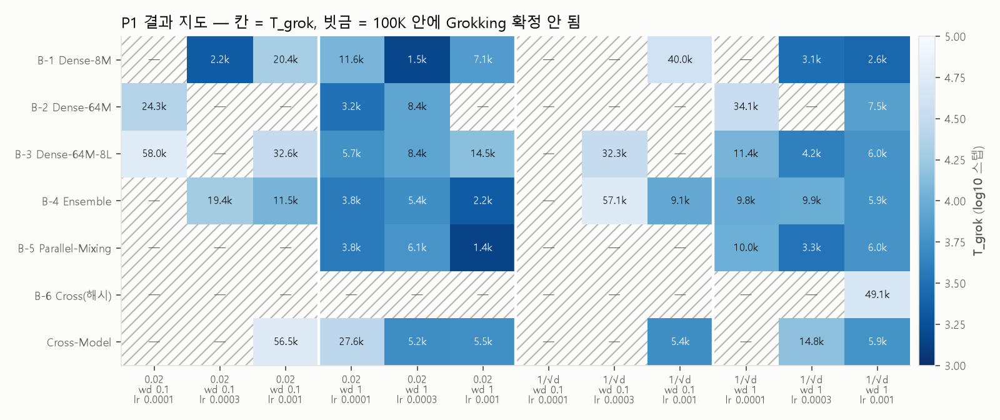
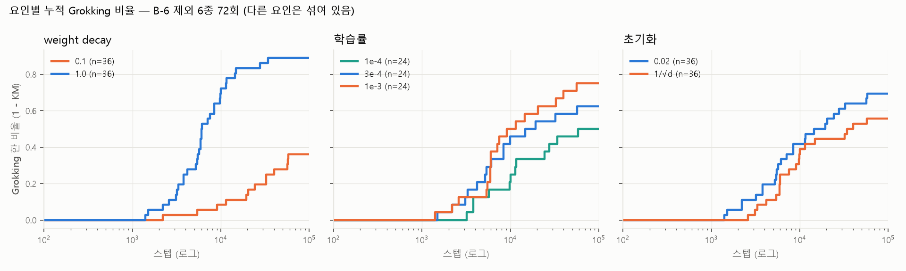
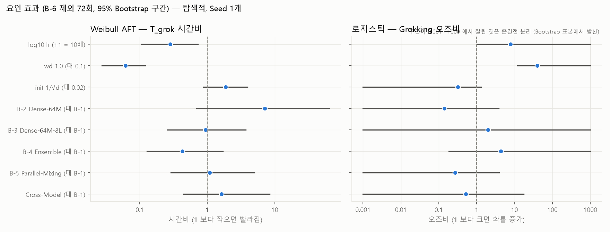
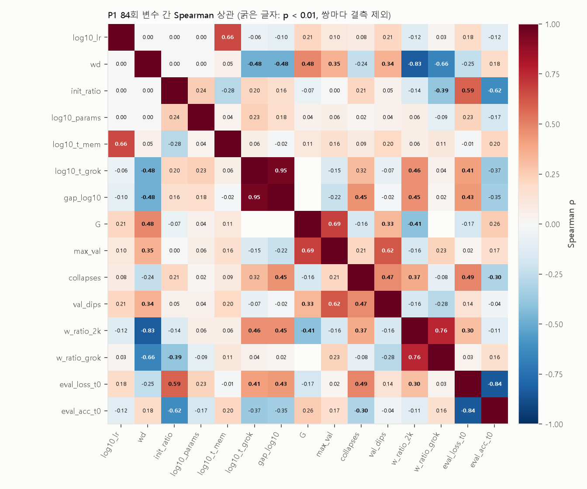
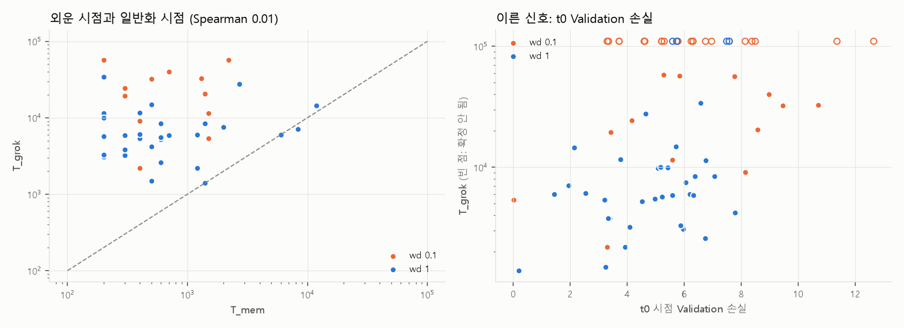

# P1 탐색 분석 — EDA · 상관 · 모형 (2026-11-28)

**탐색적 분석이다.** P1 은 아키텍처마다 12개 설정을 Seed 1개로 한 번씩 돌린 조율 실험이라(§12A-4), 여기 나온 효과는 가설 검정이 아니고 사전등록(`docs/preregistration.md`)의 판정에도 쓰지 않는다. 같은 설정 안의 Seed 변동은 아직 모른다.

- 자료: P1 84회 (7종 × 12), 참고로 P0 R1 16회. run 마다 특징 31개 → `features.csv`
- 재현 (저장소 루트에서): `python reports/p1-eda/features.py` → `analysis.py` → `strat.py` (`MKL_THREADING_LAYER=SEQUENTIAL`, T-012). 입력은 `experiments/runs/p0_*` · `p1_*` (커밋된 기록)
- 모형 계산은 사전등록 코드(`src/analysis/stats.py`)를 그대로 썼다. 사전등록 절차의 첫 실제 자료 적용이기도 하다.

## 1. 한눈에

| 아키텍처 | Grokking (12회 중) | 95% CI | KM 중앙 $T_{grok}$ | $T_{mem}$ 중앙값 | Train 붕괴 합 |
| --- | ---: | --- | ---: | ---: | ---: |
| B-1 Dense-8M | 8 | 0.39–0.86 | 11,600 | 400 | 20 |
| B-2 Dense-64M | 5 | 0.19–0.68 | 도달 안 함 | 800 | **38** |
| B-3 Dense-64M-8L | 9 | 0.47–0.91 | 14,500 | 550 | 23 |
| B-4 Ensemble | **10** | 0.55–0.95 | **9,800** | 300 | 15 |
| B-5 Parallel-Mixing | 6 | 0.25–0.75 | 10,000 | 300 | 14 |
| B-6 Cross (해시) | **1** | 0.01–0.35 | 도달 안 함 | 400 | 8 |
| Cross-Model | 7 | 0.32–0.81 | 27,600 | 800 | 15 |

KM 중앙값은 중도절단을 포함한 '절반이 Grokking 하는 시점' 이다. 12회 중 6회 이상이 확정되지 않으면 정의되지 않는다.

## 2. 요인별 효과 (B-6 제외 6종 72회)

B-6 은 12회 중 1회만 일반화해 요인 효과를 가리므로 뺐다. 설계가 완전 교차(lr 3 × wd 2 × init 2)라 세 요인은 서로 상관이 0 이다 (상관 행렬 왼쪽 위).

| 요인 | 수준 | Grokking | KM 중앙 | Grokking 한 run 의 $T_{grok}$ 중앙 | $T_{mem}$ 중앙 | run 당 Train 붕괴 |
| --- | --- | ---: | ---: | ---: | ---: | ---: |
| wd | 0.1 | 13/36 | 도달 안 함 | 24,300 | 450 | 1.92 |
| wd | 1.0 | **32/36** | **6,000** | **5,950** | 500 | 1.56 |
| lr | 1e-4 | 12/24 | 도달 안 함 | 10,700 | **300** | 1.50 |
| lr | 3e-4 | 15/24 | 14,800 | 6,100 | 500 | 1.92 |
| lr | 1e-3 | 18/24 | 9,100 | 6,550 | **1,350** | 1.79 |
| init | 0.02 | 25/36 | 19,400 | 7,100 | 600 | 1.47 |
| init | 1/√d | 20/36 | 34,100 | 8,300 | 400 | 2.00 |

wd × lr (B-6 제외, 칸마다 12회):

| | lr 1e-4 | lr 3e-4 | lr 1e-3 |
| --- | --- | --- | --- |
| wd 0.1 | 2/12 (중앙 41,150) | 4/12 (25,850) | 7/12 (20,400) |
| wd 1.0 | 10/12 (9,900) | 11/12 (5,400) | 11/12 (5,900) |

## 3. 모형

### 3.1 Weibull AFT — $T_{grok}$ (중도절단 포함)
log $T$ = 요인 + 아키텍처(기준 B-1). 계수를 시간비 exp(β) 로 읽는다 (1 보다 작으면 빨라짐). 구간은 run 단위 Bootstrap 1,000회.

| 항 | 시간비 | 95% 구간 |
| --- | ---: | --- |
| lr 10배 | **0.28** | 0.11–0.73 |
| wd 1.0 (대 0.1) | **0.06** | 0.03–0.12 |
| init 1/√d (대 0.02) | 1.86 | 0.88–3.93 |
| B-2 Dense-64M | 7.1 | 0.69–64 |
| B-3 Dense-64M-8L | 0.94 | 0.26–3.7 |
| B-4 Ensemble | 0.43 | 0.13–1.7 |
| B-5 Parallel-Mixing | 1.09 | 0.29–5.0 |
| Cross-Model | 1.62 | 0.44–8.4 |

척도 σ = 1.04 (Weibull 모양 ≈ 1, 지수 분포에 가까움).

- **wd 1.0 이면 Grokking 시점이 약 1/16** 로 줄어든다 (중도절단을 시간 정보로 넣은 값이라 Grokking 한 run 만 본 4배보다 크다).
- **lr 10배면 약 1/3.6.** 외우기는 늦어지지만(아래 상관) 일반화는 빨라진다.
- init 1/√d 는 늦추는 쪽(1.86배)이지만 구간이 1 을 포함한다.
- 아키텍처 차이는 요인을 통제하면 모두 구간이 1 을 포함한다. 같은 설정 공간을 쓰면 아키텍처 차이가 대부분 사라진다는 [30] 과 맞는 방향이다 (B-6 제외).
- lr × wd 상호작용을 더해도 나아지지 않았다 (우도비 χ² = 1.9, p = 0.17).

### 3.2 로지스틱 — Grokking 여부
같은 설계, 요인 하나씩 뺀 우도비 검정:

| 요인 | 오즈비 | χ² (1) | p |
| --- | ---: | ---: | ---: |
| wd 1.0 | 40 | 29.2 | 6.6 × 10⁻⁸ |
| lr 10배 | 7.9 | 5.9 | 0.015 |
| init 1/√d | 0.32 | 2.8 | 0.094 |

아키텍처 항이 6개라 72회로는 준완전 분리가 생겨 Bootstrap 구간이 발산한다 (그림 오른쪽). 점 추정과 우도비 p 만 읽는다.

## 4. 상관 (Spearman, P1 84회)

105쌍에 Benjamini–Hochberg 를 적용해 q < 0.05 인 것 중 해석이 있는 것:

| 쌍 | ρ | q | 읽기 |
| --- | ---: | ---: | --- |
| lr ~ log $T_{mem}$ | +0.66 | < 0.001 | lr 이 크면 **외우기가 늦다** |
| wd ~ 2K 시점 노름 비 | −0.83 | < 0.001 | wd 1.0 은 2,000 스텝 안에 노름을 줄인다 |
| wd ~ G | +0.48 | < 0.001 | |
| wd ~ log $T_{grok}$ | −0.48 | 0.004 | |
| 2K 노름 비 ~ G | −0.41 | 0.001 | 노름이 일찍 준 run 이 Grokking (wd 대리, 5절) |
| 2K 노름 비 ~ log $T_{grok}$ | +0.46 | 0.007 | 〃 |
| init 비 ~ t0 Val 손실 | +0.59 | < 0.001 | 초기값이 크면 t0 에 Val 손실이 높다 |
| t0 Val 손실 ~ Train 붕괴 | +0.49 | < 0.001 | |
| Train 붕괴 ~ log 간격 | +0.45 | 0.011 | 붕괴가 잦으면 지연이 길다 |
| Val 최고 ~ 첫 0.95 뒤 하락 | +0.62 | < 0.001 | 높이 올라간 run 일수록 떨어졌다 다시 오르기를 반복 |

**상관이 없던 것:** $T_{mem}$ 과 $T_{grok}$ (ρ = 0.01, Grokking 한 45회). 외우는 속도로 일반화 시점을 알 수 없다. 기울기 1 선 위의 점(지연 없음)도 여기서 나온다.

## 5. 이른 신호로 예측할 수 있나 (H2 의 예행연습)

$t_0$ = min($T_{mem}$, 2,000) 의 값으로 $T_{grok}$ 을 예측해, 아키텍처 하나를 통째로 빼고 맞히는(leave-one-arch-out) C-index:

| 설명 변수 | C-index |
| --- | ---: |
| 하이퍼파라미터 (lr · wd · init) | 0.73 |
| 2K 시점 노름 비 | 0.73 |
| t0 Validation 손실 | 0.61 |
| log $T_{mem}$ | 0.47 (우연 이하) |
| 하이퍼파라미터 + 이른 신호 둘 | 0.72 |

이른 신호를 더해도 나아지지 않는다. **wd 를 고정하고 보면 노름 비 · t0 손실 · lr · init 모두 log $T_{grok}$ 과 유의한 상관이 없다** (wd 1.0 32회: ρ 0.20~0.31, p > 0.08 · wd 0.1 13회: p > 0.09). 2K 노름 비의 예측력은 wd 를 다시 잰 것이다. H2 의 $C_{eff}$ 는 이 함정을 피하려면 같은 학습 설정 안(P2 · P4 는 아키텍처마다 설정 하나)에서 설명력을 보여야 하고, 사전등록 설계가 그렇게 되어 있다.

## 6. 가중치 노름

Grokking 시점의 노름 / 초기 노름 (아키텍처별 중앙값): B-1 0.64 · B-3 0.54 · B-4 0.47 · Cross-Model 0.42 · B-5 0.39 · B-2 0.39 · B-6 0.25 (1회).
**R1 은 1.08 로 반대**다 (Gate 2 의 10 Seeds, 범위 0.93~1.14 — 노름이 거의 그대로이거나 늘어난 상태에서 Grokking). R1 은 init 1/√d(0.088) · 1층 · LayerNorm 없음 · ReLU 로 구조가 다르다. Omnigrok [16] 의 '노름이 줄며 일반화' 는 P1 의 64M급 · 8M 체인 모델에서는 맞지만 R1 에서는 아니다.

## 7. Router (Cross-Model)

$t_0$ 의 Router 엔트로피(층 평균, 균등 = ln 8 = 2.08 nat)는 Grokking 여부와 상관이 약하고 (ρ = −0.27, p = 0.40, 12회), 대신 **lr 과 강하게 묶여 있다** (ρ = −0.77, p = 0.003: lr 이 크면 Router 가 일찍 한쪽으로 쏠림). h09 (lr 1e-3) 는 0.25 nat 로 거의 한 경로였는데도 5,400 에 Grokking 했다. 해시 Router(B-6)는 정의상 0 이다.

## 8. 정리와 다음 단계에 주는 것

1. **wd 가 지배적**이다 (시간비 0.06, 오즈비 40). P1 선택 7개가 모두 wd 1.0 인 것은 우연이 아니다.
2. lr 은 외우기를 늦추고 일반화는 앞당긴다. 두 시점이 서로 독립적이라 '외우고 나서 얼마나 기다리나' 는 외우는 속도로 알 수 없다.
3. 같은 설정에서 아키텍처 차이는 B-6 를 빼면 구간 안에 묻힌다 (Seed 1개의 한계). **해시 Router 만 확실히 다르다.**
4. 이른 신호의 예측력은 학습 설정의 그림자일 수 있다 → H2 는 설정 고정 안에서 본다 (사전등록대로).
5. 한계: Seed 1개 · 설정마다 1회 · 72~84회 · 아키텍처와 설정의 상호작용을 따로 추정할 수 없음. 효과의 방향은 믿을 만하지만 크기는 넓게 읽는다.
